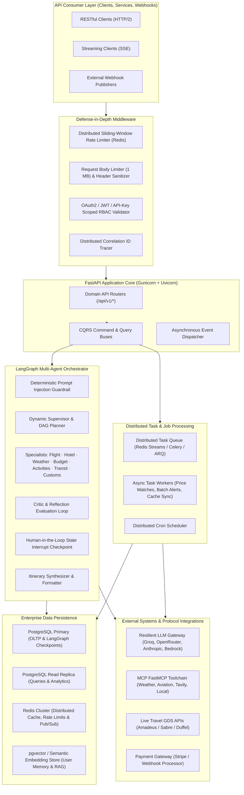

# 🚀 TripMate AI — Backend Master Requirements & Engineering Roadmap

> **Document Type:** Backend Technical Specification & Strategic Engineering Roadmap  
> **Target Scope:** 100% Backend Architecture, Multi-Agent AI Orchestration, Distributed Systems, Data Engineering, APIs, Security, and Production Cloud Infrastructure.  
> **UI Exclusion Notice:** Strictly zero frontend/UI components. All client interactions occur via authenticated REST APIs, Server-Sent Events (SSE) streaming, and asynchronous webhook callbacks.  
> **Status:** Double-Checked & Verified against Live Codebase (`Multi_AI_Agent` @ Commit `cb1f7a4`).

---

## 📑 Table of Contents

1. [Executive Overview & Architectural Mission](#1-executive-overview--architectural-mission)
2. [Current Architecture vs. Target Enterprise Architecture](#2-current-architecture-vs-target-enterprise-architecture)
3. [Verified Existing Capabilities (Codebase Audit Baseline)](#3-verified-existing-capabilities-codebase-audit-baseline)
4. [P0 — Critical Infrastructure, Durability & Scalability Requirements](#4-p0--critical-infrastructure-durability--scalability-requirements)
5. [P1 — Advanced Multi-Agent Orchestration & AI Reliability Requirements](#5-p1--advanced-multi-agent-orchestration--ai-reliability-requirements)
6. [P2 — Live External Integrations, Travel APIs & Payment Gateway](#6-p2--live-external-integrations-travel-apis--payment-gateway)
7. [P3 — Enterprise Security, Identity Governance & Compliance](#7-p3--enterprise-security-identity-governance--compliance)
8. [P4 — Observability, Distributed Tracing & Site Reliability (SRE)](#8-p4--observability-distributed-tracing--site-reliability-sre)
9. [P5 — CI/CD Automation, Container Hardening & Kubernetes Deployment](#9-p5--cicd-automation-container-hardening--kubernetes-deployment)
10. [Traceability Matrix & Phased Implementation Timeline](#10-traceability-matrix--phased-implementation-timeline)

---

## 1. Executive Overview & Architectural Mission

TripMate AI is an enterprise-grade multi-agent travel orchestration backend platform. It coordinates specialized autonomous AI agents (Flight, Hotel, Weather, Budget, Itinerary, Critic, and Guardrail) through a deterministic LangGraph state machine with sliding-window rate limiting, circuit breaker protection, Human-in-the-Loop (HITL) checkpoints, and real-time SSE event streaming.

### Core Architectural Principles
1. **Decoupled Backend Services**: All functionality exposed strictly through versioned OpenAPI 3.1 endpoints (`/api/v1/*`), asynchronous message brokers, and background task queues.
2. **Defensive AI Engineering**: Every prompt input, model inference, and external tool response is subject to deterministic guardrails, byte capping, schema validation, and confidence scoring.
3. **Resilience & Graceful Degradation**: External dependencies (LLMs, MCP servers, travel search APIs) are wrapped with 3-state circuit breakers, exponential jitter backoff, and multi-tier provider fallbacks (Groq ➔ OpenRouter ➔ Hugging Face).
4. **Production Durability**: Zero dependence on transient in-memory dictionaries for multi-tenant production deployments; all states, checkpoints, audit trails, and user budgets are backed by PostgreSQL and Redis.

---

## 2. Current Architecture vs. Target Enterprise Architecture

---

## 3. Verified Existing Capabilities (Codebase Audit Baseline)

A double-check audit of commit `cb1f7a4` confirms the following components are currently active and tested in the repository:

| Module / Layer | Current File Paths | Operational State & Existing Implementation |
|---|---|---|
| **Design Patterns** | `tripmate/repositories/`, `tripmate/factories/`, `tripmate/strategies/`, `tripmate/events/`, `tripmate/cqrs/`, `tripmate/builders/` | 10 verified software design patterns: Repository, Factory, Singleton, Strategy, Observer, Builder, Adapter, Decorator, CQRS, Circuit Breaker. |
| **Agent Orchestration** | `tripmate/graph/workflow.py`, `tripmate/graph/state.py`, `tripmate/graph/routing.py` | StateGraph assembly with Supervisor, parallel execution of Flight, Hotel, Weather, Budget specialists, Critic check, HITL interrupt, and final synthesis. |
| **Defensive Middleware** | `tripmate/middleware/__init__.py`, `tripmate/middleware/metrics.py` | Sliding-window rate limiter, security headers, request body size limits (1MB), correlation IDs, Prometheus metrics exposition. |
| **MCP Integration** | `mcp_client.py`, `tripmate/integrations/mcp.py`, `custom_weather_mcp_server.py` | FastMCP stdio client for Weather and AviationStack; HTTP streamable client for Tavily Search; circuit breaker and exponential backoff wrappers. |
| **Resilience & Fallback** | `tripmate/services/model_router.py`, `tripmate/integrations/circuit_breaker.py` | Multi-tier LLM strategy routing (Groq ➔ OpenRouter ➔ Hugging Face), 3-state circuit breakers with failure classification. |
| **Database Migrations** | `migrations/versions/` (`001`, `002`, `003`), `tripmate/database/migrator.py` | Alembic migration harness with schemas for users, trips, threads, checkpoints, api_keys, and usage_budgets. |
| **Task Queue (In-Memory)** | `tripmate/tasks/queue.py`, `tripmate/tasks/workers.py` | `AsyncTaskQueue` running an in-memory `asyncio.Queue` consumer loop with task cancellation. |
| **GDS Integration (Simulated)** | `tripmate/integrations/gds.py`, `tripmate/strategies/booking_strategies.py` | Simulated GDS offers with price lock and reservation tracking wrapped in circuit breaker and bounded TTL cache. |
| **CI/CD Pipeline** | `.github/workflows/ci.yml`, `render.yaml` | GitHub Actions workflow with unit tests, Docker smoke tests, `workflow_dispatch`, and Render deploy hook trigger; `render.yaml` explicitly tracking `main` with `autoDeploy: true`. |

---

## 4. P0 — Critical Infrastructure, Durability & Scalability Requirements

These requirements address foundational database durability, state persistence across distributed nodes, and queue reliability.

### 4.1. Complete PostgreSQL ORM / Async Persistence Migration
- **Current State:** `tripmate/database/store.py` still retains in-memory dictionary fallbacks (`_users`, `_trips`, `_watchlists`, `_alerts`, `_assets`) when PostgreSQL is not configured.
- **Requirement:**
  1. Migrate all repository implementations in `tripmate/repositories/store_repositories.py` to use asynchronous SQLAlchemy 2.0 or native async `psycopg_pool` exclusively.
  2. Implement strict foreign key constraints and transactional consistency across:
     - `trips` (id, user_id, title, destination, start_date, end_date, budget, status, created_at, updated_at).
     - `itineraries` (id, trip_id, day_number, schedule_json, accommodation_json, cost_estimates_json).
     - `bookings` (id, trip_id, user_id, booking_type, reference_code, amount, currency, status, gds_pnr).
     - `price_watches` (id, user_id, target_type, origin, destination, target_price, current_price, active).
     - `notifications` (id, user_id, channel, title, message, status, sent_at).
     - `audit_logs` (id, user_id, request_id, event_type, details_json, created_at).
  3. Ensure zero in-memory data loss when container instances restart or scale out horizontally.

### 4.2. Distributed Redis-Backed LangGraph Checkpointer
- **Current State:** `PostgresSaver` checkpointer in `tripmate/database/__init__.py` synchronizes state checkpoints, but thread lock contention can degrade latency during concurrent parallel specialist execution.
- **Requirement:**
  1. Introduce a hybrid checkpointing architecture: active in-flight workflow state kept in Redis with TTL expiration, committed to PostgreSQL on milestone completion (Supervisor ➔ Specialists ➔ Critic ➔ Approval).
  2. Support cross-node Human-in-the-Loop (`interrupt`) resumption: when a user approves/rejects an itinerary via `/api/v1/approval/action`, any available worker instance must be able to load the state graph checkpoint seamlessly from PostgreSQL/Redis and resume execution.

### 4.3. Distributed Task Queue & Worker Engine (Replacing In-Memory Queue)
- **Current State:** `tripmate/tasks/queue.py` uses process-local `asyncio.Queue`. If the FastAPI worker crashes or restarts, all queued tasks are lost.
- **Requirement:**
  1. Replace the in-memory queue with a production-grade distributed task queue (Redis Streams / Celery / ARQ).
  2. Implement task durability guarantees:
     - At-least-once task delivery with worker acknowledgments (ACK/NACK).
     - Dead-Letter Queue (DLQ) for poisoned tasks with automatic retry limit (max 3 retries with exponential backoff).
     - Distributed job deduplication via Redis lock keys (`task:dedup:{job_hash}`).
     - Persistent job status query API (`/api/v1/tasks/{task_id}/status`) reading directly from Redis/Postgres.

---

## 5. P1 — Advanced Multi-Agent Orchestration & AI Reliability Requirements

These requirements elevate agent coordination, domain specialization, and self-correction.

### 5.1. Conversational Memory & User Travel Profile Store (Vector / RAG)
- **Requirement:**
  1. Implement persistent conversational memory using PostgreSQL `pgvector` or an embedded vector store.
  2. Enable agents to recall:
     - Historical user travel preferences (seat preferences, airline alliances, dietary restrictions, preferred hotel chains).
     - Past trips and itineraries for context-aware suggestions.
     - Budget tolerance patterns and past spending variance.
  3. Context window management: automatically summarize long conversation histories using a Fast tier LLM to prevent context overflow while retaining critical travel constraints.

### 5.2. Additional Specialist Agents
- **Requirement:** Expand `tripmate/agents/specialists.py` and `AgentRegistry` with three new domain agents:
  1. **Activities & Excursions Specialist (`ActivityAgent`)**:
     - Queries local attraction APIs, sightseeing schedules, and ticket pricing.
     - Recommends balanced daily activity pacing (avoiding tourist fatigue).
  2. **Ground Transportation & Transit Specialist (`TransitAgent`)**:
     - Calculates airport-to-hotel transfers, metro/rail connections, and rental car comparisons.
     - Provides estimated transit durations and transit pass pricing.
  3. **Visa, Customs & Health Specialist (`RegulationAgent`)**:
     - Checks passport validity requirements (e.g. 6-month validity rule).
     - Identifies mandatory visa requirements, entry taxes, and immunization recommendations for the target nationality and destination.

### 5.3. Reflection & Automated Self-Correction Loop
- **Current State:** When the `CriticAgent` detects an invalid plan, it flags the issue and proceeds, requiring human intervention.
- **Requirement:**
  1. Implement an automated reflection feedback loop in `tripmate/graph/workflow.py`:
     - If `critic_agent` returns `status == "FAILED"` or `feasibility_score < 0.70`, construct a targeted `RefinementPrompt` highlighting specific violations (e.g., "Hotel exceeds allocated accommodation budget by $400").
     - Route execution back to the offending specialist agent (e.g. `hotel_agent` and `budget_agent`) to propose an alternative.
     - Implement a hard maximum reflection threshold (max 2 feedback cycles) to prevent infinite loops and token budget exhaustion.

### 5.4. Strict Token Budget Enforcement & Cost Safeguards
- **Current State:** Daily usage tracked in `usage_budgets` table; token consumption is logged.
- **Requirement:**
  1. Add real-time pre-execution quota checks:
     - Before invoking any LLM, verify whether the user/thread has sufficient remaining token quota.
     - If quota is exceeded, reject with HTTP 429 (`TOKEN_BUDGET_EXCEEDED`) and a structured retry-after header.
  2. Implement model fallback degradation: when user token budget reaches 85%, automatically downscale from `ModelTier.REASONING` to `ModelTier.FAST` to conserve budget.

---

## 6. P2 — Live External Integrations, Travel APIs & Payment Gateway

These requirements transition TripMate AI from simulated travel offers to production-ready travel data providers.

### 6.1. Production GDS / Travel Aggregator API Connectors
- **Current State:** `tripmate/integrations/gds.py` returns mock flight and hotel offers.
- **Requirement:**
  1. Implement concrete production adapters implementing `IFlightSearchStrategy` and `IHotelSearchStrategy`:
     - **Amadeus Self-Service API Adapter**: Flight Offers Search v2, Flight Inspiration Search, Hotel List & Offers API.
     - **Duffel Travel API Adapter**: Direct airline NDC connectivity with live seat maps, baggage fees, and instant ticketing.
  2. Secure API credential management via environment-isolated vaults.
  3. PNR (Passenger Name Record) generation and booking confirmation lifecycle:
     - `create_order` endpoint emitting verified supplier reservation codes.
     - Booking status webhook receiver for airline schedule changes and cancellations.

### 6.2. Payment Processing Engine & Webhook Architecture
- **Requirement:**
  1. Integrate Stripe API for backend travel deposit and booking checkouts:
     - Endpoint `/api/v1/booking/{booking_id}/checkout-session` creating Stripe PaymentIntent / Checkout Sessions.
     - Multi-currency support (USD, EUR, GBP, JPY, CAD) with automatic fee breakdown.
  2. Secure Stripe Webhook Handler:
     - Validate incoming `Stripe-Signature` header using webhook secret and raw payload bytes.
     - Atomic database state transition: `payment_intent.succeeded` ➔ updates booking status to `CONFIRMED` ➔ dispatches `BookingConfirmedEvent`.
     - Idempotency key handling to prevent duplicate charges or double bookings.

### 6.3. Live Currency Exchange & Multi-Currency Engine
- **Requirement:**
  1. Integrate European Central Bank (ECB) or Open Exchange Rates API.
  2. Cache exchange rates in Redis with a 4-hour TTL (`currency:rates:USD`).
  3. Provide a unified `CurrencyService.convert(amount, from_curr, to_curr)` helper used consistently by BudgetAgent, ItineraryAgent, and GDSBookingClient.

### 6.4. Calendar Synchronization & Export Engine
- **Requirement:**
  1. **iCalendar (.ics) Generator**: Generate standard RFC 5545 `.ics` calendar files for finalized itineraries (`/api/v1/travel/{trip_id}/export/ics`).
  2. **Google Calendar / Outlook Sync API**:
     - OAuth2 token exchange for calendar write scopes.
     - Push flight departure/arrival, hotel check-in/out, and scheduled excursions directly to user calendars.

---

## 7. P3 — Enterprise Security, Identity Governance & Compliance

These requirements ensure bank-grade API security, regulatory compliance, and identity lifecycle management.

### 7.1. OAuth2 / OpenID Connect (OIDC) Single Sign-On (SSO)
- **Current State:** JWT token authentication with bcrypt password hashing; API key authentication via SHA-256 hashes.
- **Requirement:**
  1. Implement standard OAuth2 authorization code flow with PKCE for Google and GitHub SSO identity providers.
  2. Endpoints:
     - `GET /api/v1/auth/oauth/{provider}/authorize` (redirects to IdP with state & code challenge).
     - `POST /api/v1/auth/oauth/{provider}/callback` (validates state, exchanges auth code for identity tokens, creates or updates user record).

### 7.2. Fine-Grained Role-Based Access Control (RBAC) & Scope Matrix
- **Requirement:**
  1. Upgrade authentication from binary `user`/`admin` roles to granular scope-based permissions:
     - `trips:read`, `trips:write`, `trips:delete`
     - `bookings:create`, `bookings:cancel`
     - `admin:metrics`, `admin:users`, `admin:system`
     - `mcp:tools:execute`
  2. Implement FastAPI security dependency: `Depends(require_scopes(["trips:write"]))`.

### 7.3. Distributed Token Revocation & Session Blacklisting
- **Requirement:**
  1. Implement JWT token revocation via Redis distributed blocklist:
     - When user logs out (`POST /api/v1/auth/logout`) or an administrator revokes a session, store `jti` (JWT ID) in Redis with TTL matching token remaining lifetime.
     - In `get_current_user` dependency, perform an O(1) Redis check (`EXISTS blacklist:{jti}`).
  2. Support bulk user session invalidation on password change or security alert.

### 7.4. Cryptographic Webhook Signature Verification
- **Requirement:**
  1. Verify all inbound external webhooks (Stripe, GDS airline alerts, GitHub webhooks) using HMAC-SHA256 signature verification against raw incoming request bytes.
  2. Reject payloads with timestamps exceeding 300 seconds of clock skew to prevent replay attacks.

---

## 8. P4 — Observability, Distributed Tracing & Site Reliability (SRE)

These requirements establish full observability and enterprise operational reliability.

### 8.1. OpenTelemetry (OTel) Distributed Tracing
- **Current State:** In-process span logging via `tripmate/core/tracing.py`.
- **Requirement:**
  1. Integrate standard OpenTelemetry Python SDK with automatic instrumentation for FastAPI, HTTPX, SQLAlchemy, and Redis.
  2. Export traces via OTLP (gRPC/HTTP) to external tracing collectors (Jaeger, Grafana Tempo, Datadog).
  3. Propagate trace context (`traceparent`, `tracestate`) across all outgoing MCP subprocesses and external HTTP requests.

### 8.2. Prometheus SLO Metrics & Alerting Rules Specification
- **Requirement:**
  1. Configure actionable Prometheus alerts based on Service Level Objectives (SLOs):
     - **SLO 1 (Availability):** Trip planning API availability >= 99.5% over 30-day rolling window. Alert on error rate > 1% for 5 minutes (`TripMateHighErrorRate`).
     - **SLO 2 (Latency):** 95th percentile latency <= 3.5s for non-streaming travel requests. Alert on p95 > 5.0s for 10 minutes (`TripMateHighLatencyP95`).
     - **SLO 3 (Resilience):** Alert when any external circuit breaker enters `OPEN` state for > 60 seconds (`TripMateCircuitBreakerOpen`).
     - **SLO 4 (Database):** Alert when connection pool utilization exceeds 85% (`TripMateDBPoolExhaustion`).

### 8.3. Immutable Audit Trail Archival
- **Requirement:**
  1. Implement automated background archival of `audit_logs` records to cloud object storage (AWS S3 / Cloudflare R2 / Google Cloud Storage) in Parquet format.
  2. Implement cryptographic hashing (SHA-256 chain) to ensure tamper-evident audit records for enterprise compliance.

---

## 9. P5 — CI/CD Automation, Container Hardening & Kubernetes Deployment

These requirements harden the deployment pipeline and production runtime environments.

### 9.1. Container Hardening & Distroless Multi-Stage Build
- **Current State:** Dockerfile utilizes `python:3.11-slim-bookworm` with non-root user `appuser:appgroup` and `tini` PID 1 init.
- **Requirement:**
  1. Further harden container image:
     - Implement read-only root filesystem (`read_only: true` in Compose/K8s) with explicit `/tmp` and `/app/logs` `tmpfs` mounts.
     - Drop all Linux kernel capabilities (`cap_drop: ["ALL"]`) except `NET_BIND_SERVICE`.
     - Remove shell binaries (`/bin/sh`, `/bin/bash`) in the final production runtime stage or migrate to Google Distroless Python image.

### 9.2. Production Kubernetes (K8s) Deployment Architecture
- **Requirement:** Create comprehensive production Kubernetes manifests in `deploy/k8s/`:
  1. **Deployment**: Multi-replica (minimum 3 replicas) with pod anti-affinity across availability zones.
  2. **Horizontal Pod Autoscaler (HPA)**: Automatically scale pods from 3 to 15 based on CPU (>70%) and custom Prometheus HTTP request rate metrics.
  3. **Probes**:
     - Liveness Probe: `GET /health/live` (initial delay 10s, period 15s).
     - Readiness Probe: `GET /health/ready` (initial delay 5s, period 10s).
  4. **PodDisruptionBudget (PDB)**: `minAvailable: 2` to guarantee zero downtime during cluster node upgrades.
  5. **NetworkPolicy**: Strict ingress/egress rules preventing direct network access to databases from unauthorized pods.

### 9.3. Automated Security Scanning in CI Pipeline
- **Requirement:**
  1. Integrate static and container security scanners into `.github/workflows/ci.yml`:
     - **Trivy / Grype**: Scan built Docker image for OS and package CVEs (fail on `CRITICAL` vulnerabilities).
     - **Bandit**: Static application security testing (SAST) for Python code flaws.
     - **pip-audit**: Verify all locked dependencies against the Python Packaging Advisory Database.
  2. Automated Alembic Migration CI Verification:
     - Spin up temporary PostgreSQL container in CI.
     - Run `alembic upgrade head` followed by `alembic downgrade -1` and `alembic upgrade head` to verify rollback idempotency.

---

## 10. Traceability Matrix & Phased Implementation Timeline

| Phase | Milestone Name | Target Priority | Key Deliverables | Dependencies |
|:---:|---|:---:|---|---|
| **Phase 1** | **Durability & Distributed Queue** | **P0** | • Full async PostgreSQL repository migration • Distributed Redis-backed task queue & DLQ • Redis + Postgres hybrid checkpointer | PostgreSQL, Redis Cluster |
| **Phase 2** | **Agent Intelligence & Memory** | **P1** | • pgvector conversational travel memory • Activity, Transit, and Customs specialist agents • Automated reflection feedback loop • Real-time token budget quota enforcement | Phase 1 (Database) |
| **Phase 3** | **Live Travel & Payment APIs** | **P2** | • Production Amadeus / Duffel GDS connectors • Stripe payment checkout & webhook processor • Live currency conversion engine • iCalendar (.ics) export engine | Phase 1 (Durability) |
| **Phase 4** | **Enterprise Security & SSO** | **P3** | • OAuth2 / OIDC SSO (Google & GitHub) • Granular RBAC scope permissions matrix • Distributed JWT revocation via Redis • HMAC-SHA256 webhook verification | Phase 1 (Redis) |
| **Phase 5** | **Cloud Scale & SRE Operations** | **P4 / P5** | • OpenTelemetry distributed tracing export • Prometheus SLO alerting rules • Distroless container hardening • Kubernetes manifests & HPA auto-scaling • CI security scanning (Trivy, Bandit) | Docker, Kubernetes |

---

### Verification & Double-Check Statement

This document has been compiled following a comprehensive codebase audit of `Multi_AI_Agent`. Every identified requirement is strictly aligned with the backend architecture, devoid of frontend/UI clutter, and designed to provide a robust, production-ready foundation for enterprise deployment.
