# 🚀 TripMate AI — Backend Master Requirements & Engineering Roadmap

> **Document Type:** Backend Technical Specification & Strategic Engineering Roadmap  
> **Target Scope:** 100% Backend Architecture, Multi-Agent AI Orchestration, Distributed Systems, Data Engineering, APIs, Security, and Production Cloud Infrastructure.  
> **UI Exclusion Notice:** Strictly zero frontend/UI components. All client interactions occur via authenticated REST APIs, Server-Sent Events (SSE) streaming, and asynchronous webhook callbacks.  
> **Status:** Double-Checked & Verified against Live Codebase (`Multi_AI_Agent` @ Commit `cb1f7a4`).

---

## 📑 Table of Contents

1. [Executive Overview & Architectural Mission](#1-executive-overview--architectural-mission)
2. [Current Architecture vs. Target Enterprise Architecture](#2-current-architecture-vs-target-enterprise-architecture)
3. [Verified Existing Capabilities (Codebase Audit Baseline)](#3-verified-existing-capabilities-codebase-audit-baseline)
4. [P0 — Critical Infrastructure, Durability & Scalability Requirements](#4-p0--critical-infrastructure-durability--scalability-requirements)
   - 4.1. Complete PostgreSQL ORM / Async Persistence Migration
   - 4.2. Distributed Redis-Backed LangGraph Checkpointer
   - 4.3. Distributed Task Queue & Worker Engine (Replacing In-Memory Queue)
   - 4.4. Distributed Concurrency Control & Redlock Synchronization
   - 4.5. Connection Pooling, Failover & Read-Write Database Splitting
5. [P1 — Advanced Multi-Agent Orchestration & AI Reliability Requirements](#5-p1--advanced-multi-agent-orchestration--ai-reliability-requirements)
   - 5.1. Conversational Memory & User Travel Profile Store (pgvector / RAG)
   - 5.2. Domain Specialist Agent Extensions (Activity, Transit, Customs)
   - 5.3. Reflection & Automated Self-Correction Loop
   - 5.4. Strict Token Budget Enforcement & Model Fallback Degradation
   - 5.5. Real-Time Server-Sent Events (SSE) Streaming Protocol & Contract
   - 5.6. MCP (Model Context Protocol) Server Cluster Expansion & Supervised Lifecycles
6. [P2 — Live External Integrations, Travel APIs & Payment Gateway](#6-p2--live-external-integrations-travel-apis--payment-gateway)
   - 6.1. Production GDS / Travel Aggregator API Connectors (Amadeus & Duffel)
   - 6.2. Payment Processing Engine & Webhook Architecture (Stripe)
   - 6.3. Live Currency Exchange & Multi-Currency Engine
   - 6.4. Calendar Synchronization & RFC 5545 Export Engine
   - 6.5. Multi-Channel Notification Dispatcher (Twilio SMS/WhatsApp & SendGrid Email)
   - 6.6. Document & Asset Management Service (S3/R2 & PDF Voucher Generator)
   - 6.7. Live Price Watch & Market Monitoring Background Worker
7. [P3 — Enterprise Security, Identity Governance & Compliance](#7-p3--enterprise-security-identity-governance--compliance)
   - 7.1. OAuth2 / OpenID Connect (OIDC) Single Sign-On (SSO)
   - 7.2. Fine-Grained Role-Based Access Control (RBAC) & Scoped Permissions Matrix
   - 7.3. Distributed Token Revocation & Session Blacklisting
   - 7.4. Cryptographic Inbound Webhook Signature Verification
   - 7.5. Automated PII Masking, Data Privacy & GDPR/CCPA Compliance
   - 7.6. API Key Lifecycle Management & Multi-Tenant Rate Tiering
8. [P4 — Observability, Distributed Tracing & Site Reliability (SRE)](#8-p4--observability-distributed-tracing--site-reliability-sre)
   - 8.1. OpenTelemetry (OTel) Distributed Tracing & W3C Context Propagation
   - 8.2. Prometheus SLO Metrics & Alerting Rules Specification
   - 8.3. Tamper-Evident Immutable Audit Trail Archival (Parquet & SHA-256 Hash Chain)
   - 8.4. Structured Correlated Logging (Loki / Datadog / OpenSearch)
   - 8.5. Disaster Recovery, Point-in-Time Recovery (PITR) & High Availability Runbook
9. [P5 — CI/CD Automation, Container Hardening & Kubernetes Deployment](#9-p5--cicd-automation-container-hardening--kubernetes-deployment)
   - 9.1. Container Hardening & Distroless Multi-Stage Build
   - 9.2. Production Kubernetes (K8s) Deployment Architecture
   - 9.3. Automated Security Scanning & Migration Verification in CI
   - 9.4. Infrastructure-as-Code (IaC) & Helm Chart Specification
   - 9.5. Automated Canary & Blue/Green Progressive Delivery
10. [Traceability Matrix, Definition of Done & Phased Implementation Timeline](#10-traceability-matrix-definition-of-done--phased-implementation-timeline)

---

## 1. Executive Overview & Architectural Mission

TripMate AI is an enterprise-grade multi-agent travel orchestration backend platform. It coordinates specialized autonomous AI agents (Flight, Hotel, Weather, Budget, Itinerary, Critic, and Guardrail) through a deterministic LangGraph state machine with sliding-window rate limiting, circuit breaker protection, Human-in-the-Loop (HITL) checkpoints, and real-time SSE event streaming.

### Core Architectural Principles
1. **Decoupled Backend Services**: All functionality exposed strictly through versioned OpenAPI 3.1 endpoints (`/api/v1/*`), asynchronous message brokers, and background task queues. Zero client-side UI coupling.
2. **Defensive AI Engineering**: Every prompt input, model inference, and external tool response is subject to deterministic guardrails, byte capping, schema validation, and confidence scoring.
3. **Resilience & Graceful Degradation**: External dependencies (LLMs, MCP servers, travel search APIs) are wrapped with 3-state circuit breakers, exponential jitter backoff, and multi-tier provider fallbacks (Groq ➔ OpenRouter ➔ Hugging Face).
4. **Production Durability**: Zero dependence on transient in-memory dictionaries for multi-tenant production deployments; all states, checkpoints, audit trails, and user budgets are backed by PostgreSQL and Redis.
5. **Zero Trust & Compliance**: Strict token validation, fine-grained scope authorization, PII masking, cryptographic webhook verification, and tamper-evident audit logging.

---

## 2. Current Architecture vs. Target Enterprise Architecture

```mermaid
flowchart TD
    subgraph ClientLayer["API Consumer Layer (Clients, Services, Webhooks)"]
        HTTP["RESTful Clients (HTTP/2)"]
        SSE["Streaming Clients (SSE)"]
        WH_IN["External Webhook Publishers (Stripe, Airlines)"]
    end

    subgraph SecurityLayer["Defense-in-Depth Middleware"]
        RL["Distributed Sliding-Window Rate Limiter (Redis)"]
        WAF["Request Body Limiter (1 MB) & Header Sanitizer"]
        AUTH["OAuth2 / JWT / API-Key Scoped RBAC Validator"]
        CID["Distributed Correlation ID & OTel Trace Propagator"]
        PII_SCRUB["Automated PII & Secret Scrubbing Middleware"]
    end

    subgraph AppLayer["FastAPI Application Core (Gunicorn + Uvicorn)"]
        ROUTERS["Domain API Routers (/api/v1/*)"]
        CQRS_BUS["CQRS Command & Query Buses"]
        EVT_DISP["Asynchronous Event Dispatcher"]
    end

    subgraph AgentLayer["LangGraph Multi-Agent Orchestrator"]
        GUARD["Deterministic Prompt Injection Guardrail"]
        SUP["Dynamic Supervisor & DAG Planner"]
        SPEC["Specialists: Flight · Hotel · Weather · Budget · Activities · Transit · Customs"]
        CRIT["Critic & Reflection Evaluation Loop"]
        HITL["Human-in-the-Loop State Interrupt Checkpoint"]
        SYN["Itinerary Synthesizer & Formatter"]
    end

    subgraph AsyncLayer["Distributed Task & Job Processing"]
        STREAM_QUEUE["Distributed Task Queue (Redis Streams / ARQ / Celery)"]
        WORKERS["Async Task Workers (Price Watches, Batch Alerts, Cache Sync)"]
        LOCK_MGR["Redlock Distributed Lock Manager"]
        SCHED["Distributed Cron Scheduler"]
    end

    subgraph PersistenceLayer["Enterprise Data Persistence"]
        PG_PRIMARY["PostgreSQL Primary (OLTP & LangGraph Checkpoints)"]
        PG_REPLICA["PostgreSQL Read Replica (Queries & Analytics)"]
        RD_CLUSTER["Redis Cluster (Distributed Cache, Rate Limits & Pub/Sub)"]
        VEC_DB["pgvector Semantic Embedding Store (User Memory & RAG)"]
        OBJ_STORE["Cloud Object Storage (S3 / R2 - Assets, PDFs & Parquet Audits)"]
    end

    subgraph ExternalLayer["External Systems & Protocol Integrations"]
        LLM_ROUTER["Resilient LLM Gateway (Groq, OpenRouter, Anthropic, Bedrock)"]
        MCP_SERVERS["MCP FastMCP Toolchain (Weather, Aviation, Tavily, Local)"]
        GDS_GATEWAY["Live Travel GDS APIs (Amadeus / Duffel)"]
        PAYMENT["Payment Gateway (Stripe Checkout & Webhook Processor)"]
        NOTIF_GW["Notification Dispatcher (Twilio SMS/WhatsApp · SendGrid Email)"]
    end

    ClientLayer --> SecurityLayer
    SecurityLayer --> AppLayer
    AppLayer --> CQRS_BUS
    CQRS_BUS --> AgentLayer
    CQRS_BUS --> AsyncLayer
    AgentLayer --> PersistenceLayer
    AgentLayer --> ExternalLayer
    AsyncLayer --> PersistenceLayer
    AsyncLayer --> ExternalLayer
```

---

## 3. Verified Existing Capabilities (Codebase Audit Baseline)

A double-check audit of commit `cb1f7a4` confirms the following components are currently active and tested in the repository:

| Module / Layer | Current File Paths | Operational State & Existing Implementation |
|---|---|---|
| **Design Patterns** | `tripmate/repositories/`, `tripmate/factories/`, `tripmate/strategies/`, `tripmate/events/`, `tripmate/cqrs/`, `tripmate/builders/` | 10 verified software design patterns: Repository, Factory, Singleton, Strategy, Observer, Builder, Adapter, Decorator, CQRS, Circuit Breaker. |
| **Agent Orchestration** | `tripmate/graph/workflow.py`, `tripmate/graph/state.py`, `tripmate/graph/routing.py` | StateGraph assembly with Supervisor, parallel execution of Flight, Hotel, Weather, Budget specialists, Critic check, HITL interrupt, and final synthesis. |
| **Defensive Middleware** | `tripmate/middleware/__init__.py`, `tripmate/middleware/metrics.py` | Sliding-window rate limiter, security headers, request body size limits (1MB), correlation IDs, Prometheus metrics exposition. |
| **MCP Integration** | `mcp_client.py`, `tripmate/integrations/mcp.py`, `custom_weather_mcp_server.py` | FastMCP stdio client for Weather and AviationStack; HTTP streamable client for Tavily Search; circuit breaker and exponential backoff wrappers. |
| **Resilience & Fallback** | `tripmate/services/model_router.py`, `tripmate/integrations/circuit_breaker.py` | Multi-tier LLM strategy routing (Groq ➔ OpenRouter ➔ Hugging Face), 3-state circuit breakers with failure classification. |
| **Database Migrations** | `migrations/versions/` (`001`, `002`, `003`), `tripmate/database/migrator.py` | Alembic migration harness with schemas for users, trips, threads, checkpoints, api_keys, and usage_budgets. |
| **Task Queue (In-Memory)** | `tripmate/tasks/queue.py`, `tripmate/tasks/workers.py` | `AsyncTaskQueue` running an in-memory `asyncio.Queue` consumer loop with task cancellation. |
| **GDS Integration (Simulated)** | `tripmate/integrations/gds.py`, `tripmate/strategies/booking_strategies.py` | Simulated GDS offers with price lock and reservation tracking wrapped in circuit breaker and bounded TTL cache. |
| **Domain Services** | `tripmate/services/` (`travel_service.py`, `auth_service.py`, `price_watch_service.py`, `document_service.py`, `notification_service.py`) | Core domain business logic, state handling, and service orchestrators. |
| **CI/CD Pipeline** | `.github/workflows/ci.yml`, `render.yaml` | GitHub Actions workflow with unit tests, Docker smoke tests, `workflow_dispatch`, and Render deploy hook trigger; `render.yaml` explicitly tracking `main` with `autoDeploy: true`. |

---

## 4. P0 — Critical Infrastructure, Durability & Scalability Requirements

These requirements address foundational database durability, state persistence across distributed nodes, and queue reliability.

### 4.1. Complete PostgreSQL ORM / Async Persistence Migration
- **Current State:** `tripmate/database/store.py` still retains in-memory dictionary fallbacks (`_users`, `_trips`, `_watchlists`, `_alerts`, `_assets`, `_thread_owners`, `_approval_history`, `_approval_timestamps`, `_price_locks`, `_reservations`) when PostgreSQL is not configured.
- **Requirement:**
  1. Migrate all repository implementations in `tripmate/repositories/store_repositories.py` to use asynchronous SQLAlchemy 2.0 or native async `psycopg_pool` exclusively.
  2. Implement strict foreign key constraints, cascading rules, and ACID transactional consistency across:
     - `trips` (`id`, `user_id`, `title`, `destination`, `start_date`, `end_date`, `budget`, `currency`, `status`, `created_at`, `updated_at`).
     - `itineraries` (`id`, `trip_id`, `day_number`, `schedule_json`, `accommodation_json`, `cost_estimates_json`, `created_at`).
     - `bookings` (`id`, `trip_id`, `user_id`, `booking_type`, `reference_code`, `amount`, `currency`, `status`, `gds_pnr`, `stripe_payment_intent_id`, `created_at`).
     - `price_watches` (`id`, `user_id`, `target_type`, `origin`, `destination`, `target_price`, `current_price`, `currency`, `active`, `last_checked_at`).
     - `notifications` (`id`, `user_id`, `channel`, `title`, `message`, `severity`, `read`, `created_at`).
     - `assets` (`id`, `user_id`, `trip_id`, `name`, `asset_type`, `content_uri`, `storage_key`, `size_bytes`, `metadata_json`, `created_at`).
     - `audit_logs` (`id`, `user_id`, `request_id`, `event_type`, `action`, `actor`, `details_json`, `ip_address`, `created_at`).
  3. Ensure zero in-memory data loss when container instances restart or scale out horizontally.
  4. Enforce strict repository interface compliance (`tripmate/repositories/interfaces.py`).

### 4.2. Distributed Redis-Backed LangGraph Checkpointer
- **Current State:** `PostgresSaver` checkpointer in `tripmate/database/__init__.py` synchronizes state checkpoints, but thread lock contention can degrade latency during concurrent parallel specialist execution. `RUN_STORE` and `_approval_history` in `travel_service.py` are process-local dictionaries.
- **Requirement:**
  1. Introduce a hybrid checkpointing architecture:
     - Active in-flight workflow state kept in Redis Cluster with TTL expiration (1 hour default).
     - Persist durable state checkpoints to PostgreSQL at key graph transition milestones: `supervisor` ➔ `specialists` ➔ `critic` ➔ `human_approval` ➔ `synthesizer`.
  2. Support seamless cross-node Human-in-the-Loop (`interrupt`) resumption: when a user approves/rejects an itinerary via `/api/v1/approval/action`, any available worker instance in a Kubernetes replica set must be able to load the state graph checkpoint from Redis/PostgreSQL and resume execution idempotently.
  3. Migrate `RUN_STORE` in `tripmate/services/travel_service.py` to Redis and PostgreSQL so workflow telemetry and replay queries (`GET /api/v1/runs/{run_id}`) function across distributed instances.

### 4.3. Distributed Task Queue & Worker Engine (Replacing In-Memory Queue)
- **Current State:** `tripmate/tasks/queue.py` uses process-local `asyncio.Queue`. If the FastAPI worker crashes or restarts, all queued tasks are lost.
- **Requirement:**
  1. Replace `asyncio.Queue` with a production-grade distributed task queue (Redis Streams / ARQ / Celery).
  2. Implement task durability guarantees:
     - At-least-once task delivery with worker acknowledgments (ACK/NACK).
     - Dead-Letter Queue (DLQ) for poisoned tasks with automatic retry limit (max 3 retries with exponential backoff and jitter).
     - Distributed job deduplication via Redis lock keys (`task:dedup:{job_hash}`).
     - Persistent job status query API (`/api/v1/tasks/{task_id}/status`) reading directly from Redis/PostgreSQL.
  3. Support task priority queues (`high`, `default`, `low`) for real-time flight price alerts vs. background nightly batch syncs.

### 4.4. Distributed Concurrency Control & Redlock Synchronization
- **Current State:** `_price_locks` and booking reservations in `gds.py` are stored in memory without cross-node locking, creating race conditions during concurrent booking attempts.
- **Requirement:**
  1. Implement a distributed locking manager using the Redlock algorithm across Redis instances (`tripmate/core/locking.py`).
  2. Protect concurrent state mutations:
     - Flight and hotel fare rate price locks (`/api/v1/booking/price-lock`).
     - Reservation and PNR generation (`/api/v1/booking/reserve`).
     - Daily token budget deductions and balance updates.
  3. Support configurable lock timeouts (TTL) and non-blocking lock acquisition attempts with structured retry intervals.

### 4.5. Connection Pooling, Failover & Read-Write Database Splitting
- **Current State:** Single connection pool via `psycopg_pool` configured in `tripmate/database/__init__.py`.
- **Requirement:**
  1. Configure separate Primary (Read/Write) and Read-Replica connection pools.
  2. Route all write operations (INSERT, UPDATE, DELETE) to Primary pool and read queries (GET requests for trips, itineraries, runs, watchlists) to Read-Replica pool.
  3. Support connection pool sizing parameters via environment variables (`DB_POOL_MIN=5`, `DB_POOL_MAX=20`, `DB_POOL_TIMEOUT=30.0`).
  4. Ensure zero-downtime reconnection logic with PgBouncer transaction-mode pooling compatibility.

---

## 5. P1 — Advanced Multi-Agent Orchestration & AI Reliability Requirements

These requirements elevate agent coordination, domain specialization, and self-correction.

### 5.1. Conversational Memory & User Travel Profile Store (pgvector / RAG)
- **Requirement:**
  1. Implement persistent conversational memory using PostgreSQL `pgvector` or an embedded vector store.
  2. Enable agents to recall:
     - Historical user travel preferences (seat preferences, airline alliances, dietary restrictions, preferred hotel chains, accessibility needs).
     - Past trips and itineraries for context-aware suggestions.
     - Budget tolerance patterns and past spending variance.
  3. Implement semantic retrieval: embed incoming user queries using sentence-transformers or text-embedding-3-small, retrieving the top-3 most relevant traveler preference memories into the LangGraph state.
  4. Context window management: automatically summarize long conversation histories using a Fast tier LLM to prevent context overflow while retaining critical travel constraints.

### 5.2. Domain Specialist Agent Extensions (Activity, Transit, Customs)
- **Requirement:** Expand `tripmate/agents/specialists.py` and `AgentRegistry` with three new domain agents:
  1. **Activities & Excursions Specialist (`ActivityAgent`)**:
     - Queries local attraction APIs, sightseeing schedules, and ticket pricing.
     - Recommends balanced daily activity pacing (avoiding tourist fatigue).
     - Produces structured outputs with activity name, category, duration, entrance fee, and geo-coordinates.
  2. **Ground Transportation & Transit Specialist (`TransitAgent`)**:
     - Calculates airport-to-hotel transfers, metro/rail connections, and rental car comparisons.
     - Provides estimated transit durations, route transfers, and transit pass pricing.
  3. **Visa, Customs & Health Specialist (`RegulationAgent`)**:
     - Checks passport validity requirements (e.g. 6-month validity rule).
     - Identifies mandatory visa requirements, entry taxes, and immunization recommendations for the target nationality and destination.

### 5.3. Reflection & Automated Self-Correction Loop
- **Current State:** When the `CriticAgent` detects an invalid plan, it flags the issue and proceeds, requiring human intervention.
- **Requirement:**
  1. Implement an automated reflection feedback loop in `tripmate/graph/workflow.py`:
     - If `critic_agent` returns `status == "FAILED"` or `feasibility_score < 0.70`, construct a targeted `RefinementPrompt` highlighting specific violations (e.g., "Hotel exceeds allocated accommodation budget by $400").
     - Route execution back to the offending specialist agent (e.g. `hotel_agent` and `budget_agent`) to propose an alternative.
     - Implement a hard maximum reflection threshold (max 2 feedback cycles) to prevent infinite loops and token budget exhaustion.
  2. Record reflection iterations in `TravelState.metrics` to track self-correction efficiency.

### 5.4. Strict Token Budget Enforcement & Model Fallback Degradation
- **Current State:** Daily usage tracked in `usage_budgets` table; token consumption is logged.
- **Requirement:**
  1. Add real-time pre-execution quota checks:
     - Before invoking any LLM, verify whether the user/thread has sufficient remaining token quota.
     - If quota is exceeded, reject with HTTP 429 (`TOKEN_BUDGET_EXCEEDED`) and a structured `Retry-After` header.
  2. Implement model fallback degradation: when user token budget reaches 85%, automatically downscale from `ModelTier.REASONING` to `ModelTier.FAST` to conserve budget.
  3. Expose per-request token usage in response headers: `X-TokenBudget-Remaining`, `X-TokenBudget-Consumed`.

### 5.5. Real-Time Server-Sent Events (SSE) Streaming Protocol & Contract
- **Current State:** Initial SSE generator exists in `tripmate/services/travel_service.py` (`stream_travel_events`), but lacks full state delta streaming, token-by-token LLM output, and structured event typing.
- **Requirement:**
  1. Standardize SSE event frames on `/api/v1/travel/plan/stream`:
     - `event: node_start` (node name, start timestamp).
     - `event: agent_delta` (intermediate streaming thought or token chunks).
     - `event: tool_call` (tool name, tool input arguments, execution status).
     - `event: node_complete` (node name, latency_ms, evidence summary).
     - `event: interrupt` (HITL approval request payload, options, timeout_seconds).
     - `event: final_itinerary` (synthesized travel plan).
     - `event: error` (error code, message, recovery suggestion).
  2. Implement bidirectional heartbeat keepalive comments (`: ping\n\n`) every 15 seconds to prevent intermediate proxy timeout.
  3. Graceful client disconnection handling: clean up in-flight background streaming tasks immediately when client socket closes.

### 5.6. MCP (Model Context Protocol) Server Cluster Expansion & Supervised Lifecycles
- **Current State:** FastMCP stdio client in `mcp_client.py` and `tripmate/integrations/mcp.py` connects to local weather script and simulated aviation server.
- **Requirement:**
  1. Add concrete MCP integrations:
     - **Live AviationStack MCP Server**: Real-time flight radar, flight schedule status, and delay tracking.
     - **Google Places / OpenStreetMap MCP Server**: Real-time venue lookups, operating hours, ratings, and street addresses.
     - **Currency MCP Server**: Dynamic live exchange rate conversions.
  2. Implement an MCP Process Supervisor with auto-restart, health probing (`ping`), memory usage limits, and automatic fallback to HTTP/JSON tool calls if an MCP subprocess crashes.

---

## 6. P2 — Live External Integrations, Travel APIs & Payment Gateway

These requirements transition TripMate AI from simulated travel offers to production-ready travel data providers.

### 6.1. Production GDS / Travel Aggregator API Connectors (Amadeus & Duffel)
- **Current State:** `tripmate/integrations/gds.py` returns simulated flight and hotel offers.
- **Requirement:**
  1. Implement concrete production adapters implementing `IFlightSearchStrategy` and `IHotelSearchStrategy`:
     - **Amadeus Self-Service API Adapter**: Flight Offers Search v2, Flight Inspiration Search, Hotel List & Offers API.
     - **Duffel Travel API Adapter**: Direct airline NDC connectivity with live seat maps, baggage fees, and instant ticketing.
  2. Secure API credential management via environment-isolated vaults with automatic token refresh (Amadeus OAuth2 client credentials grant).
  3. PNR (Passenger Name Record) generation and booking confirmation lifecycle:
     - `create_order` endpoint emitting verified supplier reservation codes.
     - Booking status webhook receiver for airline schedule changes, gate updates, and cancellations.

### 6.2. Payment Processing Engine & Webhook Architecture (Stripe)
- **Requirement:**
  1. Integrate Stripe API for backend travel deposit and booking checkouts:
     - Endpoint `/api/v1/booking/{booking_id}/checkout-session` creating Stripe PaymentIntent / Checkout Sessions.
     - Multi-currency support (USD, EUR, GBP, JPY, CAD) with automatic fee breakdown.
  2. Secure Stripe Webhook Handler (`POST /api/v1/booking/webhooks/stripe`):
     - Validate incoming `Stripe-Signature` header using webhook secret and raw payload bytes.
     - Atomic database state transition: `payment_intent.succeeded` ➔ updates booking status to `CONFIRMED` ➔ dispatches `BookingConfirmedEvent`.
     - Idempotency key handling to prevent duplicate charges or double bookings.
  3. Handle refunds and payment failures: `payment_intent.payment_failed` ➔ mark booking `PAYMENT_FAILED` ➔ trigger price unlock.

### 6.3. Live Currency Exchange & Multi-Currency Engine
- **Requirement:**
  1. Integrate European Central Bank (ECB) or Open Exchange Rates API.
  2. Cache exchange rates in Redis with a 4-hour TTL (`currency:rates:USD`).
  3. Provide a unified `CurrencyService.convert(amount, from_curr, to_curr)` helper used consistently by BudgetAgent, ItineraryAgent, and GDSBookingClient.
  4. Fallback to fixed historical exchange rates if live external exchange rate API is unavailable.

### 6.4. Calendar Synchronization & RFC 5545 Export Engine
- **Requirement:**
  1. **iCalendar (.ics) Generator**: Generate standard RFC 5545 `.ics` calendar files for finalized itineraries (`/api/v1/travel/{trip_id}/export/ics`).
     - Include flight departure/arrival, hotel check-in/out, and scheduled excursions with alarms and location coordinates.
  2. **Google Calendar / Outlook Sync API**:
     - OAuth2 token exchange for calendar write scopes.
     - Push flight departure/arrival, hotel check-in/out, and scheduled excursions directly to user calendars.

### 6.5. Multi-Channel Notification Dispatcher (Twilio SMS/WhatsApp & SendGrid Email)
- **Current State:** `NotificationService` and `AlertService` create database notification records; no external notification channels are connected.
- **Requirement:**
  1. Implement external notification dispatch adapters:
     - **Twilio Adapter**: SMS and WhatsApp notifications for flight delays, gate changes, and urgent booking alerts.
     - **SendGrid / AWS SES Adapter**: Transactional HTML emails with booking confirmations, finalized itineraries, and e-ticket receipts.
  2. User notification preferences matrix: allow users to configure channel preferences per alert type (`EMAIL`, `SMS`, `WHATSAPP`, `IN_APP`).
  3. Jinja2 template rendering for responsive email receipts and alerts.

### 6.6. Document & Asset Management Service (S3/R2 & PDF Voucher Generator)
- **Current State:** `tripmate/services/document_service.py` stores asset metadata in data store; actual file binaries and rendering are absent.
- **Requirement:**
  1. Cloud Object Storage integration (AWS S3 / Cloudflare R2):
     - Presigned upload URL generation (`POST /api/v1/documents/upload-url`) with MIME-type and size validation (max 10MB).
     - Presigned download URL generation (`GET /api/v1/documents/{asset_id}/download-url`) with 15-minute expiration.
  2. Automated Itinerary & Voucher PDF Generator:
     - Compile complete itinerary, hotel booking confirmation, and flight tickets into a branded PDF document (`GET /api/v1/travel/{trip_id}/export/pdf`).
     - Asynchronous generation dispatched to task queue; cached in S3.
  3. Antivirus and malware scan webhook hook before marking user-uploaded assets as active.

### 6.7. Live Price Watch & Market Monitoring Background Worker
- **Current State:** `workers.py` runs a mock mathematical price drop simulation (92% of original price).
- **Requirement:**
  1. Replace price simulation with live market polling:
     - Background worker queries Amadeus/Duffel for tracked routes in active `price_watches`.
     - Compare retrieved live fare against user-defined `threshold_price`.
  2. Trigger automated notification via `NotificationService` when a fare drop exceeds the threshold.
  3. Enforce rate-limited polling intervals (minimum 6 hours between checks per route) to conserve external API quota.

---

## 7. P3 — Enterprise Security, Identity Governance & Compliance

These requirements ensure bank-grade API security, regulatory compliance, and identity lifecycle management.

### 7.1. OAuth2 / OpenID Connect (OIDC) Single Sign-On (SSO)
- **Current State:** JWT token authentication with bcrypt password hashing; API key authentication via SHA-256 hashes.
- **Requirement:**
  1. Implement standard OAuth2 authorization code flow with PKCE for Google and GitHub SSO identity providers.
  2. Endpoints:
     - `GET /api/v1/auth/oauth/{provider}/authorize` (redirects to IdP with state & code challenge).
     - `POST /api/v1/auth/oauth/{provider}/callback` (validates state, exchanges auth code for identity tokens, creates or updates user record).
  3. Secure session cookie and bearer token emission following successful SSO authentication.

### 7.2. Fine-Grained Role-Based Access Control (RBAC) & Scoped Permissions Matrix
- **Requirement:**
  1. Upgrade authentication from binary `user`/`admin` roles to granular scope-based permissions:
     - `trips:read`, `trips:write`, `trips:delete`
     - `bookings:create`, `bookings:cancel`
     - `admin:metrics`, `admin:users`, `admin:system`
     - `mcp:tools:execute`
  2. Implement FastAPI security dependency: `Depends(require_scopes(["trips:write"]))`.
  3. Validate token scopes on every protected endpoint, returning HTTP 403 (`INSUFFICIENT_SCOPES`) upon violation.

### 7.3. Distributed Token Revocation & Session Blacklisting
- **Requirement:**
  1. Implement JWT token revocation via Redis distributed blocklist:
     - When user logs out (`POST /api/v1/auth/logout`) or an administrator revokes a session, store `jti` (JWT ID) in Redis with TTL matching token remaining lifetime.
     - In `get_current_user` dependency, perform an O(1) Redis check (`EXISTS blacklist:{jti}`).
  2. Support bulk user session invalidation on password change or security alert.

### 7.4. Cryptographic Inbound Webhook Signature Verification
- **Requirement:**
  1. Verify all inbound external webhooks (Stripe, GDS airline alerts, GitHub webhooks) using HMAC-SHA256 signature verification against raw incoming request bytes.
  2. Reject payloads with timestamps exceeding 300 seconds of clock skew to prevent replay attacks.
  3. Webhook idempotency tracking: log received webhook IDs in Redis with a 24-hour TTL to prevent double execution of identical webhook payloads.

### 7.5. Automated PII Masking, Data Privacy & GDPR/CCPA Compliance
- **Requirement:**
  1. Automated PII scrubbing middleware:
     - Detect and redact sensitive traveler data (credit card numbers, passport numbers, national IDs, SSNs) from all LLM prompts, agent messages, and application logs.
     - Replace with secure surrogate tokens (e.g., `[REDACTED_PASSPORT_ID]`).
  2. Right-to-be-Forgotten & GDPR compliance endpoints:
     - `DELETE /api/v1/users/me/gdpr-erase`: Cascade deletion or anonymization of all personal data, trips, search queries, and payment logs.
     - `GET /api/v1/users/me/export`: Export all user data in structured JSON format.
  3. Field-level database encryption for sensitive columns (e.g. passport numbers, payment tokens) using AES-256-GCM.

### 7.6. API Key Lifecycle Management & Multi-Tenant Rate Tiering
- **Current State:** Basic SHA-256 API key authentication exists in `tripmate/api/dependencies.py`.
- **Requirement:**
  1. API Key management endpoints:
     - `POST /api/v1/auth/api-keys`: Generate cryptographically random API keys (`tm_live_...`) with user-defined scopes and expiration.
     - `GET /api/v1/auth/api-keys`: List active API keys with masked prefixes.
     - `DELETE /api/v1/auth/api-keys/{key_id}`: Immediately revoke API key.
  2. Multi-tenant rate tiering via Redis Token Bucket:
     - **Free Tier:** 60 requests/minute, 50,000 daily tokens.
     - **Pro Tier:** 300 requests/minute, 500,000 daily tokens.
     - **Enterprise Tier:** 1,200 requests/minute, custom token quota.

---

## 8. P4 — Observability, Distributed Tracing & Site Reliability (SRE)

These requirements establish full observability and enterprise operational reliability.

### 8.1. OpenTelemetry (OTel) Distributed Tracing & W3C Context Propagation
- **Current State:** In-process span logging via `tripmate/core/tracing.py`.
- **Requirement:**
  1. Integrate standard OpenTelemetry Python SDK with automatic instrumentation for FastAPI, HTTPX, SQLAlchemy, and Redis.
  2. Export traces via OTLP (gRPC/HTTP) to external tracing collectors (Jaeger, Grafana Tempo, Datadog).
  3. Propagate W3C trace context (`traceparent`, `tracestate`) across all outgoing MCP subprocesses, external travel HTTP requests, and background worker jobs.
  4. Record agent-level span attributes: `agent.name`, `agent.model`, `agent.tokens_prompt`, `agent.tokens_completion`, `agent.cost_usd`.

### 8.2. Prometheus SLO Metrics & Alerting Rules Specification
- **Requirement:**
  1. Configure actionable Prometheus alerts based on Service Level Objectives (SLOs):
     - **SLO 1 (Availability):** Trip planning API availability >= 99.5% over 30-day rolling window. Alert on error rate > 1% for 5 minutes (`TripMateHighErrorRate`).
     - **SLO 2 (Latency):** 95th percentile latency <= 3.5s for non-streaming travel requests. Alert on p95 > 5.0s for 10 minutes (`TripMateHighLatencyP95`).
     - **SLO 3 (Resilience):** Alert when any external circuit breaker enters `OPEN` state for > 60 seconds (`TripMateCircuitBreakerOpen`).
     - **SLO 4 (Database):** Alert when connection pool utilization exceeds 85% (`TripMateDBPoolExhaustion`).
     - **SLO 5 (Task Queue):** Alert when DLQ message count > 10 or queue lag > 120 seconds (`TripMateTaskQueueLagging`).
  2. Expose Prometheus metrics on `/metrics` endpoint with optional scrape authentication.

### 8.3. Tamper-Evident Immutable Audit Trail Archival (Parquet & SHA-256 Hash Chain)
- **Requirement:**
  1. Implement automated background archival of `audit_logs` records to cloud object storage (AWS S3 / Cloudflare R2) in Parquet format every 24 hours.
  2. Cryptographic SHA-256 hash chaining: each audit record includes the hash of the preceding record (`prev_hash`), ensuring mathematical tamper-evidence for compliance audits.
  3. Partition Parquet files by date: `s3://tripmate-audit-logs/year=YYYY/month=MM/day=DD/*.parquet`.

### 8.4. Structured Correlated Logging (Loki / Datadog / OpenSearch)
- **Requirement:**
  1. Enforce structured JSON logging format across all backend modules with standardized schema:
     `{"timestamp": "...", "level": "INFO", "logger": "...", "message": "...", "request_id": "...", "trace_id": "...", "span_id": "...", "user_id": "..."}`.
  2. Correlate logs with OpenTelemetry `trace_id` so errors in logs can be linked directly to distributed traces.
  3. Sensitive field redaction filter applied directly in logging handler.

### 8.5. Disaster Recovery, Point-in-Time Recovery (PITR) & High Availability Runbook
- **Requirement:**
  1. Define Recovery Objectives:
     - **RPO (Recovery Point Objective):** < 15 minutes.
     - **RTO (Recovery Time Objective):** < 30 minutes.
  2. Automated daily PostgreSQL base backups and continuous Write-Ahead Log (WAL) archiving to off-site cloud storage.
  3. Automated monthly restore drill verified via CI/CD scheduled job.
  4. Documented disaster recovery runbook (`docs/DISASTER_RECOVERY.md`) covering database failover, Redis cluster recovery, and secret rotation procedures.

---

## 9. P5 — CI/CD Automation, Container Hardening & Kubernetes Deployment

These requirements harden the deployment pipeline and production runtime environments.

### 9.1. Container Hardening & Distroless Multi-Stage Build
- **Current State:** Dockerfile utilizes `python:3.11-slim-bookworm` with non-root user `appuser:appgroup` and `tini` PID 1 init.
- **Requirement:**
  1. Further harden container image:
     - Implement read-only root filesystem (`read_only: true` in Compose/K8s) with explicit `/tmp` and `/app/logs` `tmpfs` mounts.
     - Drop all Linux kernel capabilities (`cap_drop: ["ALL"]`) except `NET_BIND_SERVICE`.
     - Remove shell binaries (`/bin/sh`, `/bin/bash`) in the final production runtime stage or migrate to Google Distroless Python image.
  2. Optimize build caching with BuildKit and multi-stage dependency separation.

### 9.2. Production Kubernetes (K8s) Deployment Architecture
- **Requirement:** Create comprehensive production Kubernetes manifests in `deploy/k8s/`:
  1. **Deployment**: Multi-replica (minimum 3 replicas) with pod anti-affinity across availability zones.
  2. **Horizontal Pod Autoscaler (HPA)**: Automatically scale pods from 3 to 15 based on CPU (>70%) and custom Prometheus HTTP request rate metrics.
  3. **Probes**:
     - Liveness Probe: `GET /health/live` (initial delay 10s, period 15s).
     - Readiness Probe: `GET /health/ready` (initial delay 5s, period 10s).
  4. **PodDisruptionBudget (PDB)**: `minAvailable: 2` to guarantee zero downtime during cluster node upgrades.
  5. **NetworkPolicy**: Strict ingress/egress rules preventing direct network access to databases from unauthorized pods.
  6. **Secrets & ConfigMaps**: Decouple configuration and integrate with Kubernetes External Secrets Operator (AWS Secrets Manager / HashiCorp Vault).

### 9.3. Automated Security Scanning & Migration Verification in CI
- **Requirement:**
  1. Integrate static and container security scanners into `.github/workflows/ci.yml`:
     - **Trivy / Grype**: Scan built Docker image for OS and package CVEs (fail on `CRITICAL` vulnerabilities).
     - **Bandit**: Static application security testing (SAST) for Python code flaws.
     - **pip-audit**: Verify all locked dependencies against the Python Packaging Advisory Database.
  2. Automated Alembic Migration CI Verification:
     - Spin up temporary PostgreSQL container in CI.
     - Run `alembic upgrade head` followed by `alembic downgrade -1` and `alembic upgrade head` to verify rollback idempotency.

### 9.4. Infrastructure-as-Code (IaC) & Helm Chart Specification
- **Requirement:**
  1. Author a production-ready Helm chart in `deploy/helm/tripmate`:
     - Configurable values for `replicaCount`, `resources`, `ingress`, `autoscaling`, and `envSecrets`.
     - Subcharts or external dependencies for PostgreSQL, Redis, and Jaeger.
  2. Support environment overlays for `staging`, `production`, and ephemeral PR preview environments.

### 9.5. Automated Canary & Blue/Green Progressive Delivery
- **Requirement:**
  1. Implement progressive deployment with Argo Rollouts or Flagger:
     - 10% traffic routing to canary pod for 10 minutes.
     - Automated rollback if HTTP 5xx error rate exceeds 0.5% or p95 latency degrades by > 25%.
     - Automated promotion to 100% upon successful SLO health gate validation.

---

## 10. Traceability Matrix, Definition of Done & Phased Implementation Timeline

### 10.1. Phased Implementation Timeline

| Phase | Milestone Name | Target Priority | Key Deliverables | Dependencies |
|:---:|---|:---:|---|---|
| **Phase 1** | **Durability & Distributed Systems** | **P0** | • Full async PostgreSQL repository migration (eliminate in-memory dicts) • Redis Streams / Celery task queue & DLQ • Redis + Postgres hybrid checkpointer & cross-node HITL • Redlock concurrency locking & DB connection pool tuning | PostgreSQL, Redis Cluster |
| **Phase 2** | **Agent Intelligence & Real-Time SSE** | **P1** | • pgvector conversational travel memory & RAG • Activity, Transit, and Customs specialist agents • Automated reflection feedback loop (Critic self-healing) • Real-time token budget quota enforcement & downscaling • Production SSE event streaming protocol & keepalive | Phase 1 (Database & Redis) |
| **Phase 3** | **Live Travel, Payments & Notifications** | **P2** | • Production Amadeus & Duffel GDS connectors & PNRs • Stripe payment checkout & cryptographic webhook processor • Live currency conversion engine (ECB/Open Exchange) • iCalendar (.ics) export engine & Google Calendar sync • Multi-channel notifications (Twilio SMS/WhatsApp & SendGrid) • S3/R2 document assets & PDF itinerary voucher compiler • Live Price Watch market monitoring background worker | Phase 1 & Phase 2 |
| **Phase 4** | **Enterprise Security & Compliance** | **P3** | • OAuth2 / OIDC SSO (Google & GitHub with PKCE) • Granular RBAC scope permissions matrix (`require_scopes`) • Distributed JWT revocation via Redis (`jti` blocklist) • HMAC-SHA256 inbound webhook signature verification • Automated PII scrubbing & GDPR right-to-be-forgotten • API Key lifecycle management & Token Bucket rate tiering | Phase 1 (Redis & Postgres) |
| **Phase 5** | **Cloud Scale, SRE & Progressive Delivery** | **P4 / P5** | • OpenTelemetry distributed tracing export & W3C context • Prometheus SLO alerting rules & Grafana dashboards • Immutable Parquet audit trail archival with SHA-256 hash chaining • Distroless container hardening & read-only root FS • Production Kubernetes manifests, HPA & Helm chart • CI security scanning (Trivy, Bandit, pip-audit) & Canary rollouts | Docker, Kubernetes, CI/CD |

---

### 10.2. Definition of Done (DoD) per Requirement

Every engineering deliverable outlined in this roadmap must fulfill the following criteria before being marked complete:
1. **Zero In-Memory Fallbacks in Production**: All state, sessions, cache, locks, and task queues must be backed by distributed datastores (PostgreSQL, Redis, S3).
2. **Defensive API Standards**: All endpoints enforce Pydantic v2 validation, sliding-window rate limits, correlation IDs, and unified error responses (`APIResponse`).
3. **Automated Test Coverage**: Minimum 90% unit test coverage for services and adapters; integration tests exercising database and external mock providers.
4. **Resilience Verified**: Every external HTTP/gRPC call wrapped with a circuit breaker, exponential backoff, and fallback strategy.
5. **Observability Instrumented**: All endpoints and background jobs record Prometheus metrics, OpenTelemetry spans, and structured logs.
6. **Security Verified**: Scanned with Trivy, Bandit, and pip-audit with zero `CRITICAL` or `HIGH` unresolved vulnerabilities.

---

### Verification & Double-Check Statement

This document has been compiled following a comprehensive, exhaustive codebase audit of `Multi_AI_Agent`. Every identified requirement is strictly aligned with the backend architecture, devoid of frontend/UI clutter, and designed to provide a robust, production-ready foundation for enterprise deployment.
