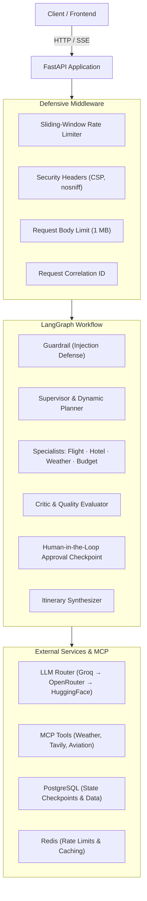

# Multi-AI-Agent

[](https://python.org)
[](https://fastapi.tiangolo.com)
[](https://langchain-ai.github.io/langgraph/)
[](LICENSE)

A multi-agent travel planning platform built with **FastAPI**, **LangGraph**, **PostgreSQL**, and **Redis**.

The application coordinates specialist AI agents (flight, hotel, weather, budget, itinerary) via a LangGraph state graph with deterministic guardrails, sliding-window rate limiting, circuit-breaker failover, SSE streaming, and human-in-the-loop approvals.

---

## Architecture



---

## Tech Stack

- **Framework:** FastAPI, Starlette, Uvicorn / Gunicorn
- **Orchestration:** LangGraph (StateGraph, Checkpointing, Command resume)
- **Tool Protocol:** Model Context Protocol (MCP) with FastMCP stdio server
- **Databases & Cache:** PostgreSQL 16 (psycopg), Redis 7 (redis-py async fallback to in-memory TTL)
- **Resilience:** Circuit breakers, sliding-window rate limiting, token budget quotas

---

## Quick Start

### 1. Clone & Set Up Environment
```bash
git clone https://github.com/backendwithvishal/Multi_AI_Agent.git
cd Multi_AI_Agent
python -m venv .venv
# Windows:
.venv\Scripts\activate
# Linux/macOS:
source .venv/bin/activate

pip install -r requirements.txt
cp .env.example .env
```

### 2. Configure Minimum Environment
Edit `.env` and set at least one LLM key:
```env
GROQ_API_KEY=gsk_your_groq_api_key_here
APP_ENV=development
```

### 3. Run Application
```bash
python app.py
```
App starts at `http://127.0.0.1:8000`. Interactive documentation is available at `http://127.0.0.1:8000/docs`.

### 4. Docker Compose
```bash
docker compose up --build
```

---

## API Overview

### Core Travel & Multi-Agent Endpoints
| Method | Endpoint | Description |
|:---|:---|:---|
| `POST` | `/api/v1/travel` | Execute travel multi-agent workflow |
| `POST` | `/api/v1/travel/stream` | Stream travel execution events via SSE |
| `POST` | `/api/v1/travel/approve` | Submit human approval or feedback for itinerary |

### Domain Endpoints (Travel Resources)
| Method | Endpoint | Description |
|:---|:---|:---|
| `POST` | `/api/v1/budget/calculate` | Deterministic trip cost calculation |
| `POST` | `/api/v1/budget/convert` | Currency exchange calculation |
| `POST` | `/api/v1/budget/budget-analysis` | Budget variance and utilization check |
| `GET` | `/api/v1/price-watches` | List tracked flight/hotel price watches |
| `POST` | `/api/v1/price-watches` | Create new price watch |
| `GET` | `/api/v1/price-watches/{item_id}` | Retrieve price watch item details |
| `DELETE` | `/api/v1/price-watches/{item_id}` | Delete price watch |
| `GET` | `/api/v1/notifications` | List user notifications and alerts |
| `POST` | `/api/v1/notifications` | Create price/weather notification |
| `PUT` | `/api/v1/notifications/{alert_id}/read` | Mark notification as read |
| `DELETE` | `/api/v1/notifications/{alert_id}` | Delete notification |
| `GET` | `/api/v1/documents` | List travel documents and vouchers |
| `POST` | `/api/v1/documents` | Register/attach travel document |
| `GET` | `/api/v1/documents/{doc_id}` | Retrieve document metadata |
| `DELETE` | `/api/v1/documents/{doc_id}` | Delete travel document |

### Compatibility & Booking Endpoints
| Method | Endpoint | Description |
|:---|:---|:---|
| `GET` | `/api/v1/health` | Health and diagnostic summary |
| `GET` | `/api/v1/liveness` | Service liveness probe |
| `GET` | `/api/v1/readiness` | Service readiness probe |
| `GET` | `/api/v1/status` | Model tiers and circuit breaker status |
| `GET` | `/api/v1/metrics` | Prometheus metrics scrape endpoint |
| `POST` | `/api/v1/auth/register` | Register user account |
| `POST` | `/api/v1/auth/login` | User login (returns JWT token) |
| `GET` | `/api/v1/auth/me` | Current user profile |
| `POST` | `/api/v1/auth/forgot-password` | Request password reset token |
| `POST` | `/api/v1/auth/reset-password` | Reset password using recovery token |
| `POST` | `/api/v1/ai/plan` | Generate Task DAG plan |
| `POST` | `/api/v1/ai/analysis` | Run feasibility and quality analysis |
| `POST` | `/api/v1/ai/agents/{agent_name}/invoke` | Invoke specific specialist agent |
| `GET` | `/api/v1/booking/flights/search` | Search flight availability via GDS |
| `GET` | `/api/v1/booking/hotels/search` | Search hotel availability via GDS |
| `POST` | `/api/v1/booking/price-lock` | Lock price quote for 15 minutes |
| `POST` | `/api/v1/booking/reserve` | Reserve flight/hotel booking |
| `GET` | `/api/v1/booking/reservations/{booking_id}` | Get booking reservation details |
| `GET` | `/api/v1/runs/{run_id}` | Get workflow run state |
| `GET` | `/api/v1/runs/{run_id}/metrics` | Get token usage and cost metrics |
| `GET` | `/api/v1/runs/{run_id}/agents` | Get specialist outputs and evidence |
| `POST` | `/api/v1/runs/{run_id}/replay` | Replay workflow execution |
| `POST` | `/api/v1/tasks/submit` | Submit background task |
| `GET` | `/api/v1/tasks` | List background tasks |
| `GET` | `/api/v1/tasks/{task_id}` | Get background task status |
| `POST` | `/api/v1/tasks/{task_id}/cancel` | Cancel running task |
| `GET` | `/api/v1/admin/stats` | Admin platform telemetry |
| `GET` | `/api/v1/admin/users` | Admin list users |
| `POST` | `/api/v1/admin/users` | Admin create user |
| `POST` | `/api/v1/admin/cache/clear` | Admin flush cache |
| `POST` | `/api/v1/admin/circuit-breakers/{service_name}/reset` | Admin reset circuit breaker |
| `GET` | `/api/v1/admin/runs` | Admin list all runs |

### Backward Compatibility Endpoints
| Method | Endpoint | Description |
|:---|:---|:---|
| `POST` | `/api/v1/financial/calculate` | Legacy trip cost calculator alias |
| `POST` | `/api/v1/financial/convert` | Legacy currency converter alias |
| `POST` | `/api/v1/financial/budget-analysis` | Legacy budget analysis alias |
| `GET` | `/api/v1/watchlists` | Legacy list watchlists alias |
| `POST` | `/api/v1/watchlists` | Legacy create watchlist alias |
| `GET` | `/api/v1/watchlists/{watchlist_id}` | Legacy get watchlist alias |
| `DELETE` | `/api/v1/watchlists/{watchlist_id}` | Legacy delete watchlist alias |
| `GET` | `/api/v1/alerts` | Legacy list alerts alias |
| `POST` | `/api/v1/alerts` | Legacy create alert alias |
| `PUT` | `/api/v1/alerts/{alert_id}/read` | Legacy mark alert read alias |
| `DELETE` | `/api/v1/alerts/{alert_id}` | Legacy delete alert alias |
| `GET` | `/api/v1/price-alerts` | Canonical price alerts alias |
| `POST` | `/api/v1/price-alerts` | Canonical create price alert alias |
| `PUT` | `/api/v1/price-alerts/{alert_id}/read` | Canonical mark price alert read alias |
| `DELETE` | `/api/v1/price-alerts/{alert_id}` | Canonical delete price alert alias |
| `GET` | `/api/v1/assets` | Legacy list travel assets alias |
| `POST` | `/api/v1/assets` | Legacy attach travel asset alias |
| `GET` | `/api/v1/assets/{asset_id}` | Legacy get travel asset alias |
| `DELETE` | `/api/v1/assets/{asset_id}` | Legacy delete travel asset alias |

---

## Environment Variables

| Variable | Default | Description |
|:---|:---|:---|
| `ADMIN_REGISTRATION_SECRET` | `""` | Secret token required to register admin accounts |
| `ALLOWED_ORIGINS` | `["http://localhost:3000"]` | Permitted CORS origins |
| `API_KEY` | `""` | Root service authorization key |
| `APP_ENV` | `"development"` | Environment name: `development`, `production`, `test` |
| `APP_NAME` | `"Multi-AI-Agent"` | Service display name |
| `APPROVAL_TTL_SECONDS` | `900` | Expiration time for paused HITL approval checkpoints |
| `AUTH_REQUIRED` | `true` | Enforces JWT authentication on protected routes |
| `AVIATIONSTACK_API_KEY` | `""` | API key for flight search integration |
| `CACHE_MAX_ENTRIES` | `1000` | Maximum cached items in bounded in-memory cache |
| `CACHE_TTL_SECONDS` | `300` | Default cache TTL in seconds |
| `CAPTURE_PROMPTS` | `false` | Whether to forward full prompt text to telemetry |
| `DAILY_TOKEN_BUDGET_PER_USER` | `100000` | Daily token quota limit per user |
| `DATABASE_URL` | `""` | PostgreSQL connection string |
| `DB_POOL_MAX_SIZE` | `20` | Maximum PostgreSQL connection pool size |
| `DB_POOL_MIN_SIZE` | `2` | Minimum PostgreSQL connection pool size |
| `DB_POOL_TIMEOUT_SECONDS` | `5.0` | Connection pool checkout timeout |
| `EMERGENCY_IN_MEMORY_RATE_LIMIT` | `5` | Fallback rate limit if Redis is down |
| `ENABLE_DOCS_IN_PROD` | `false` | Enables `/docs` and `/redoc` in production |
| `ENV` | `""` | Alias for APP_ENV |
| `EXTERNAL_API_TIMEOUT_SECONDS` | `10.0` | Timeout for external HTTP requests |
| `FAIL_OPEN_REDIS` | `false` | Fallback behavior when Redis is unavailable |
| `FAST_LLM_MODEL` | `"llama-3.1-8b-instant"` | Fast model for guardrail and routing tasks |
| `GRACEFUL_TIMEOUT` | `30` | Grace period in seconds on shutdown |
| `GROQ_API_KEY` | `""` | Groq API provider key |
| `HUGGINGFACE_API_KEY` | `""` | HuggingFace Inference API key |
| `HUGGINGFACE_FAST_MODEL` | `""` | HuggingFace fast model name |
| `HUGGINGFACE_REASONING_MODEL` | `""` | HuggingFace reasoning model name |
| `JWT_SECRET_KEY` | `""` | Secret key for JWT signing (must be changed in prod) |
| `KEEP_ALIVE` | `65` | HTTP keep-alive timeout |
| `LANGCHAIN_API_KEY` | `""` | LangSmith API key |
| `LANGCHAIN_ENDPOINT` | `""` | LangSmith tracing endpoint |
| `LANGCHAIN_PROJECT` | `""` | LangSmith project name |
| `LANGCHAIN_TRACING_V2` | `false` | Enables LangSmith tracing |
| `LANGGRAPH_RECURSION_LIMIT` | `15` | Maximum LangGraph recursion depth |
| `LLM_TIMEOUT_SECONDS` | `30.0` | Timeout for LLM provider generation |
| `LOG_LEVEL` | `"INFO"` | Application log level (`DEBUG`, `INFO`, `WARNING`, `ERROR`) |
| `MAX_FEEDBACK_LENGTH` | `1000` | Maximum character length for rejection feedback |
| `MAX_MESSAGE_LENGTH` | `2000` | Maximum user message character length |
| `MAX_PARALLEL_AGENTS` | `4` | Maximum parallel specialist agent tasks |
| `MAX_REQUEST_BODY_BYTES` | `1048576` | Maximum allowed request body size (1 MB) |
| `MAX_TOOL_OUTPUT_BYTES` | `100000` | Maximum output size for individual tool responses |
| `MCP_CACHE_MAX_BYTES` | `1048576` | Maximum memory bytes for MCP tool caching |
| `MCP_CACHE_TTL_SECONDS` | `300` | Cache duration for tool queries |
| `MCP_TIMEOUT_SECONDS` | `10.0` | Timeout for MCP tool calls |
| `METRICS_ALLOWED_IPS` | `["127.0.0.1", "::1"]` | Whitelisted IP addresses for Prometheus scrape |
| `METRICS_PROTECTED` | `true` | Restricts `/metrics` access |
| `METRICS_TOKEN` | `""` | Optional bearer token for Prometheus scraping |
| `OPENROUTER_API_KEY` | `""` | OpenRouter API provider key |
| `OPENROUTER_FAST_MODEL` | `""` | OpenRouter fast model identifier |
| `OPENROUTER_REASONING_MODEL` | `""` | OpenRouter reasoning model identifier |
| `OPENWEATHER_API_KEY` | `""` | OpenWeather API key |
| `OTEL_ENABLED` | `false` | Enable OpenTelemetry tracing exporter |
| `PORT` | `8000` | Server listening port |
| `RATE_LIMIT_REQUESTS` | `30` | Requests allowed per sliding window |
| `RATE_LIMIT_WINDOW_SECONDS` | `60` | Duration of sliding rate limit window in seconds |
| `REASONING_LLM_MODEL` | `"llama-3.3-70b-versatile"` | High-capacity model for synthesis and planning |
| `REDIS_URL` | `""` | Redis connection URL |
| `TAVILY_API_KEY` | `""` | Tavily web search API key |
| `THREAD_ID_REGEX` | `^[a-zA-Z0-9_-]{1,64}$` | Regex validating thread identifier format |
| `TOOL_ALLOWED_HOSTS` | `["*"]` | Permitted outbound network hosts for tools |
| `TRUSTED_PROXIES` | `["127.0.0.1"]` | Trusted proxy IP addresses for header forwarding |
| `WEB_CONCURRENCY` | `1` | Number of Gunicorn worker processes |

---

## Testing

Run the full automated test suite:
```bash
python -m pytest -q
```

Run specific test targets:
```bash
# Core API contracts
pytest tests/test_v1_api.py -v

# Domain resource CRUD
pytest tests/test_domain_modules.py -v

# Security and IDOR isolation
pytest tests/review/ -v

# Documentation link verification
pytest tests/test_link_checker.py -v
```

---

## Project Structure

```text
Multi_AI_Agent/
├── app.py                      # FastAPI factory, middleware chain, exception handlers
├── custom_weather_mcp_server.py # FastMCP stdio tool server for weather queries
├── mcp_client.py               # MCP client session manager
├── pyproject.toml              # Build config, testpaths, ruff lint and format settings
├── requirements.txt            # Python dependencies
├── docs/                       # Architecture, Runbook, and Security documentation
│   ├── ARCHITECTURE.md         # Component diagrams and data flows
│   ├── DEPLOYMENT.md           # Docker, Compose, and production deployment guide
│   ├── RENDER_DEPLOYMENT.md    # Render web service & PostgreSQL deployment guide
│   └── RUNBOOK.md              # Operations, SLOs, and incident playbooks
├── postman/                    # Postman collection & environment for API testing
├── tests/                      # Automated test suite (unit, integration, security)
└── tripmate/                   # Application package
    ├── adapters/               # MCP tool response normalizers
    ├── agents/                 # Guardrail, Supervisor, Planner, Critic, Specialists
    ├── api/                    # REST routes (/api/v1/travel, budget, price-watches, etc.)
    ├── cache/                  # Redis hybrid cache with in-memory TTL fallback
    ├── config/                 # Pydantic Settings configuration
    ├── core/                   # Context, logging, auditing, errors, singletons
    ├── database/               # PostgreSQL connection pool and in-memory datastore
    ├── graph/                  # LangGraph StateGraph assembly and state definitions
    ├── integrations/           # Circuit breakers and GDS flight/hotel client
    ├── middleware/             # Rate limiting, security headers, correlation IDs
    ├── schemas/                # Pydantic input/output schemas
    ├── services/               # Travel orchestration, budget, notifications, auth
    ├── strategies/             # Multi-tier LLM provider strategies
    └── tasks/                  # Background worker queue
```

---

## License

Distributed under the [MIT License](LICENSE).
