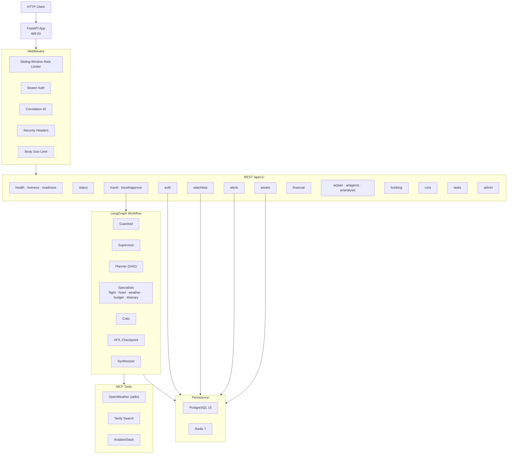

# Multi-AI-Agent

[](https://github.com/backendwithvishal/Multi_AI_Agent/actions)
[](https://python.org)
[](https://fastapi.tiangolo.com)
[](https://langchain-ai.github.io/langgraph/)
[](LICENSE)

A **multi-agent AI orchestration platform** for travel planning, built with **LangGraph**, **Model Context Protocol (MCP)**, **FastAPI**, **PostgreSQL**, and **Redis**.

The platform coordinates a team of AI specialist agents (flight, hotel, weather, budget, itinerary) through a LangGraph state graph, with circuit-breaker resilience, SSE streaming, Human-in-the-Loop approval, and 13 REST API domains.

**Live deployment:** <https://multi-ai-agent-m4g6.onrender.com/>  
**Interactive docs:** <https://multi-ai-agent-m4g6.onrender.com/docs>  
**Architecture:** [docs/ARCHITECTURE.md](docs/ARCHITECTURE.md)

---

## Table of Contents

- [Architecture](#architecture)
- [What It Actually Does](#what-it-actually-does)
- [Quick Start](#quick-start)
  - [Windows](#windows)
  - [macOS / Linux](#macos--linux)
  - [Docker](#docker)
- [Environment Variables](#environment-variables)
- [API Reference](#api-reference)
- [Authentication](#authentication)
- [SSE Event Schema](#sse-event-schema)
- [Troubleshooting](#troubleshooting)
- [Known Limitations](#known-limitations)
- [Project Structure](#project-structure)
- [Design Patterns](#design-patterns)
- [Contributing](#contributing)
- [Security](#security)
- [License](#license)

---

## Architecture



---

## What It Actually Does

| Feature | Details |
|---------|---------|
| **Multi-agent orchestration** | LangGraph `StateGraph` with Guardrail → Supervisor → Parallel Specialists → Critic → HITL → Synthesizer |
| **SSE streaming** | Real-time agent events via `text/event-stream`; heartbeat every 15 s; disconnect detection |
| **Human-in-the-Loop (HITL)** | Workflow pauses for user approval; resumes on `POST /api/v1/travel/approve`; 15-min TTL |
| **LLM provider failover** | Groq → OpenRouter → HuggingFace; circuit-breaker per provider; configurable model names |
| **MCP integration** | OpenWeather (stdio FastMCP), Tavily Search, AviationStack — all through `MultiServerMCPClient` |
| **Circuit breakers** | Per-service breakers (Tavily, AviationStack, OpenWeather, GDS); states exposed on `/api/v1/health` |
| **Hybrid cache** | Redis + bounded in-memory TTL cache; MCP responses cached; LRU eviction |
| **Sliding-window rate limiter** | Per-IP, Redis-backed; emergency in-memory cap when Redis is down |
| **Alembic migrations** | Auto-run on startup when PostgreSQL is configured |
| **Prometheus metrics** | All requests/latency tracked; `/metrics` endpoint (token-protected in production) |
| **13 REST API domains** | health, status, auth, travel, watchlists, alerts, assets, financial, AI, booking, runs, tasks, admin |
| **Background task queue** | `AsyncTaskQueue` with priority levels and worker telemetry |
| **Audit logging** | Every auth event, approval decision, and admin action recorded with actor, IP, request_id |

> [!IMPORTANT]
> **Benchmarks removed.** Claims of "~60% latency reduction" and "~40% fewer API calls" that appeared in earlier README versions have been removed — no load-test data or methodology existed to support them. Performance claims will be re-added if and when measured with a reproducible benchmark (script, environment, date, commit).

---

## Quick Start

### Windows

```powershell
git clone https://github.com/backendwithvishal/Multi_AI_Agent.git
cd Multi_AI_Agent

python -m venv .venv
.venv\Scripts\activate

pip install -r requirements.txt
Copy-Item .env.example .env
# Open .env and set at least one LLM key:
#   GROQ_API_KEY=gsk_...   OR   OPENROUTER_API_KEY=sk-or-...
# Set ENV=dev to enable MemorySaver (no Postgres required for dev)

python app.py
```

API available at <http://127.0.0.1:8000> · Docs at <http://127.0.0.1:8000/docs>

### macOS / Linux

```bash
git clone https://github.com/backendwithvishal/Multi_AI_Agent.git
cd Multi_AI_Agent

python3 -m venv .venv
source .venv/bin/activate

pip install -r requirements.txt
cp .env.example .env
# Edit .env: set GROQ_API_KEY or OPENROUTER_API_KEY, and ENV=dev

python app.py
```

### Docker

```bash
# Local full stack (API + PostgreSQL 16 + Redis 7)
docker compose up --build

# Production profile
docker compose -f docker-compose.prod.yml up -d
```

The compose file reads credentials from `.env`. Copy `.env.example` → `.env` and fill in secrets before running.

---

## Environment Variables

All variables are validated at startup by `tripmate/config/settings.py` (Pydantic Settings).  
The version is single-sourced in `pyproject.toml`; do not set `APP_VERSION` in `.env`.

> [!TIP]
> Copy `.env.example` to `.env` — every variable listed here is documented with its default there.

### Application

| Variable | Default | Description |
|----------|---------|-------------|
| `APP_NAME` | `Multi-AI-Agent` | Service name returned in health/status responses |
| `APP_ENV` | `development` | Runtime environment (`development`, `production`, `test`) |
| `ENV` | `dev` | Short alias (`dev`, `prod`, `test`). Set to `dev` to use MemorySaver |
| `LOG_LEVEL` | `INFO` | Python log level (`DEBUG`, `INFO`, `WARNING`, `ERROR`) |
| `ENABLE_DOCS_IN_PROD` | `false` | Set `true` to expose `/docs` and `/redoc` in production |

### Server

| Variable | Default | Description |
|----------|---------|-------------|
| `PORT` | `8000` | TCP port the uvicorn server listens on |
| `WEB_CONCURRENCY` | `2` | Gunicorn worker count |
| `GRACEFUL_TIMEOUT` | `30` | Gunicorn graceful shutdown timeout (seconds) |
| `KEEP_ALIVE` | `5` | Uvicorn keep-alive timeout (seconds) |

### Authentication & Access Control

| Variable | Default | Description |
|----------|---------|-------------|
| `AUTH_REQUIRED` | `false` | Enforce Bearer token on all protected routes (`true` in production) |
| `API_KEY` | _(none)_ | Master API key; required in production |
| `JWT_SECRET_KEY` | `dev_jwt_secret_key_change_in_prod` | JWT signing secret; **must** be changed in production |
| `ADMIN_REGISTRATION_SECRET` | _(none)_ | Header secret required to register admin accounts |
| `APPROVAL_TTL_SECONDS` | `900` | HITL approval expiry (15 min) |

### LLM Providers

| Variable | Default | Description |
|----------|---------|-------------|
| `GROQ_API_KEY` | _(none)_ | Groq API key (primary provider) |
| `FAST_LLM_MODEL` | `llama-3.1-8b-instant` | Groq fast-tier model |
| `REASONING_LLM_MODEL` | `llama-3.3-70b-versatile` | Groq reasoning-tier model |
| `OPENROUTER_API_KEY` | _(none)_ | OpenRouter API key (secondary provider) |
| `OPENROUTER_FAST_MODEL` | `meta-llama/llama-3.1-8b-instruct:free` | OpenRouter fast model |
| `OPENROUTER_REASONING_MODEL` | `meta-llama/llama-3.3-70b-instruct:free` | OpenRouter reasoning model |
| `HUGGINGFACE_API_KEY` | _(none)_ | HuggingFace API key (tertiary provider) |
| `HUGGINGFACE_FAST_MODEL` | `meta-llama/Meta-Llama-3-8B-Instruct` | HuggingFace fast model |
| `HUGGINGFACE_REASONING_MODEL` | `meta-llama/Llama-3.3-70B-Instruct` | HuggingFace reasoning model |

### MCP & External Tools

| Variable | Default | Description |
|----------|---------|-------------|
| `TAVILY_API_KEY` | _(none)_ | Tavily web search key |
| `OPENWEATHER_API_KEY` | _(none)_ | OpenWeather key (used by FastMCP stdio server) |
| `AVIATIONSTACK_API_KEY` | _(none)_ | AviationStack flight data key |
| `TOOL_ALLOWED_HOSTS` | _(see below)_ | Comma-separated allowlist of outbound tool hostnames (SSRF guard) |
| `MAX_TOOL_OUTPUT_BYTES` | `50000` | Maximum MCP tool response size in bytes |
| `MCP_CACHE_TTL_SECONDS` | `3600` | MCP response cache TTL (seconds) |
| `MCP_CACHE_MAX_BYTES` | `65536` | Per-key MCP cache size limit (64 KB) |

Default `TOOL_ALLOWED_HOSTS`: `api.openweathermap.org,mcp.tavily.com,api.aviationstack.com,api.groq.com,openrouter.ai`

### Persistence

| Variable | Default | Description |
|----------|---------|-------------|
| `DATABASE_URL` | _(none)_ | PostgreSQL connection URL. Required in production; optional in dev |
| `REDIS_URL` | _(none)_ | Redis connection URL. Strongly recommended; rate limiter degrades without it |
| `CACHE_TTL_SECONDS` | `3600` | Default cache TTL (seconds) |
| `CACHE_MAX_ENTRIES` | `1000` | Max in-memory cache entries |
| `DB_POOL_MIN_SIZE` | `1` | PostgreSQL connection pool minimum size |
| `DB_POOL_MAX_SIZE` | `10` | PostgreSQL connection pool maximum size |
| `DB_POOL_TIMEOUT_SECONDS` | `10.0` | Pool acquire timeout (seconds) |

### Rate Limiting & Abuse Control

| Variable | Default | Description |
|----------|---------|-------------|
| `RATE_LIMIT_REQUESTS` | `30` | Maximum requests per window per IP |
| `RATE_LIMIT_WINDOW_SECONDS` | `60` | Sliding window duration (seconds) |
| `EMERGENCY_IN_MEMORY_RATE_LIMIT` | `5` | Cap applied per minute when Redis is unavailable |
| `FAIL_OPEN_REDIS` | `false` | Allow requests through if Redis is down (`true` removes the emergency cap) |
| `DAILY_TOKEN_BUDGET_PER_USER` | `100000` | Max tokens per user per day across all LLM calls |
| `LANGGRAPH_RECURSION_LIMIT` | `15` | Max agent graph recursion depth |
| `MAX_PARALLEL_AGENTS` | `4` | Maximum concurrent specialist agents |
| `MAX_REQUEST_BODY_BYTES` | `1048576` | Maximum request body size (1 MB) |
| `MAX_MESSAGE_LENGTH` | `2000` | Maximum travel query message length (characters) |
| `MAX_FEEDBACK_LENGTH` | `1000` | Maximum HITL feedback message length (characters) |
| `THREAD_ID_REGEX` | `^[a-zA-Z0-9_-]{8,128}$` | Regex for validating thread IDs |

### Network & CORS

| Variable | Default | Description |
|----------|---------|-------------|
| `ALLOWED_ORIGINS` | `http://localhost:3000,http://127.0.0.1:3000` | Comma-separated CORS allowed origins |
| `TRUSTED_PROXIES` | `127.0.0.1,::1` | IPs trusted for `X-Forwarded-For` header |

### Observability

| Variable | Default | Description |
|----------|---------|-------------|
| `LANGCHAIN_TRACING_V2` | `false` | Enable LangSmith tracing (requires `LANGCHAIN_API_KEY`) |
| `LANGCHAIN_API_KEY` | _(none)_ | LangSmith API key |
| `LANGCHAIN_PROJECT` | `tripmate-ai` | LangSmith project name |
| `LANGCHAIN_ENDPOINT` | `https://api.smith.langchain.com` | LangSmith endpoint |
| `CAPTURE_PROMPTS` | `false` | Capture prompt content in traces (sets `LANGCHAIN_HIDE_INPUTS=true` when false) |
| `OTEL_ENABLED` | `false` | Enable OpenTelemetry distributed tracing |
| `METRICS_PROTECTED` | `true` | Require token or IP allowlist for `/metrics` |
| `METRICS_TOKEN` | _(none)_ | Bearer token for Prometheus scrape endpoint |
| `METRICS_ALLOWED_IPS` | `127.0.0.1,::1,testclient` | IPs allowed to scrape `/metrics` without token |

### Timeouts

| Variable | Default | Description |
|----------|---------|-------------|
| `LLM_TIMEOUT_SECONDS` | `30.0` | LLM provider request timeout |
| `MCP_TIMEOUT_SECONDS` | `15.0` | MCP tool call timeout |
| `EXTERNAL_API_TIMEOUT_SECONDS` | `10.0` | Generic external API timeout |

---

## API Reference

All endpoints are prefixed `/api/v1/`. Responses follow the envelope:

```json
{
  "success": true,
  "data": { ... },
  "error": null,
  "request_id": "req_abc123"
}
```

Error responses:

```json
{
  "success": false,
  "data": null,
  "error": { "code": "ERROR_CODE", "message": "Human-readable description" },
  "request_id": "req_abc123"
}
```

---

### System Health

#### `GET /api/v1/health`

Detailed backend telemetry: feature list, cache stats, circuit breaker states, database status.

```bash
curl http://localhost:8000/api/v1/health
```

**200 Response:**

```json
{
  "status": "ok",
  "service": "Multi-AI-Agent",
  "version": "3.0.0",
  "environment": "development",
  "features": ["supervisor_agent", "human_in_the_loop", "async_sse_streaming"],
  "database": { "status": "healthy" },
  "cache_stats": { "backend": "redis", "hits": 42, "misses": 7 },
  "circuit_breakers": {
    "tavily": "closed",
    "aviationstack": "closed",
    "openweather": "closed",
    "gds": "closed"
  }
}
```

#### `GET /api/v1/liveness`

Kubernetes/Docker liveness probe.

```bash
curl http://localhost:8000/api/v1/liveness
```

**200:** `{"status": "alive", "service": "Multi-AI-Agent"}`

#### `GET /api/v1/readiness`

Readiness probe — verifies database and cache connectivity.

**200 (ready):** `{"status": "ready", "service": "Multi-AI-Agent", "database": {...}, "cache_connected": true}`  
**503 (not ready):** `{"status": "not_ready", "reasons": ["Database connection probe failed."]}`

#### `GET /api/v1/status`

Operational status: uptime, agent registry, model tier availability.

```bash
curl http://localhost:8000/api/v1/status
```

**200:**

```json
{
  "success": true,
  "data": {
    "service": "Multi-AI-Agent",
    "version": "3.0.0",
    "status": "OPERATIONAL",
    "uptime_seconds": 3600,
    "agent_registry": ["flight_agent", "hotel_agent", "weather_agent", "budget_agent", "itinerary_agent"],
    "model_tiers": { "groq_configured": true, "openrouter_configured": false },
    "circuit_breakers": { "tavily_breaker": "closed" },
    "cache_backend": "redis"
  }
}
```

---

### Authentication

#### `POST /api/v1/auth/register`

Register a new user account. Returns a signed JWT.

```bash
curl -X POST http://localhost:8000/api/v1/auth/register \
  -H "Content-Type: application/json" \
  -d '{"username": "alice", "email": "alice@example.com", "password": "Secure!Pass123", "role": "user"}'
```

**200:**

```json
{
  "success": true,
  "data": {
    "access_token": "eyJhbGci...",
    "token_type": "bearer",
    "user_id": "usr_abc123",
    "role": "user"
  }
}
```

**400 — duplicate username/email:**

```json
{
  "detail": { "code": "REGISTRATION_FAILED", "message": "Username already exists." }
}
```

To register an admin, include the `X-Admin-Secret` header with `ADMIN_REGISTRATION_SECRET`.

#### `POST /api/v1/auth/login`

Authenticate and receive a JWT.

```bash
curl -X POST http://localhost:8000/api/v1/auth/login \
  -H "Content-Type: application/json" \
  -d '{"username_or_email": "alice", "password": "Secure!Pass123"}'
```

**401 — invalid credentials:**

```json
{
  "detail": { "code": "INVALID_CREDENTIALS", "message": "..." }
}
```

#### `GET /api/v1/auth/me`

Get the authenticated user's profile.

```bash
curl http://localhost:8000/api/v1/auth/me \
  -H "Authorization: Bearer <token>"
```

#### `POST /api/v1/auth/forgot-password`

Request a single-use password reset token (15-minute TTL).

```bash
curl -X POST http://localhost:8000/api/v1/auth/forgot-password \
  -H "Content-Type: application/json" \
  -d '{"email": "alice@example.com"}'
```

Always returns `200` (no email oracle to prevent enumeration).

#### `POST /api/v1/auth/reset-password`

Reset password using the token from `forgot-password`.

```bash
curl -X POST http://localhost:8000/api/v1/auth/reset-password \
  -H "Content-Type: application/json" \
  -d '{"reset_token": "<token>", "new_password": "NewSecure!456"}'
```

**400 — expired/invalid token:**

```json
{
  "detail": { "code": "INVALID_RESET_TOKEN", "message": "..." }
}
```

---

### Travel Multi-Agent Workflow

#### `POST /api/v1/travel`

Execute the multi-agent travel planning workflow (blocking, returns when complete or pending HITL).

```bash
curl -X POST http://localhost:8000/api/v1/travel \
  -H "Content-Type: application/json" \
  -d '{"message": "Plan a 5-day trip to Tokyo for 2 adults, budget $3000", "thread_id": "my-thread-001"}'
```

**200 — completed:**

```json
{
  "success": true,
  "data": {
    "answer": "Here is your 5-day Tokyo itinerary...",
    "run_id": "run_xyz789",
    "thread_id": "my-thread-001",
    "selected_agents": ["flight_agent", "hotel_agent", "weather_agent"],
    "token_usage": { "total_tokens": 3210, "estimated_cost_usd": 0.0024 },
    "status": "completed"
  }
}
```

**200 — pending HITL approval:**

```json
{
  "success": true,
  "data": {
    "status": "pending_approval",
    "thread_id": "my-thread-001",
    "draft_itinerary": "Day 1: Arrive at Narita...",
    "message": "Please review and approve the draft itinerary."
  }
}
```

**422 — missing message field:**

```json
{
  "detail": [{ "loc": ["body", "message"], "msg": "field required", "type": "value_error.missing" }]
}
```

#### `POST /api/v1/travel/stream`

Stream real-time agent execution events via SSE. See [SSE Event Schema](#sse-event-schema).

```bash
curl -X POST http://localhost:8000/api/v1/travel/stream \
  -H "Content-Type: application/json" \
  -H "Accept: text/event-stream" \
  -d '{"message": "Weekend trip to Barcelona", "thread_id": "stream-thread-001"}'
```

#### `POST /api/v1/travel/approve`

Resume a HITL-paused workflow with approval or rejection feedback.

```bash
# Approve
curl -X POST http://localhost:8000/api/v1/travel/approve \
  -H "Authorization: Bearer <token>" \
  -H "Content-Type: application/json" \
  -d '{"thread_id": "my-thread-001", "approved": true, "feedback": ""}'

# Reject with feedback
curl -X POST http://localhost:8000/api/v1/travel/approve \
  -H "Authorization: Bearer <token>" \
  -H "Content-Type: application/json" \
  -d '{"thread_id": "my-thread-001", "approved": false, "feedback": "Please include a day trip to Mount Fuji"}'
```

**400 — rejection without feedback:**

```json
{
  "success": false,
  "error": { "code": "VALIDATION_ERROR", "message": "Please provide revision feedback when rejecting the draft itinerary." }
}
```

---

### AI Orchestration

#### `POST /api/v1/ai/plan`

Decompose a query into a dependency-aware Task DAG.

```bash
curl -X POST http://localhost:8000/api/v1/ai/plan \
  -H "Content-Type: application/json" \
  -d '{"query": "Find flights and hotels for Paris trip next month"}'
```

#### `POST /api/v1/ai/agents/{agent_name}/invoke`

Directly invoke a registered specialist agent.

```bash
curl -X POST http://localhost:8000/api/v1/ai/agents/weather_agent/invoke \
  -H "Content-Type: application/json" \
  -d '{"query": "What is the weather in Tokyo in March?", "context": {}}'
```

**404 — agent not found:**

```json
{
  "detail": {
    "code": "AGENT_NOT_FOUND",
    "message": "Agent 'xyz_agent' not registered. Available: ['flight_agent', 'hotel_agent', ...]"
  }
}
```

#### `POST /api/v1/ai/analysis`

Analyze a travel request for feasibility, risk factors, and budget alignment.

```bash
curl -X POST http://localhost:8000/api/v1/ai/analysis \
  -H "Content-Type: application/json" \
  -d '{"query": "Safari trip to Kenya for 10 days", "budget": 5000, "destination": "Nairobi"}'
```

---

### Watchlists

| Method | Path | Description |
|--------|------|-------------|
| `GET` | `/api/v1/watchlists` | List all watchlist items for the authenticated user |
| `POST` | `/api/v1/watchlists` | Create a watchlist item (destination, flight route, or hotel) |
| `GET` | `/api/v1/watchlists/{watchlist_id}` | Get a specific watchlist item |
| `DELETE` | `/api/v1/watchlists/{watchlist_id}` | Delete a watchlist item |

**404 error code:** `WATCHLIST_NOT_FOUND`

---

### Alerts

| Method | Path | Description |
|--------|------|-------------|
| `GET` | `/api/v1/alerts` | List all alerts for the authenticated user |
| `POST` | `/api/v1/alerts` | Create a price drop, weather, or schedule alert |
| `PUT` | `/api/v1/alerts/{alert_id}/read` | Mark an alert as read |
| `DELETE` | `/api/v1/alerts/{alert_id}` | Delete an alert |

**404 error code:** `ALERT_NOT_FOUND`

---

### Travel Assets

| Method | Path | Description |
|--------|------|-------------|
| `GET` | `/api/v1/assets` | List travel assets (e-tickets, vouchers); optional `?trip_id=` filter |
| `POST` | `/api/v1/assets` | Attach a travel document to a trip |
| `GET` | `/api/v1/assets/{asset_id}` | Get asset metadata |
| `DELETE` | `/api/v1/assets/{asset_id}` | Delete a travel asset |

**404 error code:** `ASSET_NOT_FOUND`

---

### Financial Engine

#### `POST /api/v1/financial/calculate`

Deterministic trip cost calculation with itemized breakdown.

```bash
curl -X POST http://localhost:8000/api/v1/financial/calculate \
  -H "Content-Type: application/json" \
  -d '{"flights": 450, "hotels": 300, "activities": 150, "meals": 120, "currency": "USD", "contingency_percent": 10}'
```

**200:**

```json
{
  "success": true,
  "data": {
    "subtotal": 1020.0,
    "contingency": 102.0,
    "total_with_contingency": 1122.0,
    "currency": "USD",
    "daily_average": null
  }
}
```

#### `POST /api/v1/financial/convert`

Currency conversion using fixed exchange rates.

```bash
curl -X POST http://localhost:8000/api/v1/financial/convert \
  -H "Content-Type: application/json" \
  -d '{"amount": 1000, "from_currency": "USD", "to_currency": "EUR"}'
```

**400 — unsupported currency:**

```json
{
  "detail": { "code": "UNSUPPORTED_CURRENCY", "message": "Currency 'XYZ' is not supported." }
}
```

#### `POST /api/v1/financial/budget-analysis`

Analyze budget variance and utilization.

---

### GDS Booking

| Method | Path | Description |
|--------|------|-------------|
| `GET` | `/api/v1/booking/flights/search` | Search live flight offers (params: `origin`, `destination`, `departure_date`, `adults`) |
| `GET` | `/api/v1/booking/hotels/search` | Search hotel availability (params: `city_code`, `check_in_date`, `check_out_date`, `guests`) |
| `POST` | `/api/v1/booking/price-lock` | Lock a fare for 15 minutes |
| `POST` | `/api/v1/booking/reserve` | Complete a reservation and generate a PNR |
| `GET` | `/api/v1/booking/reservations/{booking_id}` | Get reservation details |

**502 — external GDS error:**

```json
{
  "detail": { "code": "GDS_SEARCH_ERROR", "message": "Flight search failed: ..." }
}
```

---

### Workflow Observability

| Method | Path | Description |
|--------|------|-------------|
| `GET` | `/api/v1/runs/{run_id}` | Full workflow run state and outputs |
| `GET` | `/api/v1/runs/{run_id}/metrics` | Latency breakdown, token usage, estimated cost |
| `GET` | `/api/v1/runs/{run_id}/agents` | Agent outputs, evidence items, critic report |
| `POST` | `/api/v1/runs/{run_id}/replay` | Re-run a workflow for debugging |

**404 error code:** `RUN_NOT_FOUND`

> [!NOTE]
> Run data is stored in-memory (`RUN_STORE`) and does not survive worker restarts.

---

### Background Tasks

| Method | Path | Description |
|--------|------|-------------|
| `GET` | `/api/v1/tasks` | List tasks (filtered by `?status=`, admin sees all) |
| `POST` | `/api/v1/tasks/submit` | Submit a background task by name |
| `GET` | `/api/v1/tasks/{task_id}` | Get task status and result |
| `POST` | `/api/v1/tasks/{task_id}/cancel` | Cancel a pending task |

Registered task names: `watchlist_price_scan`, `background_itinerary`, `system_health_audit`.

**400 — unknown task name:**

```json
{
  "detail": { "code": "INVALID_TASK_TYPE", "message": "..." }
}
```

---

### Metrics & Observability

| Method | Path | Description |
|--------|------|-------------|
| `GET` | `/api/v1/metrics` | Prometheus exposition format metrics (protected by token or IP allowlist) |

---

### Platform Administration

All admin endpoints require `Authorization: Bearer <admin-token>`.

| Method | Path | Description |
|--------|------|-------------|
| `GET` | `/api/v1/admin/stats` | Platform aggregate statistics |
| `GET` | `/api/v1/admin/users` | List all registered users |
| `POST` | `/api/v1/admin/users` | Provision a new user or admin account |
| `POST` | `/api/v1/admin/circuit-breakers/{service_name}/reset` | Reset a circuit breaker (`tavily`, `aviationstack`, `openweather`, `gds`, `all`) |
| `POST` | `/api/v1/admin/cache/clear` | Purge all caches |
| `GET` | `/api/v1/admin/runs` | Audit log of all workflow runs |

---

## Authentication

When `AUTH_REQUIRED=true` (always in production), protected endpoints require:

```
Authorization: Bearer <token>
```

**Obtain a token:**

```bash
# 1. Register
curl -X POST http://localhost:8000/api/v1/auth/register \
  -H "Content-Type: application/json" \
  -d '{"username": "alice", "email": "alice@example.com", "password": "MyPass123!", "role": "user"}'

# 2. Login
curl -X POST http://localhost:8000/api/v1/auth/login \
  -H "Content-Type: application/json" \
  -d '{"username_or_email": "alice", "password": "MyPass123!"}'
# → {"data": {"access_token": "eyJhbGci...", ...}}

# 3. Use the token
curl http://localhost:8000/api/v1/watchlists \
  -H "Authorization: Bearer eyJhbGci..."
```

**Python example:**

```python
import httpx

BASE = "http://localhost:8000"

# Login
resp = httpx.post(f"{BASE}/api/v1/auth/login", json={
    "username_or_email": "alice",
    "password": "MyPass123!",
})
token = resp.json()["data"]["access_token"]

# Authenticated request
headers = {"Authorization": f"Bearer {token}"}
plan = httpx.post(f"{BASE}/api/v1/travel", json={
    "message": "3-day trip to Rome",
    "thread_id": "my-rome-trip-001",
}, headers=headers)
print(plan.json()["data"]["answer"])
```

When `AUTH_REQUIRED=false` (development default), the API accepts unauthenticated requests and uses an anonymous identity.

---

## SSE Event Schema

`POST /api/v1/travel/stream` returns a `text/event-stream` response. Each SSE event has:

```
data: <JSON string>

```

(Note: two newlines separate events per the SSE spec.)

### Event Types

| `event_type` | When emitted | Key fields |
|--------------|-------------|------------|
| `workflow_started` | Workflow begins | `thread_id`, `user_input` |
| `supervisor_completed` | Supervisor selects agents | `selected_agents`, `dag_plan` |
| `specialists_completed` | All parallel agents finish | `structured_outputs`, `agent_count` |
| `critic_completed` | Critic evaluates quality | `score`, `is_valid`, `violations` |
| `approval_required` | HITL checkpoint triggered | `thread_id`, `draft_itinerary` |
| `itinerary_completed` | Final synthesis done | `answer`, `token_usage` |
| `workflow_completed` | Full workflow done | `run_id`, `total_duration_ms` |
| `workflow_failed` | Unrecoverable error | `error`, `step` |
| `heartbeat` | Keep-alive (every 15 s) | `timestamp` |
| `done` | Stream closed | — |

### Example event stream

```
data: {"event_type": "workflow_started", "thread_id": "stream-thread-001", "user_input": "Weekend trip..."}

data: {"event_type": "supervisor_completed", "selected_agents": ["flight_agent", "hotel_agent"]}

data: {"event_type": "specialists_completed", "agent_count": 2}

data: {"event_type": "itinerary_completed", "answer": "Day 1: Arrive at El Prat..."}

data: {"event_type": "workflow_completed", "run_id": "run_xyz", "total_duration_ms": 4200}

data: [DONE]
```

**Python SSE consumer:**

```python
import httpx

with httpx.stream("POST", "http://localhost:8000/api/v1/travel/stream",
                  json={"message": "Trip to Barcelona", "thread_id": "sse-001"},
                  headers={"Accept": "text/event-stream"}) as resp:
    for line in resp.iter_lines():
        if line.startswith("data: "):
            payload = line[6:]
            if payload == "[DONE]":
                break
            import json
            event = json.loads(payload)
            print(event["event_type"], event.get("answer", ""))
```

---

## Troubleshooting

### Service fails to start

**`Production/Non-dev startup failed: PostgreSQL checkpointer initialization error`**

- Set `ENV=dev` in `.env` to use MemorySaver (no PostgreSQL required).
- Or provide a valid `DATABASE_URL` and ensure PostgreSQL is running.

**`Production startup failed! Mandatory configuration missing`**

- Set at least one LLM key: `GROQ_API_KEY`, `OPENROUTER_API_KEY`, or `HUGGINGFACE_API_KEY`.
- Set a non-default `JWT_SECRET_KEY` if `APP_ENV=production`.

### `503` on `/api/v1/readiness`

- Check `DATABASE_URL` and `REDIS_URL` are correct.
- In development, a 503 from Redis is non-fatal. In production, Redis failure returns 503.

### All travel requests return `500`

1. Check at least one LLM API key is set and the provider is reachable.
2. Check `GET /api/v1/status` → `model_tiers` to verify key presence.
3. Check `GET /api/v1/health` → `circuit_breakers` for `open` breakers.
4. Reset open breakers via admin: `POST /api/v1/admin/circuit-breakers/all/reset`.

### SSE stream closes immediately

- Ensure the client sets `Accept: text/event-stream`.
- Check for rate limit: `429 Too Many Requests` may be returned before the stream opens.
- In production, ensure the reverse proxy does not buffer the stream (`X-Accel-Buffering: no` is set).

### Rate limit hit unexpectedly

- Default: 30 requests / 60 seconds per IP.
- Adjust `RATE_LIMIT_REQUESTS` and `RATE_LIMIT_WINDOW_SECONDS` in `.env`.
- If Redis is down and `FAIL_OPEN_REDIS=false`, the emergency limit (5 req/min) applies.

### HITL workflow stuck

HITL approvals expire after `APPROVAL_TTL_SECONDS` (default 15 min). To force-resolve a stuck thread:

```bash
curl -X POST http://localhost:8000/api/v1/travel/approve \
  -H "Authorization: Bearer <token>" \
  -H "Content-Type: application/json" \
  -d '{"thread_id": "<stuck-thread-id>", "approved": false, "feedback": "Cancelled by user"}'
```

---

## Known Limitations

| Limitation | Detail |
|------------|--------|
| **In-memory run store** | `RUN_STORE` (workflow history) lives in memory and is lost on worker restart. No persistent run history is currently supported. |
| **In-memory MemorySaver** | When `ENV=dev` and no `DATABASE_URL` is set, LangGraph uses MemorySaver — thread state is lost on restart. |
| **No horizontal state sharing** | Rate-limit windows and `RUN_STORE` require all workers to point at the same Redis instance; multi-process without Redis will give inconsistent rate limiting. |
| **GDS client is simulated** | The GDS booking client returns mock/simulated responses; it is not connected to a real GDS (Amadeus, Sabre, etc.). |
| **Fixed exchange rates** | The financial engine uses static exchange rate matrices; rates are not fetched live. |
| **HITL TTL not enforced by cleanup job** | After `APPROVAL_TTL_SECONDS`, the thread is not automatically cancelled from the checkpointer. |
| **No email delivery** | Password reset tokens are returned in the API response (dev mode). No SMTP is integrated. |
| **`/metrics` is Prometheus exposition format** | Standard scraping works; no Grafana dashboard is included in this repository. |
| **Performance not benchmarked** | No load tests have been run. Throughput and latency claims are not made. |

---

## Project Structure

```
Multi_AI_Agent/
├── app.py                          # FastAPI app factory & middleware chain
├── pyproject.toml                  # Project metadata — single-source of version
├── requirements.txt                # Runtime dependencies
├── requirements-dev.txt            # Dev/test dependencies
├── .env.example                    # All environment variables with defaults
├── Dockerfile                      # Multi-stage production image
├── docker-compose.yml              # Local stack (API + Postgres + Redis)
├── docker-compose.prod.yml         # Production compose profile
├── gunicorn.conf.py                # Gunicorn process manager config
├── alembic.ini                     # Alembic migration config
├── benchmark.py                    # Latency fan-out benchmark script
├── custom_weather_mcp_server.py    # FastMCP OpenWeather stdio server
├── mcp_client.py                   # MultiServerMCPClient session manager
├── CHANGELOG.md
├── CONTRIBUTING.md
├── CODE_OF_CONDUCT.md
├── SECURITY.md
├── LICENSE
├── migrations/
│   └── versions/001_initial_schema.py
├── docs/
│   ├── ARCHITECTURE.md
│   ├── RUNBOOK.md
│   ├── THREAT_MODEL.md
│   └── DEPLOYMENT.md
├── tests/
│   ├── test_docs.py                # Env var, endpoint, version, security control checks
│   ├── test_link_checker.py        # Markdown internal link checker
│   ├── test_doc_examples.py        # README example → TestClient assertions
│   └── ...                         # Domain test files
└── tripmate/
    ├── agents/                     # Guardrail, Supervisor, Planner, Critic, Specialists
    ├── api/v1/routes/              # 16 route files (13 domains)
    ├── builders/                   # WorkflowStateBuilder, ResponseBuilder
    ├── cache/                      # Hybrid Redis + in-memory TTL cache
    ├── config/settings.py          # Pydantic Settings (all env vars)
    ├── core/                       # Singleton, Audit logger, Command/Query bus
    ├── database/                   # PostgreSQL pool, store, checkpointer
    ├── events/                     # Pub/sub dispatcher & subscribers
    ├── factories/                  # AgentFactory, LLMClientFactory
    ├── graph/                      # LangGraph StateGraph assembly
    ├── integrations/               # Circuit breakers, MCP wrappers, GDS client
    ├── middleware/                 # Rate limiter, security headers, Prometheus
    ├── repositories/               # Repository interfaces & implementations
    ├── schemas/                    # Pydantic request/response models
    ├── services/                   # Domain services (auth, travel, financial, …)
    ├── strategies/                 # LLM provider & booking strategies
    └── tasks/                      # AsyncTaskQueue & worker handlers
```

---

## Contributing

See [CONTRIBUTING.md](CONTRIBUTING.md) for setup, coding standards, and PR guidelines.

---

## Security

See [SECURITY.md](SECURITY.md) for the verified security controls table, vulnerability reporting instructions, and realistic SLAs.

---

## GitHub Description & Topics

Apply these to the repository's **About** section:

**Description:**
```
Multi-agent AI orchestration platform: LangGraph workflows, MCP tools, FastAPI REST API, PostgreSQL, Redis, SSE streaming, and Human-in-the-Loop approval.
```

**Topics (up to 20):**
```
langgraph  fastapi  multi-agent  mcp  model-context-protocol  llm  travel-ai
postgresql  redis  python  sse  human-in-the-loop  circuit-breaker  pydantic
groq  openrouter  langchain  rest-api  ai-agents  orchestration
```

---

## License

MIT License — Copyright (c) 2026 [backendwithvishal](https://github.com/backendwithvishal)

See [LICENSE](LICENSE).
