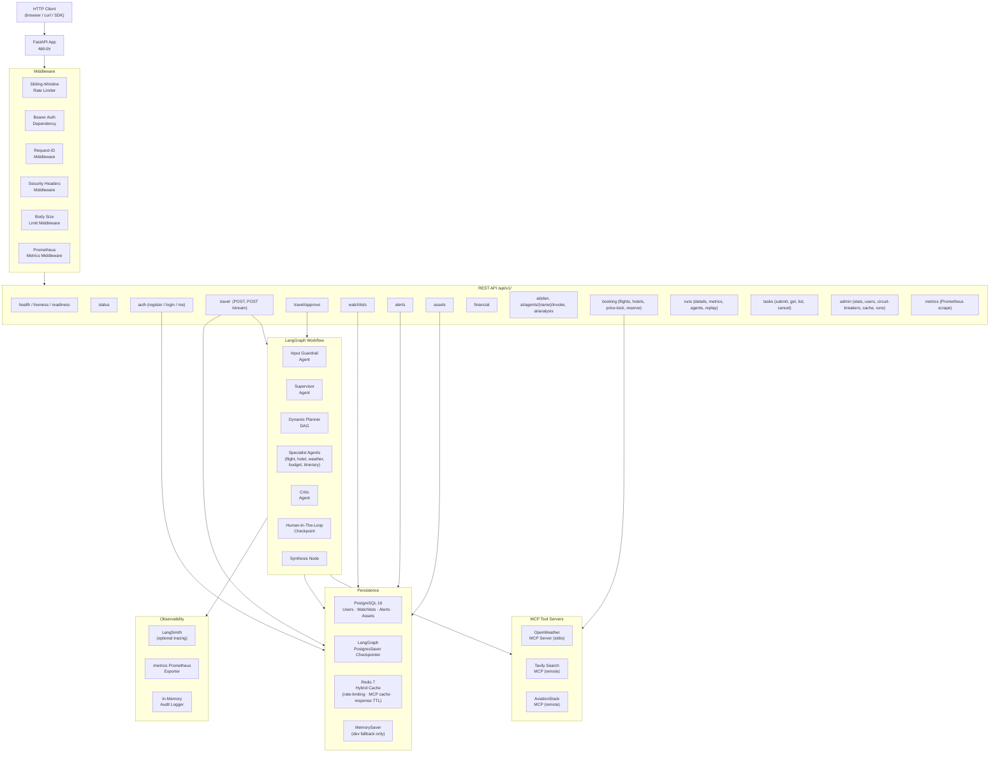
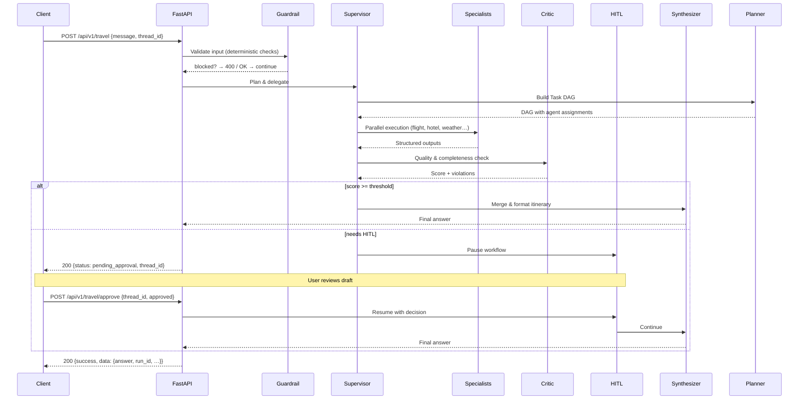
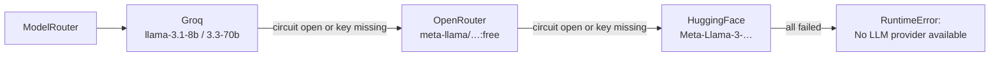
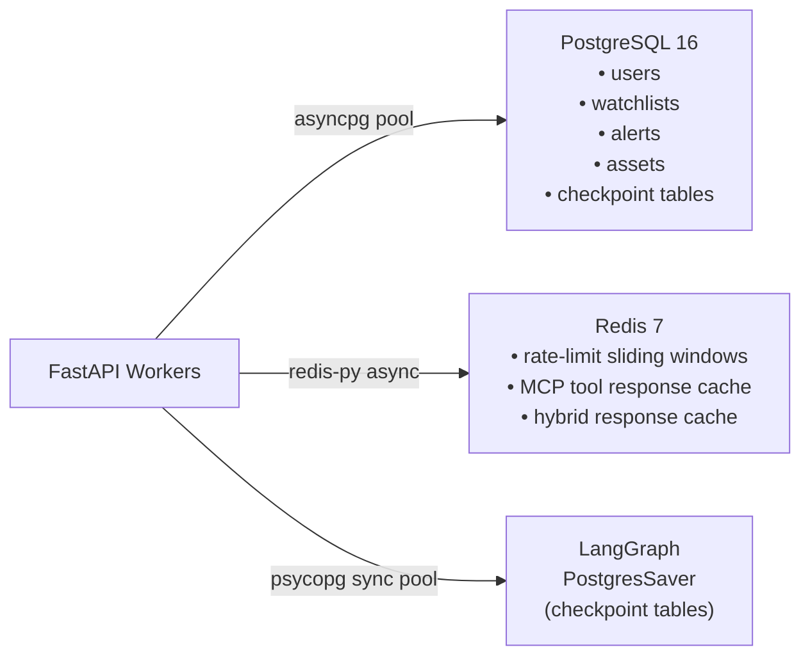

# Architecture — Multi-AI-Agent

> [!NOTE]
> This document describes the production architecture as of **v3.0.0** (commit on 2026-11-03).  
> Component paths reference the repository root.

---

## System Overview

Multi-AI-Agent is a **FastAPI** application that orchestrates a team of AI specialist agents using **LangGraph** state graphs, coordinated via **MCP** (Model Context Protocol) tool servers, persisted with **PostgreSQL**, and cached with **Redis**.

---

## Component Map

| Path | Role |
|------|------|
| [`app.py`](../app.py) | FastAPI application factory; middleware chain; lifespan hooks |
| [`tripmate/config/settings.py`](../tripmate/config/settings.py) | Pydantic Settings — single source of truth for all env vars |
| [`tripmate/api/v1/routes/`](../tripmate/api/v1/routes/) | All REST routers (16 files, 13 domains) |
| [`tripmate/agents/`](../tripmate/agents/) | Guardrail, Supervisor, Planner, Critic, Specialist agents |
| [`tripmate/graph/workflow.py`](../tripmate/graph/workflow.py) | LangGraph StateGraph assembly & routing |
| [`tripmate/services/travel_service.py`](../tripmate/services/travel_service.py) | Orchestrates workflow execution, streaming, HITL, run storage |
| [`tripmate/services/model_router.py`](../tripmate/services/model_router.py) | Multi-tier LLM provider selection (Groq → OpenRouter → HuggingFace) |
| [`tripmate/cache/redis_cache.py`](../tripmate/cache/redis_cache.py) | Hybrid Redis + bounded in-memory TTL cache |
| [`tripmate/database/`](../tripmate/database/) | PostgreSQL pool, store, Alembic migrations, checkpointer |
| [`tripmate/integrations/`](../tripmate/integrations/) | Circuit breakers, MCP wrappers, GDS client |
| [`tripmate/middleware/`](../tripmate/middleware/) | Rate limiter, security headers, correlation ID, body limit, Prometheus |
| [`mcp_client.py`](../mcp_client.py) | MultiServerMCPClient session manager |
| [`custom_weather_mcp_server.py`](../custom_weather_mcp_server.py) | FastMCP OpenWeather stdio server |

---

## Core Design & Architecture Principles

The codebase emphasizes lean, maintainable, production-ready engineering:

- **State Machine**: LangGraph `StateGraph` in [`tripmate/graph/workflow.py`](../tripmate/graph/workflow.py) coordinates multi-agent routing.
- **Provider Strategy**: Dynamic LLM routing with fallback in [`tripmate/strategies/llm_strategies.py`](../tripmate/strategies/).
- **Resilience**: Circuit breakers in [`tripmate/integrations/circuit_breaker.py`](../tripmate/integrations/).
- **Data Adapters**: Output normalization in [`tripmate/adapters/`](../tripmate/adapters/).
- **Singleton Resources**: Process-safe singletons via [`tripmate/core/singleton.py`](../tripmate/core/singleton.py).

---

## Data Flow — Travel Request

---

## LLM Provider Failover

---

## Persistence Topology

---

## Agents

| Agent | Role |
|-------|------|
| **GuardrailAgent** | Deterministic input validation; blocks prompt injection, PII, off-topic |
| **SupervisorAgent** | Routes to planner; aggregates specialist results; decides HITL |
| **ParallelSupervisorAgent** | Runs specialist nodes concurrently via `asyncio.gather` |
| **DynamicPlannerAgent** | Emits a Task DAG with per-task agent assignments |
| **CriticAgent** | Scores itinerary quality; returns violations and recommendations |
| **FlightAgent** | Queries AviationStack via MCP; formats flight options |
| **HotelAgent** | Queries GDS client for hotel availability |
| **WeatherAgent** | Queries OpenWeather via FastMCP stdio server |
| **BudgetAgent** | Runs deterministic financial calculations |
| **ItineraryAgent** | Synthesizes day-by-day itinerary from specialist outputs |

