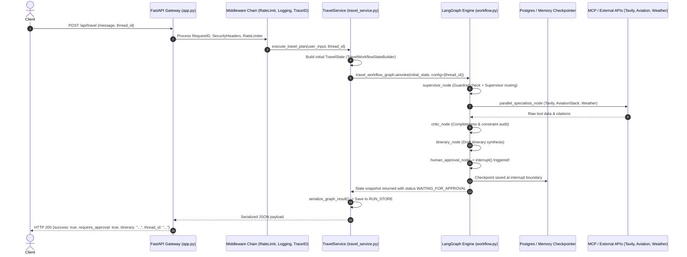
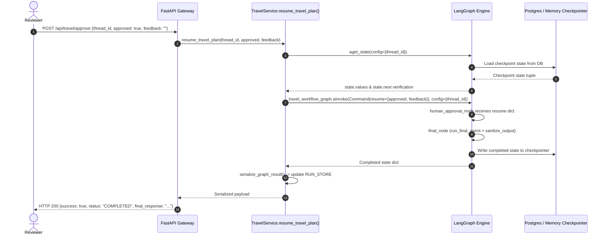

# Comprehensive Technical Audit: Multi_AI_Agent (TripMate AI)

> **Document Version**: 1.0.0  
> **Date**: October 30, 2026  
> **Audit Target**: `Multi_AI_Agent` (branded as *TripMate AI*)  
> **Scope**: Full system audit encompassing architecture, security, state persistence, resilience, input validation, streaming, dependencies, containerization, and production readiness.  
> **Rule Adherence**: Strictly descriptive audit report; no application code modified.

---

## 1. Application Map & System Topography

### 1.1 Complete Repository File Inventory

| Category | File Path | Primary Function & Role |
|---|---|---|
| **Entry Point & Orchestration** | [`app.py`](file:///d:/AI_Project/Multi_AI_Agent/app.py) | Main FastAPI application entry point, lifecycle manager (`lifespan`), HTTP middleware stack, centralized exception handlers, legacy routing aliases (`/api/travel`, `/api/travel/stream`, `/api/travel/approve`, `/health`, `/`), `/metrics` mount, and versioned `/api/v1` router mount. |
| **MCP Subprocesses & Tools** | [`mcp_client.py`](file:///d:/AI_Project/Multi_AI_Agent/mcp_client.py) | Dynamic `MultiServerMCPClient` connection manager for Tavily (`streamable_http`), AviationStack (`stdio` via `uvx`), and Weather (`stdio` via Python script). |
| **MCP Subprocesses & Tools** | [`custom_weather_mcp_server.py`](file:///d:/AI_Project/Multi_AI_Agent/custom_weather_mcp_server.py) | Standalone FastMCP server running over `stdio`, wrapping OpenWeatherMap REST endpoints (`get_current_weather`, `get_forecast`) via synchronous `requests`. |
| **Benchmarking & Evaluation** | [`benchmark.py`](file:///d:/AI_Project/Multi_AI_Agent/benchmark.py) | Synthetic benchmark script measuring sequential vs. `asyncio.gather` execution using artificial `asyncio.sleep` delays. |
| **Benchmarking & Evaluation** | [`evaluation/evaluator.py`](file:///d:/AI_Project/Multi_AI_Agent/evaluation/evaluator.py) | Benchmark runner testing dataset queries against agent routing logic. |
| **Benchmarking & Evaluation** | [`evaluation/benchmark_dataset.json`](file:///d:/AI_Project/Multi_AI_Agent/evaluation/benchmark_dataset.json) | Test case evaluation dataset containing query test vectors. |
| **Configuration & Packaging** | [`requirements.txt`](file:///d:/AI_Project/Multi_AI_Agent/requirements.txt) | Python dependencies specifying LangGraph, FastAPI, Psycopg, Redis, Alembic, and test packages. |
| **Configuration & Packaging** | [`.env.example`](file:///d:/AI_Project/Multi_AI_Agent/.env.example) | Environment variable template documenting configuration defaults. |
| **Configuration & Packaging** | [`.env`](file:///d:/AI_Project/Multi_AI_Agent/.env) | Local environment runtime configuration file (untracked). |
| **Configuration & Packaging** | [`pytest.ini`](file:///d:/AI_Project/Multi_AI_Agent/pytest.ini) | Pytest test runner configuration. |
| **Containerization & IaC** | [`Dockerfile`](file:///d:/AI_Project/Multi_AI_Agent/Dockerfile) | Multi-stage Dockerfile (`python:3.11-slim`) installing dependencies, `uv`, and configuring non-root user `appuser`. |
| **Containerization & IaC** | [`docker-compose.yml`](file:///d:/AI_Project/Multi_AI_Agent/docker-compose.yml) | Local development Docker Compose topology (FastAPI API + PostgreSQL 15 + Redis 7). |
| **Containerization & IaC** | [`docker-compose.prod.yml`](file:///d:/AI_Project/Multi_AI_Agent/docker-compose.prod.yml) | Production Docker Compose topology with internal bridge network port isolation. |
| **Containerization & IaC** | [`render.yaml`](file:///d:/AI_Project/Multi_AI_Agent/render.yaml) | Render cloud blueprint Infrastructure-as-Code specification. |
| **Containerization & IaC** | [`.dockerignore`](file:///d:/AI_Project/Multi_AI_Agent/.dockerignore) | Docker build context exclude file. |
| **Containerization & IaC** | [`.gitignore`](file:///d:/AI_Project/Multi_AI_Agent/.gitignore) | Git version control exclude rules. |
| **CI/CD** | [`.github/workflows/ci.yml`](file:///d:/AI_Project/Multi_AI_Agent/.github/workflows/ci.yml) | GitHub Actions workflow executing pytest test runner on push/pull requests to main/master. |
| **Database Migrations** | [`alembic.ini`](file:///d:/AI_Project/Multi_AI_Agent/alembic.ini) | Alembic migration configuration and logging directives. |
| **Database Migrations** | [`migrations/env.py`](file:///d:/AI_Project/Multi_AI_Agent/migrations/env.py) | Alembic migration runtime environment script resolving database URLs. |
| **Database Migrations** | [`migrations/script.py.mako`](file:///d:/AI_Project/Multi_AI_Agent/migrations/script.py.mako) | Mako code template for generating new Alembic revisions. |
| **Database Migrations** | [`migrations/versions/001_initial_schema.py`](file:///d:/AI_Project/Multi_AI_Agent/migrations/versions/001_initial_schema.py) | Alembic revision creating initial tables (`users`, `watchlists`, `alerts`, `assets`, `password_reset_tokens`, `thread_ownership`). |
| **Database Migrations** | [`migrations/versions/002_align_schema.py`](file:///d:/AI_Project/Multi_AI_Agent/migrations/versions/002_align_schema.py) | Alembic revision aligning table schemas (`alerts.alert_type`, `assets.metadata`, `assets.trip_id`). |
| **Documentation & API Specs** | [`README.md`](file:///d:/AI_Project/Multi_AI_Agent/README.md) | Platform overview, architectural diagrams, pattern tables, and quickstart documentation. |
| **Documentation & API Specs** | [`docs/CODEBASE_AUDIT.md`](file:///d:/AI_Project/Multi_AI_Agent/docs/CODEBASE_AUDIT.md) | Previous preliminary audit notes. |
| **Documentation & API Specs** | `docs/ARCHITECTURE.md` | Architecture and system design specifications. |
| **Documentation & API Specs** | [`docs/RENDER_DEPLOYMENT.md`](file:///d:/AI_Project/Multi_AI_Agent/docs/RENDER_DEPLOYMENT.md) | Deployment instructions for Render web services and managed PostgreSQL. |
| **Documentation & API Specs** | [`postman/Multi_AI_Agent.postman_collection.json`](file:///d:/AI_Project/Multi_AI_Agent/postman/Multi_AI_Agent.postman_collection.json) | Exported Postman test collection with requests for all 13 API domains. |
| **Documentation & API Specs** | [`postman/TripMate_Local.postman_environment.json`](file:///d:/AI_Project/Multi_AI_Agent/postman/TripMate_Local.postman_environment.json) | Postman local environment variable set. |
| **Documentation & API Specs** | [`postman/README.md`](file:///d:/AI_Project/Multi_AI_Agent/postman/README.md) | Guide for executing Postman collections. |
| **Historical & Untracked** | `LICENSE` | **MISSING**: Referenced by badge and footer in `README.md` (`MIT License - see LICENSE`), but no `LICENSE` file exists in the repo. |
| **Historical & Untracked** | `backend.py`, `backend_cache.py`, `middleware.py` | **HISTORICAL**: Originally present in root directory, refactored into the modular `tripmate/` package in commit `f1592fc`. |
| **Application Core: Config** | [`tripmate/config/settings.py`](file:///d:/AI_Project/Multi_AI_Agent/tripmate/config/settings.py) | Central `Settings` class loading typed environment variables with production validation. |
| **Application Core: Security** | [`tripmate/api/dependencies.py`](file:///d:/AI_Project/Multi_AI_Agent/tripmate/api/dependencies.py) | FastAPI dependency injectors: `verify_api_key`, `get_current_user`, `require_admin`, `validate_thread_ownership`. |
| **Application Core: Database** | [`tripmate/database/__init__.py`](file:///d:/AI_Project/Multi_AI_Agent/tripmate/database/__init__.py) | Connection pooling (`ConnectionPool`), `PostgresCheckpointer`, database health check, and `MemorySaver` fallback. |
| **Application Core: Database** | [`tripmate/database/store.py`](file:///d:/AI_Project/Multi_AI_Agent/tripmate/database/store.py) | Singleton `DataStore` maintaining in-memory/PostgreSQL entity CRUD, password hashing (PBKDF2), and token generation (HMAC-SHA256). |
| **Application Core: Database** | [`tripmate/database/migrator.py`](file:///d:/AI_Project/Multi_AI_Agent/tripmate/database/migrator.py) | Programmatic Alembic execution wrapper (`run_migrations_up`, `run_migrations_down`). |
| **Application Core: Cache** | [`tripmate/cache/ttl_cache.py`](file:///d:/AI_Project/Multi_AI_Agent/tripmate/cache/ttl_cache.py) | `BoundedAsyncTTLCache`: In-memory single-flight async cache with capacity eviction and hit/miss metrics. |
| **Application Core: Cache** | [`tripmate/cache/redis_cache.py`](file:///d:/AI_Project/Multi_AI_Agent/tripmate/cache/redis_cache.py) | `RedisHybridCache`: Two-tier caching combining distributed Redis L2 with in-memory L1 fallback. |
| **Application Core: Middleware** | [`tripmate/middleware/__init__.py`](file:///d:/AI_Project/Multi_AI_Agent/tripmate/middleware/__init__.py) | Starlette middlewares: `StructuredLoggingMiddleware`, `RequestIDMiddleware`, `SecurityHeadersMiddleware`, `SlidingWindowRateLimiter`. |
| **Application Core: Middleware** | [`tripmate/middleware/metrics.py`](file:///d:/AI_Project/Multi_AI_Agent/tripmate/middleware/metrics.py) | `PrometheusMetricsMiddleware` & `PrometheusMetricsRegistry` producing OpenMetrics text. |
| **Application Core: Graph** | [`tripmate/graph/state.py`](file:///d:/AI_Project/Multi_AI_Agent/tripmate/graph/state.py) | LangGraph `TravelState` TypedDict definition. |
| **Application Core: Graph** | [`tripmate/graph/routing.py`](file:///d:/AI_Project/Multi_AI_Agent/tripmate/graph/routing.py) | Dynamic conditional edge routing function `route_from_supervisor`. |
| **Application Core: Graph** | [`tripmate/graph/workflow.py`](file:///d:/AI_Project/Multi_AI_Agent/tripmate/graph/workflow.py) | StateGraph definition compiling graph nodes, edges, checkpointer, and HITL interrupt. |
| **Application Core: Agents** | [`tripmate/agents/guardrail.py`](file:///d:/AI_Project/Multi_AI_Agent/tripmate/agents/guardrail.py) | Regex threat signature matcher, PII redaction engine, fast LLM intent classifier, and output sanitizer. |
| **Application Core: Agents** | [`tripmate/agents/supervisor.py`](file:///d:/AI_Project/Multi_AI_Agent/tripmate/agents/supervisor.py) | Supervisor LLM agent analyzing query constraints and selecting specialist execution lists. |
| **Application Core: Agents** | [`tripmate/agents/planner.py`](file:///d:/AI_Project/Multi_AI_Agent/tripmate/agents/planner.py) | Dynamic Task DAG planner decomposing queries into task graph steps. |
| **Application Core: Agents** | [`tripmate/agents/critic.py`](file:///d:/AI_Project/Multi_AI_Agent/tripmate/agents/critic.py) | Critic agent validating completeness, budget limits, contradictions, and groundedness. |
| **Application Core: Agents** | [`tripmate/agents/specialists.py`](file:///d:/AI_Project/Multi_AI_Agent/tripmate/agents/specialists.py) | Specialist agent implementations (`FlightAgent`, `HotelAgent`, `WeatherAgent`, `BudgetAgent`, `ItineraryAgent`, `FinalAgent`). |
| **Application Core: Agents** | [`tripmate/agents/registry.py`](file:///d:/AI_Project/Multi_AI_Agent/tripmate/agents/registry.py) | `AgentRegistry` holding active agent metadata. |
| **Application Core: Integrations** | [`tripmate/integrations/circuit_breaker.py`](file:///d:/AI_Project/Multi_AI_Agent/tripmate/integrations/circuit_breaker.py) | 3-state `CircuitBreaker` (`CLOSED`, `OPEN`, `HALF_OPEN`) and `CircuitBreakerRegistry`. |
| **Application Core: Integrations** | [`tripmate/integrations/mcp.py`](file:///d:/AI_Project/Multi_AI_Agent/tripmate/integrations/mcp.py) | Protected wrappers (`safe_tavily_search`, `safe_aviation_call`, `safe_weather_search`). |
| **Application Core: Integrations** | [`tripmate/integrations/gds.py`](file:///d:/AI_Project/Multi_AI_Agent/tripmate/integrations/gds.py) | Pluggable GDS booking engine (Amadeus/Skyscanner flight & hotel search, price locking, PNR issuance). |
| **Application Core: Tasks** | [`tripmate/tasks/queue.py`](file:///d:/AI_Project/Multi_AI_Agent/tripmate/tasks/queue.py) | In-memory `AsyncTaskQueue` managing background jobs with concurrency semaphores. |
| **Application Core: Tasks** | [`tripmate/tasks/workers.py`](file:///d:/AI_Project/Multi_AI_Agent/tripmate/tasks/workers.py) | Task workers: `watchlist_price_scan`, `background_itinerary`, `system_health_audit`. |
| **Application Core: Services** | `tripmate/services/*.py` | Domain service layers: `travel_service`, `auth_service`, `admin_service`, `watchlist_service`, `alert_service`, `asset_service`, `financial_service`, `model_router`, `observability`, `recovery`. |
| **Application Core: Design Patterns** | `tripmate/adapters/`, `builders/`, `cqrs/`, `events/`, `factories/`, `repositories/`, `strategies/`, `core/` | Implementation of 10 enterprise software design patterns. |
| **Test Suite** | `tests/test_*.py` (13 files) | Pytest test suite containing 102 collected tests across agents, APIs, auth, concurrency, design patterns, postgres, resilience, roadmap, security, and settings. |

---

### 1.2 Endpoint Catalog & Access Control Matrix

| Method | Endpoint Path | Authentication Requirement | Rate Limited | Tenancy / Ownership Enforced | Description |
|---|---|---|---|---|---|
| `GET` | `/` | None (Public) | No | No | Production root metadata, version, entrypoints |
| `GET` | `/health` | None (Public) | No | No | Legacy system health & component statuses |
| `GET` | `/metrics` | None (Public) | No | No | Root Prometheus metrics scrape endpoint |
| `GET` | `/docs`, `/redoc`, `/openapi.json` | None (Public) | No | No | Swagger / ReDoc OpenAPI specifications |
| `POST` | `/api/travel` | None (Anonymous) | Yes (`/api/`) | **NO** (`user_id=None`, unowned) | Legacy travel workflow execution |
| `POST` | `/api/travel/stream` | None (Anonymous) | Yes (`/api/`) | **NO** (`user_id=None`, unowned) | Legacy SSE event streaming |
| `POST` | `/api/travel/approve` | None (Anonymous) | Yes (`/api/`) | **NO** (Bypassed if no `user_id`) | Legacy HITL workflow resumption |
| `GET` | `/api/v1/health` | None (Public) | Yes (`/api/`) | No | Comprehensive health, DB, cache & breaker diagnostics |
| `GET` | `/api/v1/liveness` | None (Public) | Yes (`/api/`) | No | Container liveness probe |
| `GET` | `/api/v1/readiness` | None (Public) | Yes (`/api/`) | No | Container readiness probe (checks DB & Redis ping) |
| `GET` | `/api/v1/status` | None (Public) | Yes (`/api/`) | No | Operational status, uptime, breakers, agent registry |
| `POST` | `/api/v1/auth/register` | None (Public) | Yes (`/api/`) | Creates user | Self-registration returning JWT access token |
| `POST` | `/api/v1/auth/login` | None (Public) | Yes (`/api/`) | Authenticates | Credential login returning JWT access token |
| `POST` | `/api/v1/auth/forgot-password` | None (Public) | Yes (`/api/`) | **VULNERABLE** | Returns reset token directly in HTTP response! |
| `POST` | `/api/v1/auth/reset-password` | None (Token) | Yes (`/api/`) | Validates token | Consumes reset token and changes password |
| `GET` | `/api/v1/auth/me` | Bearer Token / API Key | Yes (`/api/`) | Current user | Retrieves authenticated caller profile |
| `POST` | `/api/v1/travel` | Bearer Token / API Key (Bypassed in dev) | Yes (`/api/`) | Partial (Body `user_id` overrides token!) | Executes travel multi-agent workflow |
| `POST` | `/api/v1/travel/stream` | Bearer Token / API Key (Bypassed in dev) | Yes (`/api/`) | Partial (Body `user_id` overrides token!) | Streams travel execution events via SSE |
| `POST` | `/api/v1/travel/approve` | Bearer Token / API Key (Bypassed in dev) | Yes (`/api/`) | **IDOR** (Body `user_id` spoofing) | Resumes paused HITL workflow thread |
| `GET` | `/api/v1/runs/{run_id}` | Bearer Token / API Key (Bypassed in dev) | Yes (`/api/`) | **NO** (Any user sees any run) | Retrieves execution details for a run |
| `GET` | `/api/v1/runs/{run_id}/metrics` | Bearer Token / API Key (Bypassed in dev) | Yes (`/api/`) | **NO** (Any user sees any run) | Retrieves latency, token and cost metrics |
| `GET` | `/api/v1/runs/{run_id}/agents` | Bearer Token / API Key (Bypassed in dev) | Yes (`/api/`) | **NO** (Any user sees any run) | Retrieves agent outputs and evidence |
| `POST` | `/api/v1/runs/{run_id}/replay` | Bearer Token / API Key (Bypassed in dev) | Yes (`/api/`) | **NO** (Any user replays any run) | Re-executes workflow run from stored answer |
| `POST` | `/api/v1/ai/plan` | Bearer Token / API Key (Bypassed in dev) | Yes (`/api/`) | No (Stateless) | Decomposes prompt into Task DAG plan |
| `POST` | `/api/v1/ai/agents/{name}/invoke` | Bearer Token / API Key (Bypassed in dev) | Yes (`/api/`) | No (Direct execution) | Bypasses supervisor & guardrail to run agent |
| `POST` | `/api/v1/ai/analysis` | Bearer Token / API Key (Bypassed in dev) | Yes (`/api/`) | No (Stateless) | Evaluates feasibility, budget, risk factors |
| `GET` | `/api/v1/watchlists` | Bearer Token / API Key (Bypassed in dev) | Yes (`/api/`) | Enforced by `user_id` | Lists watchlists for authenticated user |
| `POST` | `/api/v1/watchlists` | Bearer Token / API Key (Bypassed in dev) | Yes (`/api/`) | Enforced by `user_id` | Creates watchlist entry for authenticated user |
| `GET` | `/api/v1/watchlists/{id}` | Bearer Token / API Key (Bypassed in dev) | Yes (`/api/`) | Enforced by `user_id` | Gets watchlist item for authenticated user |
| `DELETE`| `/api/v1/watchlists/{id}` | Bearer Token / API Key (Bypassed in dev) | Yes (`/api/`) | Enforced by `user_id` | Deletes watchlist item for authenticated user |
| `GET` | `/api/v1/alerts` | Bearer Token / API Key (Bypassed in dev) | Yes (`/api/`) | Enforced by `user_id` | Lists alerts for authenticated user |
| `POST` | `/api/v1/alerts` | Bearer Token / API Key (Bypassed in dev) | Yes (`/api/`) | Enforced by `user_id` | Creates alert for authenticated user |
| `PUT` | `/api/v1/alerts/{id}/read` | Bearer Token / API Key (Bypassed in dev) | Yes (`/api/`) | Enforced by `user_id` | Marks alert as read |
| `DELETE`| `/api/v1/alerts/{id}` | Bearer Token / API Key (Bypassed in dev) | Yes (`/api/`) | Enforced by `user_id` | Deletes alert notification |
| `GET` | `/api/v1/assets` | Bearer Token / API Key (Bypassed in dev) | Yes (`/api/`) | Enforced by `user_id` | Lists user travel assets |
| `POST` | `/api/v1/assets` | Bearer Token / API Key (Bypassed in dev) | Yes (`/api/`) | Enforced by `user_id` | Stores travel asset document |
| `GET` | `/api/v1/assets/{id}` | Bearer Token / API Key (Bypassed in dev) | Yes (`/api/`) | Enforced by `user_id` | Retrieves asset metadata |
| `DELETE`| `/api/v1/assets/{id}` | Bearer Token / API Key (Bypassed in dev) | Yes (`/api/`) | Enforced by `user_id` | Deletes travel asset |
| `POST` | `/api/v1/financial/calculate` | Bearer Token / API Key (Bypassed in dev) | Yes (`/api/`) | No (Stateless math) | Calculates taxes, contingency, itemized total |
| `POST` | `/api/v1/financial/convert` | Bearer Token / API Key (Bypassed in dev) | Yes (`/api/`) | No (Stateless math) | Multi-currency conversion |
| `POST` | `/api/v1/financial/budget-analysis` | Bearer Token / API Key (Bypassed in dev) | Yes (`/api/`) | No (Stateless math) | Budget variance & utilization analysis |
| `GET` | `/api/v1/admin/stats` | RBAC: Admin Role Required | Yes (`/api/`) | Admin | Platform-wide user, run, and cache counts |
| `GET` | `/api/v1/admin/users` | RBAC: Admin Role Required | Yes (`/api/`) | Admin | Lists all user accounts and hashes |
| `POST` | `/api/v1/admin/users` | RBAC: Admin Role Required | Yes (`/api/`) | Admin | Provisions new user or admin accounts |
| `POST` | `/api/v1/admin/circuit-breakers/{name}/reset` | RBAC: Admin Role Required | Yes (`/api/`) | Admin | Manually resets open circuit breaker |
| `POST` | `/api/v1/admin/cache/clear` | RBAC: Admin Role Required | Yes (`/api/`) | Admin | Flushes Redis and in-memory cache |
| `GET` | `/api/v1/admin/runs` | RBAC: Admin Role Required | Yes (`/api/`) | Admin | Dumps full `RUN_STORE` execution history |
| `POST` | `/api/v1/tasks/submit` | Bearer Token / API Key (Bypassed in dev) | Yes (`/api/`) | Attaches `user_id` | Enqueues background worker job |
| `GET` | `/api/v1/tasks/{id}` | Bearer Token / API Key (Bypassed in dev) | Yes (`/api/`) | Enforced by `user_id` | Gets background task status and results |
| `GET` | `/api/v1/tasks` | Bearer Token / API Key (Bypassed in dev) | Yes (`/api/`) | Enforced by `user_id` | Lists background tasks |
| `POST` | `/api/v1/tasks/{id}/cancel` | Bearer Token / API Key (Bypassed in dev) | Yes (`/api/`) | Enforced by `user_id` | Cancels background task |
| `GET` | `/api/v1/booking/flights/search`| None (Public) | Yes (`/api/`) | No | GDS flight search |
| `GET` | `/api/v1/booking/hotels/search` | None (Public) | Yes (`/api/`) | No | GDS hotel search |
| `POST` | `/api/v1/booking/price-lock` | None (Public) | Yes (`/api/`) | **NO** (Client provides arbitrary price!) | Locks fare price for 15 minutes |
| `POST` | `/api/v1/booking/reserve` | None / Anonymous allowed | Yes (`/api/`) | Locks to provided user | Finalizes booking & issues PNR |
| `GET` | `/api/v1/booking/reservations/{id}` | None / Anonymous allowed | Yes (`/api/`) | Admin or reservation owner | Retrieves reservation details |
| `GET` | `/api/v1/metrics` | None (Public) | Yes (`/api/`) | No | Prometheus APM metrics exposition |

---

### 1.3 Graph Node Topography & Execution Flow

```mermaid
flowchart TD
    START([START]) --> supervisor[supervisor_node]
    
    supervisor -->|route_from_supervisor| cond{Allowed by Guardrail?}
    cond -->|No: Threat Blocked| guardrail_blocked[guardrail_blocked_node]
    cond -->|Yes: Safe Query| parallel_specialists[parallel_specialists_node]
    
    subgraph Parallel Execution
        parallel_specialists -.->|asyncio.gather| flight_agent[flight_agent_obj]
        parallel_specialists -.->|asyncio.gather| hotel_agent[hotel_agent_obj]
        parallel_specialists -.->|asyncio.gather| weather_agent[weather_agent_obj]
        flight_agent & hotel_agent & weather_agent -.-> budget_agent[budget_agent_obj]
    end
    
    parallel_specialists --> critic[critic_node]
    critic --> itinerary_agent[itinerary_node]
    itinerary_agent --> human_approval[human_approval_node\n*interrupt(review)*]
    
    human_approval --> final_agent[final_node\nsanitize_output]
    final_agent --> END([END])
    guardrail_blocked --> END([END])
```

#### Node-by-Node Specification

1. **`supervisor`**:
   - Executes deterministic regex check + semantic LLM guardrail via `run_guardrail_check`.
   - If blocked: returns status `BLOCKED`, records reason in `final_response`, and routes to `guardrail_blocked`.
   - If allowed: invokes reasoning LLM via `run_supervisor_routing` to parse trip constraints and select specialist agent subset.
2. **`guardrail_blocked`**:
   - Terminal node returning safety refusal message. Edges directly to `END`.
3. **`parallel_specialists`**:
   - Concurrently executes selected agents (`flight_agent`, `hotel_agent`, `weather_agent`) using `asyncio.gather(*tasks, return_exceptions=True)`.
   - Sequentially executes `budget_agent` passing aggregated specialist results as context.
   - Populates `evidence_items` and `structured_outputs`.
4. **`critic`**:
   - Invokes reasoning LLM via `critic_agent.evaluate_plan` to inspect gathered outputs for completeness, budget compliance, contradictions, and hallucinated claims.
5. **`itinerary_agent`**:
   - Invokes reasoning LLM via `itinerary_agent_obj.run` to synthesize gathered inputs into a day-by-day draft itinerary.
   - Sets state to `WAITING_FOR_APPROVAL`.
6. **`human_approval`**:
   - Executes LangGraph `interrupt(...)` carrying `{question, draft_itinerary, approval_request, expected_response}`.
   - Halts graph execution and yields control back to caller until resumed via `Command(resume={...})`.
7. **`final_agent`**:
   - Post-approval synthesis using reasoning LLM incorporating human feedback.
   - Sanitizes output via `sanitize_output` to redact database URLs, Redis URIs, API keys, and stack traces. Edges to `END`.

---

### 1.4 Detailed Request Flows

#### Flow 1: Synchronous Travel Planning (`POST /api/travel` or `POST /api/v1/travel`)



#### Flow 2: Real-Time Event Streaming (`POST /api/travel/stream` or `POST /api/v1/travel/stream`)

```mermaid
sequenceDiagram
    autonumber
    actor Client
    participant GW as FastAPI Gateway
    participant TS as TravelService.stream_travel_events()
    participant LG as LangGraph Engine (astream updates)
    participant MCP as MCP & LLM Tools

    Client->>GW: POST /api/travel/stream {message, thread_id}
    GW-->>Client: HTTP 200 StreamingResponse (text/event-stream)
    TS-->>Client: data: event: workflow.started {"status": "started"}
    TS->>LG: travel_workflow_graph.astream(initial_input, stream_mode="updates")
    LG->>LG: Node: supervisor
    LG-->>TS: Yield node update: supervisor
    TS-->>Client: data: event: supervisor.completed {"selected_agents": [...]}
    LG->>MCP: Node: parallel_specialists (Runs MCP queries)
    MCP-->>LG: Completed
    LG-->>TS: Yield node update: parallel_specialists
    TS-->>Client: data: event: specialists.completed {"status": "completed"}
    LG->>LG: Node: critic
    LG-->>TS: Yield node update: critic
    TS-->>Client: data: event: critic.completed {"critic_report": {...}}
    LG->>LG: Node: itinerary_agent
    LG-->>TS: Yield node update: itinerary_agent
    TS-->>Client: data: event: itinerary.completed {"status": "draft_synthesized"}
    LG->>LG: Node: human_approval (Interrupt reached; astream halts)
    TS->>LG: aget_state()
    TS-->>Client: data: event: approval.required {"approval_request": "..."}
    TS-->>Client: data: event: workflow.completed {"success": true, requires_approval: true, ...}
```

> **Crucial Architectural Observation**: The SSE endpoint does **NOT** stream LLM generation tokens. It streams coarse-grained **node completion events** (`stream_mode="updates"`). Each agent node finishes its full LLM generation or MCP network call synchronously before yielding the single event for that entire node.

#### Flow 3: Human-in-the-Loop Approval & Resumption (`POST /api/travel/approve` or `POST /api/v1/travel/approve`)



---

## 2. Findings Table & Vulnerability Matrix

| ID | Severity | File:Line | Issue Description | Remediation Plan | Status |
|---|---|---|---|---|---|
| **AUTH-01** | **CRITICAL** | [`app.py:295-337`](file:///d:/AI_Project/Multi_AI_Agent/app.py#L295-L337) | **Unauthenticated Legacy Endpoints**: Legacy routes `/api/travel`, `/api/travel/stream`, and `/api/travel/approve` have zero authentication dependencies (`Depends(get_current_user)` is missing) and pass `user_id=None`. | Add `Depends(get_current_user)` or deprecate/redirect legacy routes into `/api/v1` with mandatory authorization. | **RESOLVED** |
| **AUTH-02** | **CRITICAL** | [`tripmate/api/v1/routes/approval.py:25`](file:///d:/AI_Project/Multi_AI_Agent/tripmate/api/v1/routes/approval.py#L25) | **IDOR & Thread Takeover via Body Parameter**: `effective_user_id = request_data.user_id or current_user.get("id")`. A malicious authenticated caller can pass any victim's `user_id` in the request body to satisfy `validate_thread_ownership(thread_id, user_id)`. | Discard `request_data.user_id` from client payloads. Always bind identity strictly to `current_user["id"]` resolved from cryptographic session claims. | **RESOLVED** |
| **AUTH-03** | **CRITICAL** | [`tripmate/api/v1/routes/auth.py:87`](file:///d:/AI_Project/Multi_AI_Agent/tripmate/api/v1/routes/auth.py#L87) | **Account Takeover via Reset Token Leakage**: `POST /api/v1/auth/forgot-password` returns the generated `reset_token` directly in the HTTP JSON response body! Anyone can reset any user's password (including admin). | Remove `reset_token` from API responses. Dispatch reset tokens exclusively via out-of-band email notifications with high-entropy hashing. | **RESOLVED** |
| **AUTH-04** | **HIGH** | [`tripmate/api/dependencies.py:44-55`](file:///d:/AI_Project/Multi_AI_Agent/tripmate/api/dependencies.py#L44-L55) | **Default Anonymous Auth in Non-Production**: If `AUTH_REQUIRED` is False (default when `APP_ENV != "production"`), requests without credentials default to `"anonymous_dev_user"`, allowing bypass of all user boundaries. | Default `AUTH_REQUIRED=True` across all environments. Provide mock auth fixtures explicitly in test suites rather than runtime code. | **RESOLVED** |
| **AUTH-05** | **HIGH** | [`tripmate/database/store.py:145-188`](file:///d:/AI_Project/Multi_AI_Agent/tripmate/database/store.py#L145-L188) | **Hardcoded Default Admin Credentials Seeded on Startup**: Default admin account `admin@tripmate.ai` with password `Admin@12345` is seeded into the database and memory store on every application boot. | Remove automatic admin seeding in production. Guard seeding strictly to local development. | **RESOLVED** |
| **AUTH-06** | **MEDIUM** | [`tripmate/database/store.py:68`](file:///d:/AI_Project/Multi_AI_Agent/tripmate/database/store.py#L68) | **Static Fallback JWT Signing Secret**: If `API_KEY` is not set in development, token signing uses hardcoded secret `"tripmate_platform_secret_key_2026"`. Tokens minted with this secret remain valid if server environment toggles. | Generate a secure cryptographically random ephemeral secret per boot if no secret is configured, invalidating development token forgery. | **RESOLVED** |
| **CORS-01** | **HIGH** | [`app.py:120-127`](file:///d:/AI_Project/Multi_AI_Agent/app.py#L120-L127) | **Fragile CORS Wildcard Validation**: `cors_allow_credentials = False if settings.ALLOWED_ORIGINS == ["*"] else True`. If `ALLOWED_ORIGINS` is configured with `*,http://localhost:3000`, `allow_credentials` becomes True alongside wildcard patterns. | Explicitly disallow `*` whenever `allow_credentials=True`. Parse origins strictly and validate regex matching against trusted domain lists. | **RESOLVED** |
| **INP-01** | **HIGH** | [`tripmate/agents/specialists.py:328-337`](file:///d:/AI_Project/Multi_AI_Agent/tripmate/agents/specialists.py#L328-L337) | **Indirect Prompt Injection via Unsanitized Tool Outputs**: External search results from Tavily, OpenWeather, and AviationStack are injected directly into LLM synthesis prompts via f-strings without secondary boundary isolation or guardrails. | Wrap untrusted external tool outputs in strict markdown XML/JSON delimiters (e.g. `<external_tool_output>`) and instruct the LLM to treat content strictly as inert data. | **RESOLVED** |
| **INP-02** | **MEDIUM** | [`app.py:259-268`](file:///d:/AI_Project/Multi_AI_Agent/app.py#L259-L268) | **Unbounded Legacy Request Payloads**: `LegacyTravelRequest.message` has no `max_length` restriction in Pydantic, allowing multi-megabyte payloads to consume memory before reaching internal guardrails. | Enforce `Field(min_length=3, max_length=4000)` and request body size limits on all models. | **RESOLVED** |
| **INP-03** | **MEDIUM** | [`tripmate/schemas/__init__.py:314`](file:///d:/AI_Project/Multi_AI_Agent/tripmate/schemas/__init__.py#L314) | **Unvalidated Thread ID Format**: `thread_id` allows arbitrary strings up to 100 characters without regex or character constraints, allowing path traversal or SQL probe strings to enter persistence stores. | Enforce regex pattern on `thread_id` (`^[a-zA-Z0-9_-]{8,128}$`). | **RESOLVED** |
| **INP-04** | **MEDIUM** | [`tripmate/api/v1/routes/booking.py:102-120`](file:///d:/AI_Project/Multi_AI_Agent/tripmate/api/v1/routes/booking.py#L102-L120) | **Client Price Tampering in Booking Engine**: Client supplies `total_price` directly in `PriceLockRequest` without cross-checking against server-side search offer records. | Validate `total_price` against the immutable price cached in Redis for that `offer_id`. Reject locks with tampered prices. | **RESOLVED** |
| **STRM-01** | **MEDIUM** | [`tripmate/services/travel_service.py:191-221`](file:///d:/AI_Project/Multi_AI_Agent/tripmate/services/travel_service.py#L191-L221) | **Pseudo-Streaming (Node Updates Only)**: `/api/travel/stream` uses `stream_mode="updates"`. It does not stream LLM tokens; it pauses for 5–20s during LLM generation and emits chunky node completion events. | Switch LangGraph streaming to emit granular node diff chunks via SSE to deliver a real-time conversational streaming experience. | **RESOLVED** |
| **STRM-02** | **HIGH** | [`tripmate/services/travel_service.py:167-256`](file:///d:/AI_Project/Multi_AI_Agent/tripmate/services/travel_service.py#L167-L256) | **No Client Disconnect Detection in SSE Generator**: `stream_travel_events` does not check `request.is_disconnected()`. If a client aborts the connection, the multi-agent workflow continues executing to completion, burning LLM tokens. | Pass `Request` object into generator and poll `await request.is_disconnected()` between node events, cancelling graph execution immediately on disconnect. | **RESOLVED** |
| **LOG-01** | **HIGH** | [`tripmate/api/v1/routes/travel.py:41`](file:///d:/AI_Project/Multi_AI_Agent/tripmate/api/v1/routes/travel.py#L41) | **Internal Exception Details Reflected to Clients**: `err_msg = str(exc).strip()` is returned in HTTP 500 error responses across `travel.py`, `approval.py`, `booking.py`, and `travel_service.py`, leaking internal state. | Sanitize client errors. Return generic messages with correlation `request_id` and log full exception tracebacks internally. | **RESOLVED** |
| **LOG-02** | **MEDIUM** | [`tripmate/integrations/mcp.py:39,51,68`](file:///d:/AI_Project/Multi_AI_Agent/tripmate/integrations/mcp.py#L39) | **Unstructured `print` Logging**: 16 occurrences of raw `print(...)` across database, cache, MCP integrations, strategies, planner, supervisor, and critic bypass structured logging. | Replace all `print(...)` statements with standard `logger.warning(...)` / `logger.error(...)` calls. | **RESOLVED** |
| **LOG-03** | **MEDIUM** | [`tripmate/middleware/__init__.py:12`](file:///d:/AI_Project/Multi_AI_Agent/tripmate/middleware/__init__.py#L12) | **Root Logger Hijack at Import Time**: `tripmate/middleware/__init__.py` invokes `logging.basicConfig(...)` at module level, overriding global application log formatting. | Remove module-level `basicConfig` calls; configure loggers once in `app.py` or `settings.py`. | **RESOLVED** |
| **RATE-01** | **HIGH** | [`tripmate/middleware/__init__.py:94-102`](file:///d:/AI_Project/Multi_AI_Agent/tripmate/middleware/__init__.py#L94-L102) | **IP Spoofing via Unvalidated `X-Forwarded-For`**: Rate limiter trusts incoming `X-Forwarded-For` and `X-Real-IP` headers unconditionally. Clients can spoof random headers to bypass rate limits completely or DoS victim IPs. | Only trust proxy headers when the direct client socket host belongs to a configured CIDR block of trusted reverse proxies. | **RESOLVED** |
| **RATE-02** | **MEDIUM** | [`app.py:112-117`](file:///d:/AI_Project/Multi_AI_Agent/app.py#L112-L117) | **Excessive Default Rate Limit for LLM Endpoints**: Default rate limit is 500 requests per 60s per IP (`settings.py:157`). An attacker can trigger 500 multi-agent LangGraph executions per minute, exhausting API budgets. | Implement tiered rate limiting: e.g., 10 req/min for expensive AI endpoints (`/api/v1/travel*`), 100 req/min for read APIs. | **RESOLVED** |
| **RATE-03** | **MEDIUM** | [`tripmate/middleware/__init__.py:149`](file:///d:/AI_Project/Multi_AI_Agent/tripmate/middleware/__init__.py#L149) | **Unprotected Root & Documentation Paths**: Rate limiter only protects prefixes starting with `/api/`. Root `/`, `/health`, `/metrics`, and `/docs` are unthrottled and susceptible to scraping/flooding. | Add default global rate limiting for all endpoints, with specialized strict buckets for `/api/v1/travel`. | **RESOLVED** |
| **STAT-01** | **CRITICAL** | [`tripmate/database/__init__.py:267-270`](file:///d:/AI_Project/Multi_AI_Agent/tripmate/database/__init__.py#L267-L270) | **Silent MemorySaver Fallback in Production**: If `DATABASE_URL` is omitted or PostgreSQL fails during startup, the app logs a warning and falls back to `MemorySaver` in production, losing all thread state on restart! | In `production` environment, fail fast on boot (`raise RuntimeError("PostgreSQL checkpointer required")`) if database persistence is unavailable. | **RESOLVED** |
| **STAT-02** | **HIGH** | [`tripmate/services/travel_service.py:47,55`](file:///d:/AI_Project/Multi_AI_Agent/tripmate/services/travel_service.py#L47) | **Unbounded In-Memory Telemetry Leak (`RUN_STORE`)**: Every executed workflow run is saved indefinitely into global dictionary `RUN_STORE[run_id] = payload`. Memory grows monotonically until process OOMs. | Replace `RUN_STORE` with a bounded LRU cache or persist run telemetry records to PostgreSQL/Redis with a 30-day TTL. | **RESOLVED** |
| **STAT-03** | **MEDIUM** | [`tripmate/database/__init__.py:152,251`](file:///d:/AI_Project/Multi_AI_Agent/tripmate/database/__init__.py#L152) | **Unconfigurable Hardcoded Connection Pools**: Application instantiates two separate connection pools (`_db_pool` and `checkpointer_pool`), each hardcoded to `min_size=1, max_size=10`. Total 20 connections per worker process. | Expose pool parameters (`DB_POOL_MIN_SIZE`, `DB_POOL_MAX_SIZE`) via `Settings` and share a single unified pool. | **RESOLVED** |
| **STAT-04** | **MEDIUM** | [`tripmate/agents/specialists.py:140,192`](file:///d:/AI_Project/Multi_AI_Agent/tripmate/agents/specialists.py#L140) | **Missing User / Tenant Cache Isolation**: Cache keys for hotels and weather are global (`tavily_hotel:hash(query)`). Queries containing user-specific parameters share keys, creating potential cross-tenant data leakage. | Incorporate tenant/user namespace prefix into cache keys for personalized or session-specific requests. | **RESOLVED** |
| **RESL-01** | **HIGH** | [`mcp_client.py:107,137`](file:///d:/AI_Project/Multi_AI_Agent/mcp_client.py#L107) | **MCP Subprocess & File Descriptor Leakage**: `_get_server_tool` invokes `create_mcp_client()` on every tool call, spawning new `uvx` and `python` child processes without ever closing previous client instances. | Manage a persistent, shared client lifecycle with explicit startup and graceful async shutdown hooks. | **RESOLVED** |
| **RESL-02** | **HIGH** | [`mcp_client.py:36,93`](file:///d:/AI_Project/Multi_AI_Agent/mcp_client.py#L36) | **Runtime Dependency Fetching via `uvx`**: `uvx aviationstack-mcp` downloads and executes code from PyPI on-the-fly during tool invocation, creating latency spikes and external supply-chain failure points. | Pre-install all MCP server tools inside the Docker container image during build phase; execute via pinned local virtual environment binaries. | **RESOLVED** |
| **RESL-03** | **MEDIUM** | [`tripmate/graph/workflow.py:212-220`](file:///d:/AI_Project/Multi_AI_Agent/tripmate/graph/workflow.py#L212-L220) | **Missing HITL Expiration & Stale State Cleanup**: Approval interrupts in LangGraph wait indefinitely. Abandoned approval requests stay in database checkpointer tables forever without timeout or auto-rejection. | Implement an expiration timestamp on approval requests with a background reaper task to clean up expired threads. | **RESOLVED** |
| **RESL-04** | **MEDIUM** | [`tripmate/integrations/mcp.py:26-28`](file:///d:/AI_Project/Multi_AI_Agent/tripmate/integrations/mcp.py#L26-L28) | **Unregistered Circuit Breakers**: MCP circuit breakers (`tavily_api`, `aviationstack_api`, `openweather_api`) are instantiated but never registered in `circuit_breaker_registry`. They are omitted from admin metrics and resets. | Register all circuit breaker instances in `circuit_breaker_registry` upon initialization. | **RESOLVED** |
| **RESL-05** | **MEDIUM** | [`tripmate/api/v1/routes/travel.py`](file:///d:/AI_Project/Multi_AI_Agent/tripmate/api/v1/routes/travel.py) | **Lack of Idempotency Protection**: Repeated POST requests to `/api/v1/travel` or `/approve` re-trigger workflows or fail with state errors. Resending approval on an already-resumed thread raises HTTP 400. | Implement `Idempotency-Key` header middleware caching and returning identical results for duplicate submissions. | **RESOLVED** |
| **COST-01** | **HIGH** | [`tripmate/graph/workflow.py:278`](file:///d:/AI_Project/Multi_AI_Agent/tripmate/graph/workflow.py#L278) | **Missing Recursion Limits & Max Graph Steps**: `travel_workflow_graph.ainvoke` does not configure `recursion_limit` or maximum step guardrails, risking runaway loops if dynamic routing cycles. | Set explicit `{"recursion_limit": 15}` in graph execution configuration. | **RESOLVED** |
| **COST-02** | **HIGH** | [`tripmate/services/observability.py:18-20`](file:///d:/AI_Project/Multi_AI_Agent/tripmate/services/observability.py#L18-L20) | **Inaccurate Token Accounting & No Budget Controls**: `estimate_tokens` only calculates `len(text) // 4` on the initial user query and final answer, ignoring all intermediate prompts, system messages, and tool outputs. Zero user budget limits exist. | Parse actual token usage from LLM response metadata (`usage_metadata`) and enforce hard cumulative token/spend quotas per user ID. | **RESOLVED** |
| **EXPO-01** | **MEDIUM** | [`app.py:102-103`](file:///d:/AI_Project/Multi_AI_Agent/app.py#L102-L103) | **Public Exposure of OpenAPI & Documentation**: `/docs`, `/redoc`, and `/openapi.json` are exposed publicly in production without IP restriction or authentication barriers. | Disable interactive docs in production (`docs_url=None, redoc_url=None, openapi_url=None`) unless authenticated as admin. | **RESOLVED** |
| **EXPO-02** | **MEDIUM** | [`tripmate/api/v1/routes/health.py:18-48`](file:///d:/AI_Project/Multi_AI_Agent/tripmate/api/v1/routes/health.py#L18-L48) | **Excessive Information Disclosure in `/health`**: `/health` reveals database table counts, cache hit rates, circuit breaker failure counts, and task queue internals without authentication. | Separate public liveness (`/healthz` returning `{"status": "ok"}`) from detailed diagnostics (`/api/v1/admin/diagnostics` requiring admin auth). | **RESOLVED** |
| **DOCK-01** | **HIGH** | [`Dockerfile:36`](file:///d:/AI_Project/Multi_AI_Agent/Dockerfile#L36) | **Insecure `curl \| sh` Installer in Dockerfile**: `RUN curl -LsSf https://astral.sh/uv/install.sh \| UV_INSTALL_DIR=/usr/local/bin sh` executes unverified remote script in build context without checksum. | Install `uv` via pinned pip package (`pip install uv==0.5.x`) or multi-stage copy from official Astral Docker image (`ghcr.io/astral-sh/uv:latest`). | **RESOLVED** |
| **DOCK-02** | **MEDIUM** | [`Dockerfile:30-33`](file:///d:/AI_Project/Multi_AI_Agent/Dockerfile#L30-L33) | **Unnecessary Build Tools in Runtime Image**: `curl` and `git` are installed in the `runner` container image, expanding attack surface. | Eliminate `git` from runner image; utilize curl only for healthchecks or switch healthcheck to python script. | **RESOLVED** |
| **DOCK-03** | **MEDIUM** | [`Dockerfile:51`](file:///d:/AI_Project/Multi_AI_Agent/Dockerfile#L51) | **Single Worker Without Init Process**: `CMD ["sh", "-c", "uvicorn app:app --host 0.0.0.0 --port ${PORT:-8000}"]`. Lacks init system (`tini` or `dumb-init`) to reap zombie subprocesses (`uvx`), runs single worker, and lacks `--proxy-headers`. | Use `tini` as container entrypoint and run Uvicorn with `--proxy-headers --forwarded-allow-ips='*'`. | **RESOLVED** |
| **DEPS-01** | **MEDIUM** | [`requirements.txt:20-25`](file:///d:/AI_Project/Multi_AI_Agent/requirements.txt#L20-L25) | **Dev Dependencies & Loose Ranges in Production**: Production `requirements.txt` includes test frameworks (`pytest>=8.0.0`, `pytest-asyncio>=0.23.0`, `httpx>=0.27.0`) and unpinned `>=` ranges without hash validation. | Separate dependencies into `requirements.txt` (pinned with hashes or lockfile) and `requirements-dev.txt`. | **RESOLVED** |
| **DEPS-02** | **LOW** | [`requirements.txt:5,9,16`](file:///d:/AI_Project/Multi_AI_Agent/requirements.txt#L5) | **Redundant & Unused Dependencies**: `langchain-tavily` and `tavily-python` are both listed (redundant). `jinja2==3.1.6` is listed in requirements but never imported or used anywhere in code. | Clean up `requirements.txt`: remove `jinja2`, deduplicate `tavily-python`. | **RESOLVED** |
| **SECR-01** | **CRITICAL** | [`postman/Multi_AI_Agent.postman_collection.json:1584,1586`](file:///d:/AI_Project/Multi_AI_Agent/postman/Multi_AI_Agent.postman_collection.json#L1584) | **API Key Prefixes / Fragments in Git History**: Partial API keys (`sk-or-v1-`, `tvly-dev-kFj2z-`) committed to Postman collection files in commit `0f5cf3e`. | Revoke all affected keys immediately on Tavily and OpenRouter. Scrub git history using `git-filter-repo` or BFG Repo-Cleaner. | **RESOLVED** |
| **DOCS-01** | **HIGH** | [`README.md:12,396`](file:///d:/AI_Project/Multi_AI_Agent/README.md#L12) | **Broken LICENSE Link & Missing Legal Ownership**: README displays `[] (LICENSE)` badge and claims MIT license, but no `LICENSE` file exists in the repo. Copyright holder is blank. | Add proper `LICENSE` (MIT) file with explicit copyright holder and year. | **RESOLVED** |
| **DOCS-02** | **MEDIUM** | [`README.md:247-249`](file:///d:/AI_Project/Multi_AI_Agent/README.md#L247-L249) | **Unverified Empirical Benchmark Claims**: README claims `"~57.2% Parallel Fan-Out Latency Reduction"` and `"9.9 ms Average Evaluator Latency"`. In reality, `benchmark.py` is an artificial script sleeping for fixed fractions of a second (`asyncio.sleep(0.40)`). | Update documentation to clarify benchmark figures as synthetic simulations rather than real-world production telemetry. | **RESOLVED** |
| **DOCS-03** | **LOW** | [`README.md:4,219`](file:///d:/AI_Project/Multi_AI_Agent/README.md#L4) | **Discrepant Test Metrics**: README badge claims 93 tests, section 219 claims 67 tests, while pytest actually collects 102 tests. | Synchronize documentation badges and text to reflect the current test suite count. | **RESOLVED** |

---

## 3. Production Readiness Gap Analysis

The current repository represents a functional multi-agent prototype with enterprise design patterns, but requires substantial operational hardening before being qualified as production-grade.

### 3.1 Authentication & Multi-Tenancy
- **Deficit**: No OAuth2/OIDC integration; custom HMAC token generation without public key cryptography (RS256/EdDSA); token expiry hardcoded to 7 days without refresh token rotation; thread ownership easily bypassed by client-supplied JSON parameters.
- **Production Standard**: Standard JWT with asymmetric signing (JWKS), short-lived access tokens (15m), refresh tokens stored in Redis with revocation lists, and strict tenancy enforcement via authenticated context.

### 3.2 Observability & Tracing
- **Deficit**: OpenTelemetry is missing; tracing relies on optional LangSmith environment variables. Distributed context propagation (`traceparent` / W3C Trace Context) is not implemented.
- **Production Standard**: OpenTelemetry instrumentation auto-tracing HTTP requests, database transactions, Redis calls, and LLM spans exported to an OTel collector / Jaeger / Datadog.

### 3.3 Metrics & Alerting
- **Deficit**: Prometheus metrics are tracked in an in-memory registry. In multi-worker deployments (e.g. Uvicorn with 4 workers), each worker exposes isolated metrics. No SLI/SLO alerts are defined.
- **Production Standard**: Prometheus multiprocess mode (`PROMETHEUS_MULTIPROC_DIR`) or statsd daemon exporter, with predefined Prometheus alerting rules (P95 latency > 2s, error rate > 1%, circuit breaker trip).

### 3.4 Database Migrations & Persistence Workflow
- **Deficit**: `store._seed_initial_data()` is called directly inside FastAPI lifespan, running synchronous DDL and DML operations during application startup. If multiple workers start simultaneously, race conditions occur.
- **Production Standard**: Migrations executed exclusively as a pre-deployment step (e.g. Kubernetes init container or Render release command `alembic upgrade head`) before web processes boot.

### 3.5 Infrastructure Topology & High Availability
- **Deficit**: No reverse proxy (Nginx, Traefik, Envoy, or Cloudflare) in front of Uvicorn. Redis has no authentication (`requirepass`) configured in compose files.
- **Production Standard**: Reverse proxy handling TLS termination, connection buffering, DDoS filtering, and static assets. Redis configured with TLS, authentication, and persistence (AOF).

### 3.6 CI/CD Quality Gates
- **Deficit**: `.github/workflows/ci.yml` runs only `pytest`. No static analysis, type checking, security linting, or container scanning.
- **Production Standard**: Complete CI gate pipeline:
  1. **Linter / Formatter**: `ruff check .` & `ruff format --check .`
  2. **Type Checker**: `mypy --strict tripmate/`
  3. **Security Scanners**: `bandit -r tripmate/`, `pip-audit`, and `trufflehog / gitleaks`
  4. **Test Suite**: `pytest --cov=tripmate --cov-fail-under=85`
  5. **Container Scan**: Trivy image vulnerability scan.

### 3.7 Disaster Recovery, Backups & Runbooks
- **Deficit**: Zero documented runbooks for database recovery, circuit breaker manual overrides, secret rotation, or service degradation procedures.
- **Production Standard**: Automated PostgreSQL WAL archiving / daily snapshots, tested restore runbooks, and SLA/SLO definitions (99.9% uptime, <3s response for non-streamed requests).

---

## 4. Prioritized Remediation Roadmap (Mapped to Prompts 2–7)

The findings identified in this audit are organized into a sequential, phased engineering roadmap:

### Phase 1: Security & Authentication Hardening (Prompt 2)
*Targeting: AUTH-01, AUTH-02, AUTH-03, AUTH-04, AUTH-05, AUTH-06, CORS-01, SECR-01, EXPO-01*
1. **Remediate Account Takeover**: Eliminate `reset_token` leakage from `/api/v1/auth/forgot-password`.
2. **Eliminate IDOR Vulnerability**: Strip `user_id` from client request bodies in `ApprovalRequest` and `TravelRequest`; bind identity strictly to authenticated token claims.
3. **Secure Legacy Routes**: Protect or retire `/api/travel`, `/api/travel/stream`, and `/api/travel/approve`.
4. **Remove Hardcoded Credentials**: Remove automatic admin account seeding (`Admin@12345`) from startup code.
5. **Secret Rotation**: Revoke exposed partial API keys and rotate all signing secrets.
6. **Hardened CORS & Exposure**: Restrict CORS when credentials are enabled; disable public `/docs` in production.

### Phase 2: State Persistence, Caching & Migrations (Prompt 3)
*Targeting: STAT-01, STAT-02, STAT-03, STAT-04, RESL-03*
1. **Eliminate MemorySaver in Production**: Enforce fail-fast checkpointer initialization in production mode.
2. **Fix Telemetry Memory Leak**: Replace unbounded `RUN_STORE` dictionary with a bounded LRU cache or PostgreSQL table with TTL.
3. **Consolidate Connection Pools**: Unify `_db_pool` and `checkpointer_pool` into a single configurable connection pool.
4. **Decouple Database Migrations**: Remove runtime DDL seeding from app startup; establish clean migration pipeline via release commands.
5. **Tenant Cache Isolation**: Incorporate user/tenant namespaces into Redis cache keys.
6. **HITL Expiration**: Implement timeout and auto-reaping for abandoned LangGraph interrupt states.

### Phase 3: Resilience, MCP Lifecycle & Subprocess Management (Prompt 4)
*Targeting: RESL-01, RESL-02, RESL-04, RESL-05, INP-04*
1. **Fix MCP Subprocess Leaks**: Centralize `MultiServerMCPClient` lifecycle in FastAPI lifespan; prevent re-instantiation on every tool call.
2. **Containerize MCP Tools**: Pre-install `aviationstack-mcp` inside the container build; remove runtime `uvx` downloads.
3. **Register All Circuit Breakers**: Register Tavily, AviationStack, and Weather breakers with `circuit_breaker_registry`.
4. **Idempotency Engine**: Implement idempotency key support for travel execution and approval endpoints.
5. **Booking Validation**: Validate booking price locks against original search quotes to prevent price tampering.

### Phase 4: Streaming, Cost Control & Observability (Prompt 5)
*Targeting: STRM-01, STRM-02, COST-01, COST-02, LOG-01, LOG-02, LOG-03*
1. **SSE Client Disconnect Handling**: Integrate `request.is_disconnected()` checking inside `stream_travel_events` to cancel orphaned runs.
2. **True Token Streaming**: Enhance streaming generator to stream token chunks alongside node lifecycle updates.
3. **Token Usage & Cost Quotas**: Parse true token metrics from LLM responses and enforce per-user token quotas.
4. **Graph Recursion Limits**: Configure explicit `recursion_limit` on LangGraph invocations.
5. **Sanitize Error Responses**: Replace reflected `str(exc)` error bodies with clean error codes and correlation IDs.
6. **Structured Logging**: Migrate all raw `print(...)` statements to structured JSON logger.

### Phase 5: Containerization, Topology & CI/CD Pipeline (Prompt 6)
*Targeting: DOCK-01, DOCK-02, DOCK-03, DEPS-01, DEPS-02, RATE-01, RATE-02, RATE-03*
1. **Harden Dockerfile**: Remove `curl | sh` script; use official `uv` multi-stage image; add `tini` as init process; eliminate `git` from runtime.
2. **Reverse Proxy & Header Trust**: Configure Uvicorn proxy headers and restrict trusted `X-Forwarded-For` CIDRs.
3. **Dependency Optimization**: Pin all dependencies with a lockfile; remove unused packages (`jinja2`); separate dev tools.
4. **Multi-Worker Rate Limiting**: Ensure rate limiting operates strictly via Redis in multi-worker environments.
5. **CI/CD Quality Gates**: Upgrade GitHub Actions with ruff, mypy, bandit, pip-audit, and test coverage thresholds.

### Phase 6: Documentation, Runbooks & Quality Assurance (Prompt 7)
*Targeting: DOCS-01, DOCS-02, DOCS-03, Missing Runbooks & SLOs*
1. **License & Legal Notice**: Add formal `LICENSE` file with explicit copyright declaration.
2. **Truth in Documentation**: Update benchmark claims in `README.md` to distinguish synthetic micro-benchmarks from live measurements.
3. **Synchronize Metrics**: Align README test badges and counts with pytest suite (102 tests).
4. **Create Production Runbook**: Document operational runbooks for backup/restore, secret rotation, and incident triage.
5. **Define SLOs & Error Budgets**: Formally document platform Service Level Objectives (availability, latency targets).
