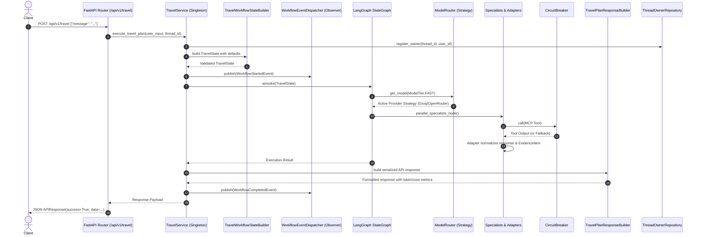

# 🏛️ Software Design Patterns & Architecture Reference

## TripMate AI Multi-Agent Orchestration Platform

This document serves as the comprehensive architectural and design pattern specification for **TripMate AI** (`Multi_AI_Agent`). It details how 10 classical and modern software design patterns and architectural concepts are integrated into the existing production codebase to deliver enterprise maintainability, modularity, testability, reliability, and resilience.

---

## 🗺️ Architectural Pattern Implementation Matrix

| # | Design Pattern / Architectural Concept | Primary Module & File Paths | Implementation Role & Use Case |
|---|---|---|---|
| **1** | **Repository Pattern** | [interfaces.py](file:///d:/AI_Project/Multi_AI_Agent/tripmate/repositories/interfaces.py)<br>[store_repositories.py](file:///d:/AI_Project/Multi_AI_Agent/tripmate/repositories/store_repositories.py) | Decouples business services from persistence logic. Establishes interfaces (`IUserRepository`, `IWatchlistRepository`, `IAlertRepository`, `IAssetRepository`, `IThreadOwnerRepository`, `IBookingRepository`) and concrete store implementations with isolated mockability. |
| **2** | **Factory Pattern** | [agent_factory.py](file:///d:/AI_Project/Multi_AI_Agent/tripmate/factories/agent_factory.py)<br>[llm_factory.py](file:///d:/AI_Project/Multi_AI_Agent/tripmate/factories/llm_factory.py) | Centralizes dynamic discovery and instantiation of specialist agents (`AgentFactory`) and provider clients (`LLMClientFactory`). Validates configuration requirements and fails fast on unsupported options. |
| **3** | **Singleton Pattern** | [singleton.py](file:///d:/AI_Project/Multi_AI_Agent/tripmate/core/singleton.py) | Guarantees thread-safe, double-checked locking single-instance lifecycles for expensive resources (`DataStore`, `ModelRouter`, `AgentRegistry`, `CircuitBreakerRegistry`, `CommandBus`, `QueryBus`). Documents process-local boundaries. |
| **4** | **Strategy Pattern** | [llm_strategies.py](file:///d:/AI_Project/Multi_AI_Agent/tripmate/strategies/llm_strategies.py)<br>[booking_strategies.py](file:///d:/AI_Project/Multi_AI_Agent/tripmate/strategies/booking_strategies.py) | Encapsulates interchangeable algorithms behind uniform strategy contracts. Enables dynamic LLM provider failover (Groq ➔ OpenRouter ➔ Hugging Face) and pluggable GDS flight/hotel search algorithms without scattering conditional logic. |
| **5** | **Observer Pattern** | [events.py](file:///d:/AI_Project/Multi_AI_Agent/tripmate/events/events.py)<br>[dispatcher.py](file:///d:/AI_Project/Multi_AI_Agent/tripmate/events/dispatcher.py)<br>[subscribers.py](file:///d:/AI_Project/Multi_AI_Agent/tripmate/events/subscribers.py) | Asynchronous, in-process event pub/sub mechanism. Decouples workflow lifecycle milestones (`WorkflowStartedEvent`, `SupervisorCompletedEvent`, `SpecialistsCompletedEvent`, etc.) from consumers (Audit Log, Prometheus Metrics, SSE Streaming Bridge) with complete exception isolation. |
| **6** | **Builder Pattern** | [workflow_state_builder.py](file:///d:/AI_Project/Multi_AI_Agent/tripmate/builders/workflow_state_builder.py)<br>[response_builder.py](file:///d:/AI_Project/Multi_AI_Agent/tripmate/builders/response_builder.py) | Provides validated step-by-step assembly of complex multi-key objects (`TravelState` for LangGraph and `TravelPlanResponseBuilder` for API payload serialization, token counting, and cost estimation), eliminating duplicated dict literals. |
| **7** | **Adapter Pattern** | [weather_adapter.py](file:///d:/AI_Project/Multi_AI_Agent/tripmate/adapters/weather_adapter.py)<br>[flight_adapter.py](file:///d:/AI_Project/Multi_AI_Agent/tripmate/adapters/flight_adapter.py)<br>[tavily_adapter.py](file:///d:/AI_Project/Multi_AI_Agent/tripmate/adapters/tavily_adapter.py) | Normalizes heterogeneous outputs, raw strings, and third-party schemas from OpenWeather MCP, AviationStack MCP, GDS, and Tavily Search into strongly-typed domain representations and audited `EvidenceItem` models. |
| **8** | **Decorator Pattern** | [decorators.py](file:///d:/AI_Project/Multi_AI_Agent/tripmate/core/decorators.py) | Reusable cross-cutting decorators (`@timed_async`, `@retry_async`, `@circuit_protected`) providing timing telemetry, exponential backoff for transient errors, and circuit guarding while preserving signatures, docstrings, and typing via `functools.wraps`. |
| **9** | **CQRS** | [commands.py](file:///d:/AI_Project/Multi_AI_Agent/tripmate/cqrs/commands.py)<br>[queries.py](file:///d:/AI_Project/Multi_AI_Agent/tripmate/cqrs/queries.py)<br>[handlers.py](file:///d:/AI_Project/Multi_AI_Agent/tripmate/cqrs/handlers.py)<br>[bus.py](file:///d:/AI_Project/Multi_AI_Agent/tripmate/cqrs/bus.py) | Enforces strict Command Query Responsibility Segregation at the application service layer. State-mutating operations execute through dedicated Command Handlers; read operations execute through dedicated Query Handlers guaranteeing zero query-side state mutation. |
| **10** | **Circuit Breaker** | [circuit_breaker.py](file:///d:/AI_Project/Multi_AI_Agent/tripmate/integrations/circuit_breaker.py) | Protects downstream dependencies with a 3-state state machine (`CLOSED`, `OPEN`, `HALF_OPEN`). Features failure classification (discriminating transient network/timeout errors from permanent client/validation errors), trial concurrency limits in `HALF_OPEN`, consecutive success recovery thresholds, and centralized registry management. |

---

## 📐 Detailed Architecture & Pattern Specifications

### 1. Repository Pattern
- **Problem Solved**: Services originally called the monolithic `DataStore` directly. This coupled business logic to persistence details and prevented isolated testing.
- **Implementation**:
  - `IUserRepository`, `IWatchlistRepository`, `IAlertRepository`, `IAssetRepository`, `IThreadOwnerRepository`, `IBookingRepository` define explicit contracts in [interfaces.py](file:///d:/AI_Project/Multi_AI_Agent/tripmate/repositories/interfaces.py).
  - Concrete classes (`StoreUserRepository`, `StoreWatchlistRepository`, etc.) in [store_repositories.py](file:///d:/AI_Project/Multi_AI_Agent/tripmate/repositories/store_repositories.py) wrap storage and map entities.
  - Services inject repository interfaces via constructor default arguments, enabling mock-based unit tests without database or shared mutable state dependencies.

### 2. Factory Pattern
- **Problem Solved**: Specialist agent instantiation and LLM client creation were hardcoded or scattered with ad-hoc error handling.
- **Implementation**:
  - `AgentFactory` in [agent_factory.py](file:///d:/AI_Project/Multi_AI_Agent/tripmate/factories/agent_factory.py) dynamically creates specialist agents by name, registers them into `AgentRegistry`, and validates agent capabilities and risk profiles. Fails with clear `ValueError` if an unsupported agent type is requested.
  - `LLMClientFactory` in [llm_factory.py](file:///d:/AI_Project/Multi_AI_Agent/tripmate/factories/llm_factory.py) validates provider keys and parameters for Groq, OpenRouter, and Hugging Face, failing fast if credentials are missing.

### 3. Singleton Pattern
- **Problem Solved**: Shared resources (`ModelRouter`, `DataStore`, `AgentRegistry`, `CircuitBreakerRegistry`, `CommandBus`, `QueryBus`) previously relied on import-time globals without guaranteed thread safety or reset capabilities.
- **Implementation**:
  - `SingletonMeta` in [singleton.py](file:///d:/AI_Project/Multi_AI_Agent/tripmate/core/singleton.py) utilizes double-checked locking with a class-specific `threading.Lock`.
  - Process boundaries are explicitly documented: Singletons are process-local in Python. Multi-worker uvicorn configurations maintain isolated instances per worker.
  - Features `SingletonMeta.reset_instance()` and `SingletonMeta.clear_all()` for isolated testing.

### 4. Strategy Pattern
- **Problem Solved**: `ModelRouter.get_model()` contained rigid conditional branches for Groq, OpenRouter, and Hugging Face. Adding new providers required editing routing code.
- **Implementation**:
  - `LLMProviderStrategy` base class in [llm_strategies.py](file:///d:/AI_Project/Multi_AI_Agent/tripmate/strategies/llm_strategies.py) defines `provider_name`, `priority`, `is_configured()`, and `create_model(tier, timeout)`.
  - Concrete strategies: `GroqProviderStrategy`, `OpenRouterProviderStrategy`, `HuggingFaceProviderStrategy`.
  - `ModelRouter` delegates model resolution to configured strategies sorted by priority.
  - `IFlightSearchStrategy` and `IHotelSearchStrategy` in [booking_strategies.py](file:///d:/AI_Project/Multi_AI_Agent/tripmate/strategies/booking_strategies.py) provide pluggable search implementations for the GDS booking client.

### 5. Observer Pattern
- **Problem Solved**: Workflow milestones and progress reporting were coupled directly to the HTTP SSE streaming generator. Downstream consumers (audit logs, metrics) could not subscribe without modifying workflow logic.
- **Implementation**:
  - Typed dataclass events in [events.py](file:///d:/AI_Project/Multi_AI_Agent/tripmate/events/events.py): `WorkflowStartedEvent`, `SupervisorCompletedEvent`, `SpecialistsCompletedEvent`, `CriticCompletedEvent`, `ItineraryCompletedEvent`, `ApprovalRequiredEvent`, `WorkflowCompletedEvent`, `WorkflowFailedEvent`.
  - `WorkflowEventDispatcher` in [dispatcher.py](file:///d:/AI_Project/Multi_AI_Agent/tripmate/events/dispatcher.py) provides async `publish()` and `subscribe()` with isolated try/except handling. A slow or failing subscriber never crashes the main workflow.
  - Concrete observers: `AuditLogSubscriber`, `MetricsCollectorSubscriber`, and `SSEEventBridgeSubscriber` in [subscribers.py](file:///d:/AI_Project/Multi_AI_Agent/tripmate/events/subscribers.py).

### 6. Builder Pattern
- **Problem Solved**: Constructing the 24-key `TravelState` dictionary required by LangGraph was duplicated across `execute_travel_plan` and `stream_travel_events`, creating maintenance risks if keys were added or modified.
- **Implementation**:
  - `TravelWorkflowStateBuilder` in [workflow_state_builder.py](file:///d:/AI_Project/Multi_AI_Agent/tripmate/builders/workflow_state_builder.py) provides a fluent interface (`.with_user_query()`, `.with_thread_id()`, `.with_user_id()`, etc.), validates mandatory parameters, and supplies sensible defaults for all state keys.
  - `TravelPlanResponseBuilder` in [response_builder.py](file:///d:/AI_Project/Multi_AI_Agent/tripmate/builders/response_builder.py) encapsulates response formatting, token counting, cost calculation, and interrupt payload extraction.

### 7. Adapter Pattern
- **Problem Solved**: External MCP tools (AviationStack, OpenWeather, Tavily) return diverse formats (unstructured strings, nested dicts). Specialist agents had ad-hoc parsing logic.
- **Implementation**:
  - `WeatherServiceAdapter` in [weather_adapter.py](file:///d:/AI_Project/Multi_AI_Agent/tripmate/adapters/weather_adapter.py) extracts current weather and forecast strings, producing `NormalizedWeatherData` and `EvidenceItem`.
  - `FlightServiceAdapter` in [flight_adapter.py](file:///d:/AI_Project/Multi_AI_Agent/tripmate/adapters/flight_adapter.py) normalizes GDS offers into `NormalizedFlightOffer` and evidence items.
  - `TavilySearchAdapter` in [tavily_adapter.py](file:///d:/AI_Project/Multi_AI_Agent/tripmate/adapters/tavily_adapter.py) adapts web search results into citations and evidence items.

### 8. Decorator Pattern
- **Problem Solved**: Cross-cutting concerns such as latency tracking, retry with exponential backoff, and circuit breaker protection were scattered or manually coded.
- **Implementation**:
  - `@timed_async`: Measures async execution time, logs durations, and optionally populates metrics dictionaries.
  - `@retry_async`: Configurable exponential backoff retry decorator. Discriminates transient failures from permanent errors (which are immediately re-raised without retry).
  - `@circuit_protected`: Wraps any async function call in a designated `CircuitBreaker`.
  - All decorators use `functools.wraps` to preserve function signatures, type annotations, and docstrings.

### 9. CQRS (Command Query Responsibility Segregation)
- **Problem Solved**: Domain services mixed state mutations and read queries in the same methods without clear boundaries.
- **Implementation**:
  - Commands (write operations) in [commands.py](file:///d:/AI_Project/Multi_AI_Agent/tripmate/cqrs/commands.py): `CreateWatchlistCommand`, `DeleteWatchlistCommand`, `CreateAlertCommand`, `MarkAlertReadCommand`, `DeleteAlertCommand`, `CreateAssetCommand`, `DeleteAssetCommand`, `ExecuteTravelPlanCommand`, `ResumeTravelPlanCommand`.
  - Queries (read-only operations) in [queries.py](file:///d:/AI_Project/Multi_AI_Agent/tripmate/cqrs/queries.py): `GetWatchlistQuery`, `ListWatchlistsQuery`, `ListAlertsQuery`, `GetAssetQuery`, `ListAssetsQuery`, `GetRunDetailsQuery`, `GetRunMetricsQuery`.
  - Handlers in [handlers.py](file:///d:/AI_Project/Multi_AI_Agent/tripmate/cqrs/handlers.py): Command handlers validate and mutate state via repositories; Query handlers retrieve data with zero state mutation.
  - Buses in [bus.py](file:///d:/AI_Project/Multi_AI_Agent/tripmate/cqrs/bus.py): In-process `CommandBus` and `QueryBus` for dispatching.
  - Domain services (`WatchlistService`, `AlertService`, `AssetService`) delegate to command and query handlers, keeping API routes 100% backward compatible.

### 10. Circuit Breaker Pattern
- **Problem Solved**: The initial circuit breaker did not differentiate transient from permanent failures, lacked trial concurrency guards in `HALF_OPEN`, and could not manage breakers centrally.
- **Implementation**:
  - [circuit_breaker.py](file:///d:/AI_Project/Multi_AI_Agent/tripmate/integrations/circuit_breaker.py) manages a 3-state machine (`CLOSED`, `OPEN`, `HALF_OPEN`).
  - **Failure Classification**: Discriminates permanent errors (`ValueError`, `TypeError`, `KeyError`, 4xx HTTP errors) from transient errors (`ConnectionError`, `TimeoutError`, 5xx Server Errors). Permanent errors immediately re-raise without incrementing failure counters.
  - **Half-Open Concurrency Guard**: In `HALF_OPEN`, limits concurrent trial requests (`half_open_max_trials`). Saturated trial requests fail fast to prevent herd effects on recovering dependencies.
  - **Success Recovery Threshold**: Configurable `success_threshold` consecutive successes required before transitioning `HALF_OPEN` -> `CLOSED`.
  - `CircuitBreakerRegistry`: Centralized singleton registry to inspect and manually reset all named breakers.

---

## 🔄 End-to-End Request Lifecycle with Patterns



---

## 🧪 Testing and Verification

The test suite validates all 10 patterns through dedicated tests in [test_design_patterns.py](file:///d:/AI_Project/Multi_AI_Agent/tests/test_design_patterns.py):

- **Repository Tests**: CRUD operations, boundary isolation, and mock repository injection into services.
- **Factory Tests**: Dynamic agent creation, metadata registration, unsupported agent type handling, LLM client validation.
- **Singleton Tests**: Thread safety with multi-threaded concurrent instantiation, identity preservation, and lifecycle reset.
- **Strategy Tests**: Provider priorities, configuration detection, custom strategy injection into `ModelRouter`, and booking search strategies.
- **Observer Tests**: Event publishing, subscriber receipt, subscriber failure isolation, and SSE queue bridging.
- **Builder Tests**: Validated state creation, default parameter population, mandatory field validation, and response serialization.
- **Adapter Tests**: Weather, flight, and search normalization into `EvidenceItem` and domain models.
- **Decorator Tests**: `@timed_async` latency tracking, `@retry_async` transient error recovery, and permanent error fast-fail.
- **CQRS Tests**: Command state mutation, query read-only immutability, and bus dispatching.
- **Circuit Breaker Tests**: Transient vs permanent error discrimination, trial concurrency guards in `HALF_OPEN`, and registry tracking.

```bash
# Run pattern test suite
pytest tests/test_design_patterns.py -v

# Run complete test suite (all 93 tests)
pytest
```
