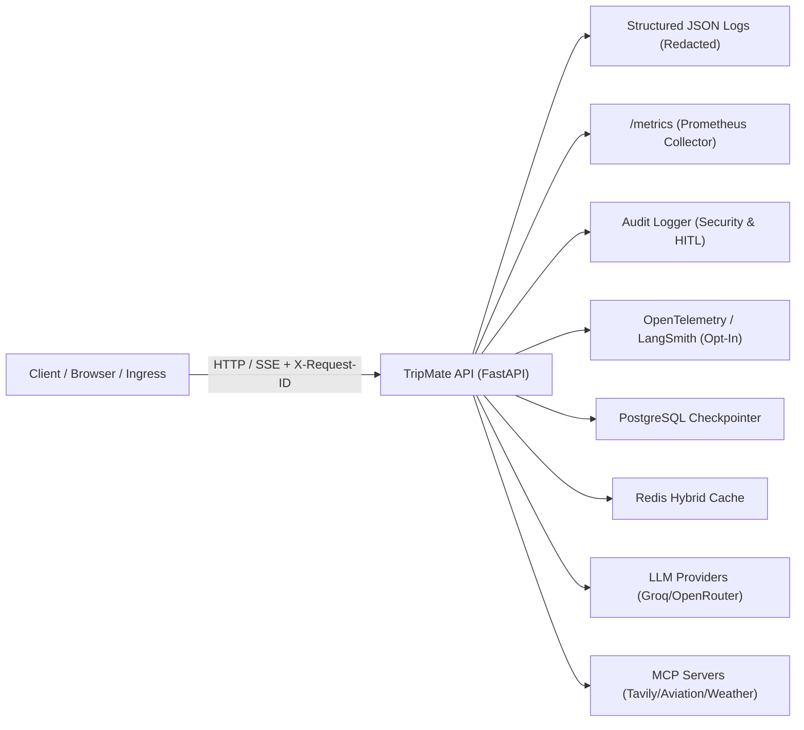

# Production Operations, SLOs & Alerting Guide

This operational guide details the Service Level Objectives (SLOs), Prometheus monitoring metrics, structured logging, distributed tracing, alerting rules, and incident runbooks for the **TripMate Multi-Agent AI Platform**.

---

## 1. Observability Architecture



### Telemetry Components
- **Structured JSON Logging**: Every HTTP request emits a sanitized JSON line containing `request_id`, `thread_id_hash` (SHA-256 masked), `user_id`, `route`, `status`, and `latency_ms`. API keys, bearer tokens, passwords, authorization headers, full prompts, and PII are redacted by default.
- **Prometheus Metrics**: Scrape endpoint at `/metrics` (and `/api/v1/metrics`), protected against public exposure (internal RFC1918 loopback or `METRICS_TOKEN` / Admin authorization required).
- **OpenTelemetry Tracing**: Toggled on-demand via `OTEL_ENABLED=true` / `ENABLE_OTEL=true`. Traces graph workflows, agent specialist nodes, and external tool calls.
- **Security Audit Log**: Records auth failures, HITL approval/rejection decisions, and administrative actions with actor, IP, timestamp, and context.

---

## 2. Service Level Objectives (SLOs) & Error Budgets

| Service / Capability | Indicator (SLI) | Objective (SLO) | Window | Measurement Metric |
| :--- | :--- | :--- | :--- | :--- |
| **API Availability** | Percentage of non-5xx HTTP requests | **99.9%** | Rolling 30 Days | `tripmate_http_requests_total` |
| **Readiness & Uptime** | `/health/ready` probe success rate | **99.95%** | Rolling 30 Days | Health check HTTP status == 200 |
| **Standard API Latency** | Duration of non-workflow REST endpoints | **p95 < 250ms, p99 < 500ms** | 5-minute rolling | `tripmate_http_request_duration_seconds` |
| **Agent Workflow Latency** | Multi-agent execution stream duration | **p95 < 12.0s, p99 < 20.0s** | 5-minute rolling | `tripmate_agent_duration_seconds` |
| **Checkpointer Latency** | Database checkpoint get/put duration | **p95 < 50ms, p99 < 150ms** | 5-minute rolling | `tripmate_checkpoint_db_latency_seconds` |
| **Rate Limiting Accuracy** | Clean rejection without memory exhaustion | **Zero leaks, fail-closed** | Continuous | `tripmate_rate_limit_rejections_total` |

---

## 3. Prometheus Alerting Rules & Suggestions

Place these alert rules in your Prometheus alert rules configuration (`/etc/prometheus/alerts/tripmate.yml`).

### Alert 1: High 5xx Error Rate (`TripMateHigh5xxRate`)
- **Severity**: Critical
- **Threshold**: 5xx HTTP response rate > 1% over 5 minutes.
- **PromQL**:
  ```promql
  sum(rate(tripmate_http_requests_total{status=~"5.."}[5m]))
  /
  sum(rate(tripmate_http_requests_total[5m])) * 100 > 1.0
  ```
- **Description**: The application is returning an elevated number of server errors, violating the 99.9% availability SLO.
- **Action**: Check `tripmate.access` logs filtered by `status=500` and trace unhandled exceptions.

---

### Alert 2: Readiness Probe Failing (`TripMateReadinessFailing`)
- **Severity**: Critical
- **Threshold**: `/health/ready` non-200 for > 1 minute.
- **PromQL**:
  ```promql
  probe_http_status_code{job="tripmate_readiness"} != 200
  ```
  *(or if monitoring via HTTP metrics)*:
  ```promql
  tripmate_http_requests_total{path="/health/ready",status!="200"} > 0
  ```
- **Description**: TripMate container is failing readiness checks. Ingress traffic will be routed away from unhealthy instances.
- **Action**: Check PostgreSQL database pool status, Redis cache ping, and persistent MCP subprocesses.

---

### Alert 3: Redis / Datastore Down (`TripMateDatastoreDegraded`)
- **Severity**: High
- **Threshold**: Cache misses surging on Redis while fallback to memory triggers, or DB connection latency exceeds SLA.
- **PromQL**:
  ```promql
  rate(tripmate_cache_misses_total{cache_type="redis"}[5m]) > 50
  or
  tripmate_checkpoint_db_latency_seconds_sum / tripmate_checkpoint_db_latency_seconds_count > 0.5
  ```
- **Description**: Redis cache connectivity is lost or PostgreSQL checkpoint persistence is taking over 500ms per operation.
- **Action**: Verify Redis container connectivity. Check database connection pool limits (`DB_POOL_MAX_SIZE`).

---

### Alert 4: LLM Spend or Token Consumption Spike (`TripMateLLMSpendSpike`)
- **Severity**: High
- **Threshold**: Token consumption rate exceeds 250,000 tokens/minute or hourly spend rate increases by > 300%.
- **PromQL**:
  ```promql
  sum(rate(tripmate_llm_tokens_total{type="total"}[5m])) * 60 > 250000
  or
  sum(rate(tripmate_llm_cost_dollars_total[15m])) * 3600 > 25.0
  ```
- **Description**: Rapid budget consumption or runaway agent loop detected.
- **Action**: Verify `DAILY_TOKEN_BUDGET_PER_USER` enforcement. Review active threads in `tripmate.audit`.

---

### Alert 5: 429 Rate-Limit Rejection Spike (`TripMateRateLimitSpike`)
- **Severity**: Warning / Medium
- **Threshold**: Rate limit rejections exceed 20 rejections/minute.
- **PromQL**:
  ```promql
  sum(rate(tripmate_rate_limit_rejections_total[5m])) * 60 > 20
  ```
- **Description**: Sudden influx of rate-limited requests indicates potential DDoS attack, credential stuffing, or misconfigured API consumer client.
- **Action**: Identify offending IP address from `tripmate.access` logs (`status=429`) and block at WAF / ingress level if abusive.

---

### Alert 6: Circuit Breaker Tripped OPEN (`TripMateCircuitBreakerOpen`)
- **Severity**: High
- **Threshold**: External dependency circuit breaker tripped to state OPEN (`state == 2`).
- **PromQL**:
  ```promql
  tripmate_circuit_breaker_state == 2
  ```
- **Description**: An external upstream provider (Tavily, AviationStack, OpenWeather, or LLM Provider) has failed repeatedly and calls are fast-failing.
- **Action**: Check upstream provider status dashboards. Reset breaker via `POST /api/v1/admin/circuit-breakers/{name}/reset` after upstream recovers.

---

## 4. Runbook Procedures & Triage

### 1. Circuit Breaker Inspection and Manual Reset
View all circuit breaker statuses:
```bash
curl -X GET "http://localhost:8000/api/v1/admin/stats" \
     -H "Authorization: Bearer <ADMIN_TOKEN>"
```

Reset an open circuit breaker after provider recovery:
```bash
curl -X POST "http://localhost:8000/api/v1/admin/circuit-breakers/groq_llm/reset" \
     -H "Authorization: Bearer <ADMIN_TOKEN>"
```

### 2. Cache Purge
If stale data persists or Redis synchronization is impaired:
```bash
curl -X POST "http://localhost:8000/api/v1/admin/cache/clear" \
     -H "Authorization: Bearer <ADMIN_TOKEN>"
```

### 3. Emergency Fail-Closed vs Fail-Open Configurations
In `.env` or runtime environment variables:
- `FAIL_OPEN_REDIS=false`: Rejects LLM routes with emergency in-memory rate limiting when Redis goes offline (prevents uncontrolled API spend).
- `EMERGENCY_IN_MEMORY_RATE_LIMIT=5`: Strict per-minute cap during datastore outages.
- `METRICS_PROTECTED=true`: Enforces network perimeter access on `/metrics`.
- `CAPTURE_PROMPTS=false`: Guarantees user message contents are never persisted into APM / tracing systems.

### 4. Scraping Metrics Securely
From internal Prometheus scrapers within VPC / Kubernetes network:
```bash
curl -s "http://tripmate-service:8000/metrics"
```
Or when scraping externally using a provisioned metrics token:
```bash
curl -s "https://api.tripmate.ai/metrics" \
     -H "Authorization: Bearer <METRICS_TOKEN>"
```

---

## 5. Security & Data Privacy Verification

To verify that production logs never leak credentials, tokens, or PII:
```bash
pytest tests/test_observability.py -k "test_redaction"
```

To verify access controls on `/metrics`:
```bash
pytest tests/test_observability.py -k "test_metrics"
```

