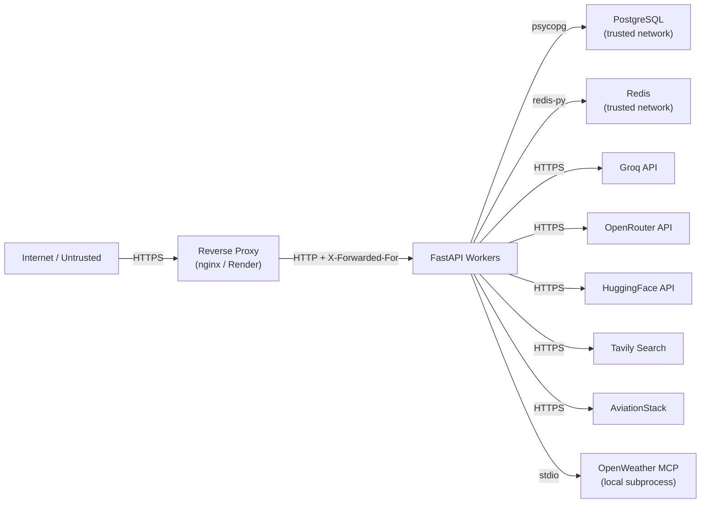

# Threat Model — Multi-AI-Agent

> [!NOTE]
> STRIDE threat model for v3.0.0 (2026-11-03).  
> Every mitigated threat references the code control and, where available, the verifying test.

---

## System Entry Points (Trust Boundaries)

---

## STRIDE Analysis

### S — Spoofing

| Threat | Impact | Mitigation | Test |
|--------|--------|------------|------|
| Attacker forges JWT to impersonate another user | Unauthorized data access | JWT signed with `JWT_SECRET_KEY`; production startup rejects weak defaults | `test_jwt_token_verification` |
| Attacker crafts request claiming admin role | Privilege escalation | Role validated server-side from JWT claims, not request headers | `test_admin_endpoint_requires_admin_role` |
| Spoofed `X-Forwarded-For` to bypass rate limit | Rate limit bypass | Trusted proxies list (`TRUSTED_PROXIES`) enforced; untrusted IPs ignored | `test_trusted_proxy_headers` |

### T — Tampering

| Threat | Impact | Mitigation | Test |
|--------|--------|------------|------|
| Attacker modifies thread state of another user | Data corruption / privacy breach | Thread ownership validated on every workflow operation | `test_thread_ownership_isolation` |
| SQL injection via user-supplied thread ID or message | Database compromise | Thread IDs validated against `THREAD_ID_REGEX`; parameterized queries via psycopg | `test_thread_id_regex_validation` |
| Prompt injection to override LLM behavior | Unauthorized actions, data exfiltration | Deterministic `deterministic_input_check` guardrail; blocklist patterns | `test_prompt_injection_blocked` |

### R — Repudiation

| Threat | Impact | Mitigation | Test |
|--------|--------|------------|------|
| User denies submitting approval decision | Dispute over itinerary authorization | `AuditLogger` records every approval/rejection with actor, IP, request_id, and timestamp | `test_hitl_audit_log_records_decision` |
| Admin denies clearing cache or resetting circuit breaker | Dispute over platform actions | Admin actions recorded in audit log | — (manual audit log review) |

### I — Information Disclosure

| Threat | Impact | Mitigation | Test |
|--------|--------|------------|------|
| Health endpoint leaks API keys or DB URLs | Credential exposure | `/api/v1/health` and `/health/ready` contain no secrets; validated in tests | `test_health_ready_response_has_no_secrets` |
| LangSmith traces capture user prompts | PII in third-party logs | `CAPTURE_PROMPTS=false` sets `LANGCHAIN_HIDE_INPUTS=true` by default | `test_prompt_capture_disabled_by_default` |
| Error responses reveal internal stack traces | Reconnaissance | Generic error messages in 4xx/5xx responses; stack traces suppressed in production | `test_error_responses_omit_stack_traces` |
| PII in structured logs | Privacy breach | PII redaction applied to logged fields | `test_pii_redaction_in_logs` |

### D — Denial of Service

| Threat | Impact | Mitigation | Test |
|--------|--------|------------|------|
| Request flooding | Service unavailability | Sliding-window rate limiter (`RATE_LIMIT_REQUESTS/RATE_LIMIT_WINDOW_SECONDS`) per IP; emergency in-memory cap when Redis is down | `test_rate_limiter_blocks_excess_requests` |
| Oversized request bodies | Memory exhaustion | `MAX_REQUEST_BODY_BYTES` (default 1 MB) enforced by `RequestBodyLimitMiddleware` | `test_request_body_size_limit` |
| Long messages causing expensive LLM calls | Cost/token abuse | `MAX_MESSAGE_LENGTH` (default 2 000 chars) validated at request parse time | `test_message_length_limit_enforced` |
| Runaway LangGraph recursion | CPU / token exhaustion | `LANGGRAPH_RECURSION_LIMIT` (default 15) enforced by LangGraph graph config | `test_langgraph_recursion_limit` |
| Token budget exhaustion per user | Cost abuse | `DAILY_TOKEN_BUDGET_PER_USER` tracked in-memory per user_id | `test_daily_token_budget_enforced` |
| SSRF via MCP tool outbound calls | Internal network pivoting | Outbound hosts restricted to `TOOL_ALLOWED_HOSTS`; enforced in MCP adapters | `test_tool_host_allowlist_enforced` |

### E — Elevation of Privilege

| Threat | Impact | Mitigation | Test |
|--------|--------|------------|------|
| Regular user accesses admin endpoints | Unauthorized platform control | `require_admin` dependency checks JWT role claim; returns 403 | `test_admin_endpoint_requires_admin_role` |
| Unauthenticated access when `AUTH_REQUIRED=true` | Unauthorized data access | `get_current_user` dependency returns 401 when auth is required | `test_auth_required_blocks_unauthenticated` |
| Weak production JWT secret | Token forgery | Startup `validate_production()` rejects known weak secrets | `test_production_validation_rejects_weak_secrets` |

---

## Out of Scope

- **Network-layer DDoS** — no WAF or CDN in front; deploy behind Cloudflare or similar in production.
- **Supply chain attacks** — dependencies pinned in `requirements.lock`; update via `pip-compile` with review.
- **Secrets in git history** — use `git-secrets` or `trufflehog` pre-commit hooks; not enforced in this repo by default.
- **Multi-tenancy data isolation** — all user data is co-located in a single PostgreSQL database; no schema-per-tenant isolation.

---

## Assumptions & Residual Risks

1. **LLM provider security** — Groq, OpenRouter, and HuggingFace are trusted third-party processors. Their data handling policies apply to prompt content.
2. **In-memory stores** — `RUN_STORE` (workflow history) and `ACTIVE_RUNS` are in-memory and do not survive worker restarts. This is a known limitation.
3. **HITL approval TTL** — after 15 minutes (`APPROVAL_TTL_SECONDS`), paused workflows are not auto-cancelled; the thread remains in the checkpointer until garbage-collected or explicitly deleted.
4. **No mutual TLS** — internal database and Redis connections are not mTLS-protected; rely on network-level isolation.

